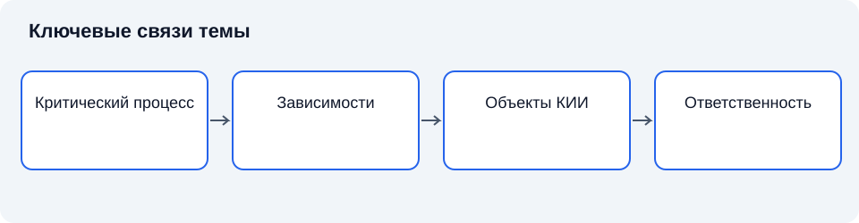

# Лекция 1. Понятие и компоненты критической информационной инфраструктуры

Дисциплина: «Основы информационной безопасности». Пункт РП: 1.1.

**Цель:** объяснить связь цифровой инфраструктуры с непрерывностью общественно значимых процессов.

**Задачи:** различить субъект и объект КИИ; объяснить три типа объектов и роль компонентов; проследить зависимости критического процесса; сопоставить безопасность, надёжность и устойчивость; установить границы выводов о защищённости.

## Введение

Начнём курс с вопроса: почему отказ одной информационной системы способен затронуть людей, которые никогда ею не пользовались? Ответ связан с зависимостью современных услуг от обработки информации. Управление транспортом, медицинская помощь и энергоснабжение опираются на цифровые процессы. Поэтому защита информации рассматривается вместе с устойчивостью деятельности.

Изучение инфраструктуры полезно начинать с различия между средством и результатом. Компьютер, программа и линия связи нужны не сами по себе: они поддерживают определённое действие. Когда мы говорим о защите, необходимо назвать, что именно должно сохраняться. Это может быть возможность получить достоверное измерение, выполнить уполномоченную операцию или восстановить подтверждённые сведения. Без такого уточнения безопасность превращается в неограниченное пожелание.

В дальнейшем курсе мы будем рассматривать угрозы, уязвимости, управление доступом, криптографические механизмы и оценку соответствия. Каждая тема отвечает на часть общего вопроса. Угроза показывает возможность нарушения, уязвимость — способствующую слабость, мера — способ влияния на сценарий. Но сначала требуется объект, относительно которого эти понятия приобретают смысл. Поэтому первая лекция посвящена построению целостного представления.

## Схема темы



*Рисунок 1. Упрощённые связи понятий. Схема поясняет текст и не заменяет условия применения правил.*

## 1. От процесса к инфраструктуре

**Инфраструктура** — совокупность средств и связей, обеспечивающих выполнение деятельности. Информационная инфраструктура поддерживает получение, хранение, обработку и передачу сведений. Её значение определяется ролью в процессе: одинаковые серверы могут иметь совершенно разные последствия отказа.

Следует различать технологическую функцию и её техническую реализацию. Функция сохраняется при замене оборудования, но зависит от доступности данных, правил обработки и взаимодействия участников. Анализ защищённости начинается с назначения процесса, а затем переходит к системам. Такой порядок помогает обнаружить зависимости, которые не видны в перечне устройств [1; 4].

### 1.1. Функциональная и структурная модели

**Структурная модель** показывает части системы и связи между ними. **Функциональная модель** описывает выполняемые действия и необходимые результаты.

| Модель | Отвечает на вопрос | Что показывает | Риск при отсутствии второй модели |
|---|---|---|---|
| Структурная | Из чего состоит система? | Части и связи между ними | Анализ превращается в инвентарную ведомость |
| Функциональная | Что система делает? | Действия и необходимые результаты | Нельзя определить, где действуют механизмы контроля |

Для обоснования защиты обе нужны одновременно. Структурное представление без функций превращает анализ в инвентарную ведомость; функциональное без структуры не позволяет определить, где должны действовать механизмы контроля.

Связь между двумя моделями обычно не является взаимно однозначной. Одна функция может выполняться несколькими компонентами, а один компонент обслуживать несколько функций. Поэтому отказ общего компонента способен затронуть больше процессов, чем ожидается при рассмотрении каждого приложения отдельно. **Общая причина отказа** — обстоятельство, вызывающее утрату нескольких предположительно независимых возможностей. Классический случай связан с общим электропитанием, но организационная причина тоже возможна: один и тот же недостаточно проверенный процесс обновления распространяет ошибку на все резервные экземпляры.

Отсюда следует важное правило: при оценке резервирования нужно исследовать разнообразие причин отказа.

| Ситуация | Формально | Фактически | Вывод о независимости |
|---|---|---|---|
| Два сервера в одном помещении | Два устройства | Общее охлаждение, питание, доступ | Не независимы |
| Два канала с общей трассой | Два канала | Общая физическая среда | Не независимы |
| Два экземпляра с одной конфигурацией | Две копии | Общая ошибка настройки | Не независимы |
| Разные площадки, разные поставщики, разные конфигурации | Две системы | Раздельные причины отказа | Независимость требует проверки |

Наличие двух устройств снижает риск отказа одного устройства лишь при определённых условиях. Если оба зависят от одного канала связи, одного помещения или одной ошибочной конфигурации, сохраняется единая зависимость. Нельзя считать независимость установленной только по различию серийных номеров. В инженерном заключении указывают, какие причины разделены и какие остаются общими.

Управление инфраструктурой также образует самостоятельный уровень. Средство управления способно менять настройки многих компонентов, поэтому его полномочия имеют большое значение. Надёжная защита отдельных узлов может потерять смысл при незащищённом административном контуре. Анализ должен включать не только рабочие данные, но и конфигурации, учётные записи сопровождения, журналы и процедуры изменения. Это выявление условий, от которых зависит сохранение свойств объекта [1; 3].

### 1.2. Информация, управление и обратная связь

Чтобы понять роль информационной инфраструктуры, полезно различать три действия: наблюдение состояния, принятие решения и исполнение воздействия.

**Схема 1.2. Контур управления с обратной связью.**

```
   ┌──────────────────────────────────────────────┐
   │                                              │
   ▼                                              │
Наблюдение ──► Принятие решения ──► Исполнение ──┘
(сведения)     (сопоставление       (изменение
               с целью)             состояния)
```

Наблюдение формирует сведения о происходящем. Решение сопоставляет сведения с целью и допустимыми ограничениями. Исполнение изменяет состояние процесса. Даже если каждое действие выполняется разными компонентами, они образуют единую функциональную цепочку. Нарушение передачи между действиями меняет результат всей цепочки.

**Обратная связь** — получение сведений о результате воздействия для уточнения последующих действий. Без неё система может продолжать выполнять команды, не зная, достигнут ли нужный результат. Обратная связь не гарантирует правильности: измерение может быть неверным или запоздалым, а интерпретация — ошибочной. Но её отсутствие ограничивает возможность обнаружить отклонение. Для защиты важно понимать, какие сведения подтверждают фактический результат, а какие лишь показывают отправку команды.

Рассмотрим различие между подтверждением доставки и подтверждением исполнения.

| Уровень подтверждения | Что подтверждает | Чего не подтверждает |
|---|---|---|
| Сетевой | Сообщение принято удалённым узлом | Что приложение обработало его правильно |
| Прикладной | Приложение приняло и обработало запрос | Что физический процесс изменился требуемым образом |
| Процессный | Физический процесс достиг нужного состояния | Что результат устойчив и соответствует цели |

Сетевой механизм способен сообщить, что сообщение принято удалённым узлом. Это ещё не доказывает, что приложение обработало его правильно и что физический процесс изменился требуемым образом. На каждом уровне существует собственный критерий успеха. Инфраструктурный анализ связывает эти критерии, чтобы подтверждение низкого уровня не выдавалось за выполнение конечной функции.

**Состояние системы** — совокупность существенных характеристик, определяющих её поведение в рассматриваемый момент.

| Задача | Существенные характеристики состояния |
|---|---|
| Сетевое взаимодействие | Соединения и маршруты |
| Доступ | Учётные записи и полномочия |
| Восстановление | Версии данных и доступность зависимостей |

Выбор существенных характеристик зависит от задачи. Нельзя описать состояние одним универсальным числом. Поэтому наблюдение строится как согласованное множество представлений.

Переход между состояниями может быть разрешённым или недопустимым. Защита должна ограничивать не только доступ к данным, но и возможность перевести объект в опасную конфигурацию. Например, временное отключение проверки может быть допустимым при специальных условиях, но недопустимым без контроля и ограничений. В таком случае предметом защиты становится порядок перехода: кто принимает решение, какие предпосылки проверены, как фиксируется изменение и каким образом возвращается штатное состояние.

### 1.3. Сигнал и значение

**Сигнал** — физическое или формально представленное изменение, используемое для передачи сведений. Значение сигнала определяется правилами интерпретации. Одна и та же последовательность может быть безвредными данными для одного приложения и управляющей инструкцией для другого. Поэтому безопасность обработки требует понимания границы между данными и командой. Это фундаментальное различие будет подробно рассматриваться при изучении уязвимостей.

В инфраструктуре значение зависит от согласования участников. Отправитель и получатель должны одинаково понимать формат, единицы, обозначения и условия актуальности. Ошибка согласования способна сохраняться даже при защищённом канале. Криптографический контроль подтверждает определённые свойства сообщения, но не устанавливает правильность его предметного смысла. Следовательно, техническая подлинность и содержательная корректность относятся к разным уровням проверки.

| Уровень проверки | Что проверяется | Что остаётся за пределами |
|---|---|---|
| Техническая подлинность | Целостность и источник сообщения | Правильность предметного смысла |
| Содержательная корректность | Соответствие значения реальному состоянию | Своевременность и полномочия |
| Своевременность | Актуальность для текущего управления | Достоверность исторического наблюдения |

Временной контекст также входит в значение. Измерение температуры относится к определённому моменту и месту. Если оно доставлено с большой задержкой, его точность как исторического наблюдения может сохраняться, тогда как пригодность для текущего управления утрачивается. Слово «достоверный» необходимо использовать с указанием задачи: верно описывать прошлое не означает быть достаточным основанием для немедленного действия.

**Качество данных** — пригодность данных для определённой цели с учётом точности, полноты, актуальности и согласованности. Это рабочее инженерное представление. Оно помогает связать информационную безопасность с назначением процесса. Не все проблемы качества возникают из атак, но некоторые способны привести к тем же последствиям. Поэтому защита взаимодействует с общими механизмами контроля корректности, не подменяя их полностью.

### 1.4. Краткий вывод

Критичность определяется последствиями для процесса. Структурная модель показывает компоненты, функциональная — выполняемые действия; для оценки резервирования проверяют общие причины отказов.

## 2. Объекты и субъекты КИИ

**Объект КИИ** — информационная система, информационно-телекоммуникационная сеть или автоматизированная система управления субъекта КИИ. **Субъект КИИ** — относящийся к установленному законом кругу государственный орган, государственное учреждение или российское юридическое лицо, которому соответствующие объекты принадлежат на законном основании либо который обеспечивает их взаимодействие. Юридические признаки необходимо проверять по 187-ФЗ [6].

| Понятие | Уровень описания | Что обозначает | Пример |
|---|---|---|---|
| Субъект КИИ | Организационно-правовой | Участник, несущий обязанности | Организация, владеющая системами |
| Объект КИИ | Технический | Система или сеть, выполняющая функции | Информационная система, АСУ, сеть |

Организация и система относятся к разным уровням описания. Организация принимает решения и несёт обязанности, система выполняет функции обработки информации. Один субъект может иметь несколько объектов. Не любой компьютер организации автоматически образует отдельный объект, а отраслевой характер деятельности ещё не заменяет анализа состава систем.

### 2.1. Правовые отношения и техническое описание

Юридическое описание определяет круг участников и характер обязанностей. Техническое описание показывает, как устроена система и что может произойти при воздействии. Одно не заменяет другое. Если организация обладает законным основанием использования инфраструктуры, это отвечает на вопрос об отношениях с объектом, но ещё не устанавливает технические границы угроз. Если инженер обнаружил значимую зависимость, это не даёт ему оснований самостоятельно объявить правовой статус любого связанного участника.

При чтении определения субъекта необходимо обращать внимание на соединение условий. Отрасль деятельности, принадлежность систем и обеспечение взаимодействия рассматриваются в предусмотренной законом связи. Сокращённый пересказ определения полезен для первоначального понимания, однако юридический вывод должен опираться на полный текст нормы. Перечень отраслей нельзя восстанавливать по памяти, особенно при обновлении законодательства. В учебном анализе устойчивее сначала понять устройство определения, а затем проверять конкретные признаки по действующей редакции [6].

Отдельного внимания заслуживает понятие законного основания. Собственность не является единственным способом правомерного использования объекта. Возможны отношения аренды и иные предусмотренные законом основания. Однако из договора на отдельную услугу не всегда следует тот же объём управления системой, который имеется у её владельца. Для распределения функций защиты необходимо установить реальные полномочия участников: кто меняет конфигурацию, кто получает журналы, кто уведомляет об инциденте и кто восстанавливает работу.

**Ответственность за процесс** и **возможность управления компонентом** могут быть распределены между разными лицами. Это создаёт задачу согласования. Организация может отвечать за выполнение своей функции, но зависеть от внешнего поставщика связи. Поставщик не обязан знать все последствия для деятельности каждого клиента, если они не отражены в допустимых условиях взаимодействия. Поэтому надёжность не возникает автоматически из наличия нескольких договоров: требуется понятное распределение действий и проверка согласованности ожиданий.

Условия эксплуатации также влияют на трактовку технических границ. Один сервер способен поддерживать несколько приложений, а одно приложение может быть распределено между площадками. Следовательно, границу объекта нельзя выводить только из названия устройства. В описании необходимо объяснить, какие функции объединены, какие данные обрабатываются и какие связи обеспечивают совместное выполнение задачи. Это позволяет обсуждать объект с инженером, руководителем процесса и специалистом по правовым вопросам без подмены терминов.

### 2.2. Объект как единица ответственности

Объектом управления удобно считать такую совокупность, для которой можно определить функции, состояние, допустимые изменения и ответственных за действия. Это инженерное требование к описанию, а не самостоятельное юридическое определение. Если невозможно установить, кто разрешает изменение и кто оценивает результат, эксплуатация оказывается зависимой от неформальных договорённостей. Подобная неопределённость особенно опасна в момент происшествия, когда времени на согласование меньше обычного.

Наличие документа о распределении функций помогает только при его соответствии фактическим возможностям. Назначенному ответственному нужны доступ к сведениям, средства контроля и полномочия инициировать необходимые действия. Иначе документ фиксирует обязанность, которую невозможно исполнить. Напротив, технический администратор с неограниченными возможностями, но без установленной ответственности образует другой пробел: действия выполняются без понятных критериев допустимости и проверки.

| Уровень решения | Кто участвует | Что определяет |
|---|---|---|
| Стратегический | Руководство | Допустимые риски и ресурсы в установленных пределах |
| Процессный | Владельцы процессов | Последствия нарушения функций |
| Технический | Технические специалисты | Архитектура и реализация мер |
| Защитный | Специалисты защиты | Угрозы, выполнение требований, реагирование |

Для согласования полезно разделять решения по уровням. В небольшой организации несколько ролей может выполнять один человек; это не устраняет необходимость различать сами функции и возможные конфликты полномочий.

Источником ошибки становится представление, будто информационная безопасность полностью передаётся внешнему исполнителю вместе с договором сопровождения. Передать можно определённые работы и технические операции. Для сохранения управляемости заказчик должен понимать назначение системы, необходимые результаты и пределы ответственности исполнителя. Внешняя услуга включается в архитектуру защиты как зависимость с определёнными условиями, а не как неограниченная гарантия результата [1; 5].

### 2.3. Юридическая и инженерная классификации

Классификация необходима для упорядочения разнообразия, но её назначение должно быть ясно.

| Классификация | Назначение | Что определяет | Что не заменяет |
|---|---|---|---|
| Юридическая | Применение норм и процедур | Правовой статус, обязанности | Инженерный анализ зависимостей |
| Инженерная | Выбор модели и способа проверки | Технические признаки, поведение системы | Установленный законом статус |

Совпадение названий не делает их тождественными. Если исследователь назвал функцию критичной в своём анализе, он ещё не выполнил установленное законом категорирование объекта КИИ.

Рабочие инженерные признаки могут включать режим реального времени, распределённость, наличие внешних интерфейсов, возможность отложить операцию и допустимость ручного управления. Эти признаки полезны для объяснения поведения системы. Однако они не заменяют критерии значимости и отраслевые условия, установленные для юридической процедуры. Профессиональная точность состоит в сохранении связи между моделями без подмены одной другой.

| Инженерный признак | Что означает | На что влияет |
|---|---|---|
| Режим реального времени | Правильность связана с соблюдением временных ограничений | Выбор допустимых проверок и резервных режимов |
| Распределённость | Функции размещены между компонентами через каналы | Доставка, согласованность состояния, частичные отказы |
| Возможность отложить действие | Задача допускает накопление и последующую обработку | Допустимый объём очереди и условия возврата |
| Допустимость ручного управления | Часть действий может выполнить человек | Полнота альтернативного процесса и условия возврата |

**Режим реального времени** означает, что правильность выполнения связана не только с результатом, но и с соблюдением временных ограничений. Он не равнозначен просто высокой скорости. Система может быстро выполнять большинство операций, но не гарантировать необходимое время для конкретного действия. Для оценки безопасности важно установить, когда задержка превращается в нарушение функции. Эта характеристика влияет на выбор допустимых проверок и резервных режимов.

**Распределённость** означает размещение взаимосвязанных функций между несколькими компонентами, которые взаимодействуют через каналы. Она создаёт дополнительные условия: доставку, согласованность состояния и частичные отказы. При частичном отказе одна часть продолжает работать, а другая становится недоступной. Поэтому участники могут иметь разные представления о состоянии процесса. Уверенное локальное сообщение об успехе не всегда отражает результат всей распределённой операции.

Возможность отложить действие изменяет последствия нарушения. Если задача допускает накопление и последующую обработку, краткий перерыв может не привести к утрате результата. Но накопление ограничено ресурсами и временем. Очередь способна переполниться, сведения — утратить актуальность, а внешние обязательства — истечь. Следовательно, выражение «обработаем позже» должно сопровождаться объяснением допустимого объёма и условий возврата.

Ручной режим также имеет пределы. Человек способен заменить часть автоматизированных действий, но может не иметь доступа к исходным данным или не справляться с объёмом операций. Кроме того, результаты ручной работы впоследствии необходимо согласовать с восстановленной системой. Накопленные действия могут дублироваться или противоречить автоматически сохранённым записям. Поэтому альтернативный процесс оценивают полностью, включая переход в него и возврат.

### 2.4. Краткий вывод

Субъект КИИ несёт обязанности, объект выполняет функции обработки или управления. Правовой статус устанавливают по закону, а инженерные границы обосновывают по составу и связям системы.

## 3. Компоненты и зависимости

**Компонент** — выделяемая часть системы, имеющая определённую функцию и связи.

| Компонент | Роль в системе | Что учитывается в анализе |
|---|---|---|
| Оборудование | Физическая основа обработки | Размещение, питание, отказы |
| Программное обеспечение | Преобразование данных по правилам | Полномочия, обновления, происхождение |
| Данные | Содержание и контекст обработки | Происхождение, структура, состояния |
| Персонал | Проектирование, эксплуатация, восстановление | Роли, полномочия, передача контекста |
| Помещения | Физические условия работы | Доступ, охлаждение, общие причины отказа |
| Внешние услуги | Дополнение собственных функций | Интерфейс ответственности, зависимости |

Для анализа полезно рассматривать оборудование, программное обеспечение, данные, персонал, помещения и внешние услуги. Персонал не превращается в технический элемент: его действия входят в организационную модель эксплуатации.

**Зависимость** означает, что выполнение одной функции требует результата другой. Система может сохранять исправность своих серверов, но утратить работоспособность из-за потери электроснабжения, времени или связи. Общая зависимость нескольких резервов создаёт единую точку отказа. Поэтому резервирование оценивают по независимости причин отказа, а не по количеству копий [1; 5].

### 3.1. Программное обеспечение и доверенные основания

Программное обеспечение преобразует данные по установленным правилам. В систему входят прикладные программы, операционные системы, встроенное программное обеспечение устройств и средства управления. Для безопасности важно не только число программ, но и их полномочия. Компонент, который проверяет доступ, занимает иное положение, чем приложение, работающее с ограниченным набором данных. Ошибка в привилегированном механизме способна повлиять на широкий круг функций.

**Доверенная вычислительная база** — совокупность компонентов, от корректной работы которых зависит выполнение политики безопасности. Это понятие помогает отделить критичные для защиты механизмы от остальных элементов. Доверенный в данном контексте не означает доказанно безошибочный; это означает, что его корректность принята как необходимая предпосылка. Чем шире такая база, тем больше компонентов требуется анализировать для обоснования уверенности [2].

Доверие может возникать из архитектурной необходимости. Если все проверки полномочий выполняет один сервис, он становится частью основания защиты. Нельзя снизить его значение декларацией о недоверии, сохранив при этом полную зависимость остальных компонентов от его решений. Инженерная задача состоит в том, чтобы сделать предпосылки явными, ограничить последствия отказа и проверить свойства, на которые опирается система.

Обновление программного обеспечения имеет двойственную роль. Оно может устранять известные ошибки, но также изменять поведение и зависимости. Поэтому вопрос о необходимости обновления связан с оценкой угроз и совместимости. Неконтролируемое откладывание сохраняет известные слабости, а бесконтрольное внедрение создаёт риск нарушения функции. Управляемый процесс включает оценку изменения, проверку в применимых условиях, подготовку возврата и наблюдение после внедрения. Конкретные операции зависят от системы; общий принцип состоит в сохранении обоснованности состояния.

Программная цепочка поставки расширяет круг зависимостей. Приложение включает библиотеки, пакеты, инструменты сборки и средства доставки. Уверенность в исходном коде прикладной части не охватывает автоматически все эти элементы. Для инфраструктуры важно понимать происхождение компонентов и порядок их изменения. **Происхождение компонента** включает сведения о том, кем он создан, откуда получен и какие преобразования прошёл до установки. Такие сведения помогают проверке, но не заменяют испытания функций.

### 3.2. Модель зависимостей как граф

Для строгого рассуждения удобно использовать **граф зависимостей** — множество выделенных элементов и отношений, показывающих необходимость одного элемента для функционирования другого. Вершинами могут быть функции, сервисы или ресурсы; дуга указывает направление зависимости. Модель должна сохранять единый смысл вершин и связей либо явно разделять уровни. Если в одном рисунке без пояснения смешаны организация, приложение, договор и физический канал, зритель может ошибочно принять разные отношения за одинаковые.

Пусть функция F требует одновременно ресурсов A и B. Тогда условие её выполнения выражается логической связкой «и». Отказ любого обязательного ресурса способен нарушить функцию. Если ту же функцию можно выполнить через A или через B, используется связка «или». Но наличие альтернативы не предполагается: оно должно следовать из архитектуры и подтверждаться возможностью переключения. Различие между обязательным сочетанием и реальной альтернативой определяет смысл резервирования.

**Схема 3.1. Обязательные и альтернативные зависимости.**

```
Обязательное сочетание:     F ← A И B
Альтернативное выполнение:  F ← A ИЛИ B
```

Эта схема не является расчётом вероятности. Она показывает структуру условий. Чтобы перейти к количественной оценке, необходимы сведения о распределении отказов, зависимости событий и границах наблюдения. Если два канала имеют общую трассу, вероятность их одновременного отказа нельзя получать простым перемножением индивидуальных вероятностей без обоснования независимости. Ошибка возникает тогда, когда математически корректная формула применяется к неверной модели.

Для последовательной цепочки A → B → C важен характер передачи нарушения.

**Схема 3.2. Передача нарушения по цепочке.**

```
A ──► B ──► C

Отказ A может:
  • немедленно сделать B недоступным
  • проявиться только после исчерпания запаса
```

Отказ A может сделать B недоступным немедленно, а может проявиться только после исчерпания запаса. Например, компонент способен некоторое время использовать ранее полученные данные. Поэтому граф полезно дополнять условиями и временными ограничениями. **Буфер** — промежуточное накопление ресурса или данных, позволяющее временно разделить скорость либо момент действий связанных частей. Буфер уменьшает чувствительность к некоторым задержкам, но не превращает зависимость в независимость.

Устаревание данных создаёт особый вид зависимости. Сервис продолжает отвечать, однако информация перестаёт соответствовать текущему состоянию. Функциональная доступность и смысловая актуальность расходятся.

| Критерий | Что показывает | Чего не показывает |
|---|---|---|
| Сетевая доступность | Сервис отвечает | Соответствует ли результат текущему состоянию |
| Возраст данных | Насколько информация свежа | Достаточна ли она для конкретного решения |
| Успешная контрольная операция | Выбранный маршрут работает | Доступность всех функций для всех пользователей |

Следовательно, критерий успешной работы должен учитывать допустимый возраст данных. Простая проверка сетевой доступности не позволяет установить, соответствует ли результат необходимому контексту. Это объясняет, почему технические метрики требуют связи с назначением процесса.

Обратные связи усложняют картину. Система управления получает измерения, вычисляет решение, воздействует на процесс и затем оценивает изменившееся состояние.

**Схема 3.3. Циркуляция ошибки в контуре управления.**

```
Неверное наблюдение
        ↓
Неверное действие
        ↓
Изменение условий последующих наблюдений
        ↓
Усиление ошибки в контуре
```

Ошибка может циркулировать по контуру: неверное наблюдение вызывает неверное действие, которое изменяет условия последующих наблюдений. Поэтому отдельный компонент нельзя оценивать полностью независимо от того, как его результат используется другими частями. Защита контура требует согласованности входных проверок, допустимых действий и наблюдаемости результата.

### 3.3. Согласованность документов и фактического состояния

Документация является моделью, а не самой системой. Она должна помогать управлению, но способна отставать от изменений. Обновление схемы после каждой существенной модификации сохраняет связь между знанием и объектом. Если схема не отражает временный канал сопровождения, анализ угроз может пропустить действительный интерфейс. Поэтому временность решения не освобождает от необходимости учитывать его влияние.

Полезно различать утверждённое состояние и обнаруженное отклонение.

| Состояние | Что показывает | Как используется |
|---|---|---|
| Утверждённое | Что должно быть | Основа для сравнения |
| Обнаруженное | Что имеется фактически | Выявление расхождений |
| Решение | Вернуть к утверждённому или изменить правило | Обоснованное управление |

Сопоставление выявляет расхождения, после чего принимается решение: вернуть объект в установленное состояние либо обоснованно изменить правило. Неконтролируемое принятие фактической настройки как нормы делает историю случайных изменений основой политики.

**Управление конфигурацией** — поддержание определённости состава и существенных параметров системы. Оно обеспечивает возможность понять, что установлено, почему выбраны параметры и какие изменения были выполнены. Для безопасности это создаёт основу воспроизводимости: невозможно убедительно проверить свойства неизвестного состава. При этом полнота учёта оценивается относительно назначения, а не числа заполненных строк.

### 3.4. Краткий вывод

Программные средства, персонал и внешние услуги создают зависимости. Модель зависимостей и учёт фактических изменений позволяют обнаруживать общие точки отказа и расхождения документации.

## 4. Безопасность и устойчивость

**Безопасность КИИ** связывает защищённость объектов с устойчивым функционированием при компьютерных атаках. Она не сводится к секретности: для управления технологическим процессом особенно важны своевременность и достоверность команд. Конкретный приоритет выводят из назначения объекта, а не из универсального ранжирования свойств [6].

**Устойчивость** предполагает способность сохранять необходимые функции либо восстанавливать их в допустимых пределах. Её нельзя отождествлять с отсутствием происшествий в прошлом. Наблюдаемая тишина может означать как эффективную защиту, так и недостаточное обнаружение. Доказательства защищённости складываются из модели угроз, реализованных мер, результатов испытаний и контроля эксплуатации [2; 3].

### 4.1. Свойства информации и назначение объекта

| Свойство | Что означает | Что важно для инфраструктуры |
|---|---|---|
| Конфиденциальность | Сохранение ограничений на получение и раскрытие | Определить, какие сведения действительно требуют ограничения |
| Целостность | Защита от неправомерного изменения и разрушения | Понимать правила допустимого преобразования |
| Доступность | Возможность уполномоченного использования | Учитывать временное измерение и допустимые задержки |

**Конфиденциальность** связана с сохранением установленных ограничений на получение и раскрытие сведений. Для инфраструктуры важно определить, какие сведения действительно требуют ограничения, кто уполномочен их использовать и при каких обстоятельствах. Секретность всех без исключения данных не является универсальной целью. Часть сведений должна быть доступна участникам процесса своевременно, иначе запрет доступа сам создаст угрозу выполнению функции. Поэтому ограничение должно быть обосновано назначением и применимыми правилами.

**Целостность** означает защиту от неправомерного изменения и разрушения. Она относится не только к значению отдельного поля, но и к структуре, связям, состоянию и последовательности обработки. Если команда изменена на допустимую по формату, но относящуюся к другому объекту, простая проверка синтаксиса не обнаружит смысловой ошибки. Защита целостности требует понимать правила допустимого преобразования. Разрешённое изменение, выполненное уполномоченным субъектом в установленном порядке, не противоречит целостности.

**Доступность** характеризует возможность уполномоченного использования при необходимых условиях. Доступность имеет временное измерение. Данные, поступившие после момента принятия решения, могут быть формально получены, но функционально бесполезны. Поэтому требование должно объяснять, какие задержки допустимы, какие функции сохраняются при ограничениях и когда необходимо переключение на альтернативный порядок. Универсальная фраза о круглосуточной работе не заменяет определения необходимых результатов.

Между свойствами возникают связи.

| Усиление | Возможный побочный эффект |
|---|---|
| Усиленная проверка полномочий | Увеличение времени выполнения операции |
| Повышенное резервирование | Дополнительные копии, требующие ограничения доступа |
| Подробная регистрация действий | Массив сведений о работе пользователей и системы |

Задача состоит не в максимизации каждого механизма отдельно, а в согласовании мер относительно целей деятельности. Несогласованное усиление одного свойства способно ухудшить другое.

Приоритеты устанавливаются для конкретных функций. Система распространения открытых оповещений может предъявлять высокие требования к целостности и своевременности, не требуя конфиденциальности опубликованного сообщения. В том же объекте служебные ключи и административные сведения нуждаются в ограничении доступа. Следовательно, внутри одной системы могут существовать ресурсы с разными требованиями. Присвоить всем компонентам одинаковые правила удобно организационно, но такое упрощение должно быть обосновано.

### 4.2. От надёжности к безопасности

| Понятие | Отвечает на вопрос | Что добавляет |
|---|---|---|
| Надёжность | Выполняет ли система функции при установленных условиях? | — |
| Безопасность информации | Допустимы ли действия и защищены ли свойства сведений? | Анализ допустимости, противодействия, защищённости |
| Безотказность | Сохраняется ли функция без отказа? | — |
| Восстанавливаемость | Можно ли вернуть функцию после нарушения? | — |

**Надёжность** в общем инженерном смысле описывает способность выполнять требуемые функции при установленных условиях в течение рассматриваемого времени. **Безопасность информации** добавляет к этому анализ допустимости действий, противодействия нарушениям и защищённости свойств сведений. Технически надёжное устройство может достоверно выполнять команды неуполномоченного лица. Поэтому высокая безотказность сама по себе не гарантирует защищённости.

Различие становится особенно ясным при наличии мотивированного противника. Случайные отказы обычно моделируются относительно известных механизмов и условий эксплуатации. Целенаправленный участник способен выбирать момент, сочетать слабости и изменять поведение в ответ на защиту. Это не означает, что методы надёжности неприменимы. Они сохраняют значение для анализа резервирования и восстановления, но дополняются моделью нарушителя и проверкой предположений о доверии.

**Безотказность** и **восстанавливаемость** отвечают на разные вопросы. Первая связана с сохранением функции без отказа; вторая — с возможностью вернуть её после нарушения. При проектировании необходимо учитывать обе стороны. Система может редко отказывать, но требовать недоступного специалиста для восстановления. Другая система может иметь хорошо подготовленное восстановление, но слишком часто терять функцию. Обоснованное решение рассматривает частоту, продолжительность и последствия нарушения вместе.

Наблюдаемая работоспособность в штатном режиме не подтверждает поведение при ошибках. Если резерв ни разу не использовался, его наличие остаётся предпосылкой, требующей проверки. Если механизм блокирования не проверялся при недоступности управляющего сервиса, неизвестно, в какое состояние он перейдёт. Испытания должны охватывать существенные режимы, включая отказ зависимостей. Они не способны доказать отсутствие всех ошибок, но уменьшают неопределённость относительно проверенных условий.

### 4.3. Угроза, неопределённость и риск для инфраструктуры

| Понятие | Что описывает | Чего не заменяет |
|---|---|---|
| Угроза | Возможность нарушения защищаемых свойств | Условий реализации |
| Уязвимость | Слабость, способствующая реализации угрозы | Причинного рассуждения |
| Риск | Связь неопределённости с последствиями для целей | Обоснования исходных данных |

**Угроза безопасности информации** описывает возможность нарушения защищаемых свойств, а не обязательно уже произошедшее действие. Такой взгляд позволяет обсуждать потенциальные события до появления ущерба. Но он требует дисциплины: возможность должна быть связана с условиями реализации. Простое перечисление всех известных происшествий не объясняет, какие из них имеют значение для рассматриваемой инфраструктуры.

**Уязвимость** — слабость объекта или его окружения, которая может способствовать реализации угрозы. Она не тождественна программной ошибке. Недостаточное распределение полномочий, отсутствие независимого контроля, неверно определённая граница и зависимость резервов от общего ресурса также могут создавать слабости. В каждом случае необходимо объяснить, каким образом условие влияет на сценарий. Слово «уязвимость» не должно заменять причинное рассуждение.

**Риск** связывает неопределённость реализации событий с последствиями для целей деятельности. В теории риска существуют различные способы формализации. Некоторые модели используют вероятность и величину ущерба, другие — качественные шкалы и категории. Выбор зависит от доступных данных и задачи решения. Числовая запись не делает оценку достоверной автоматически. Если вероятность получена из произвольного впечатления, точность вычисления не компенсирует слабость исходного основания [4].

Для инфраструктуры особенно важно различать частоту наблюдаемых событий и вероятность целенаправленного воздействия. Статистика прошлых отказов может быть полезна при стабильных условиях, но поведение противника способно изменяться. Отсутствие прошлых атак не означает нулевой риск, а большое количество незначительных событий не обязательно указывает на большой ожидаемый ущерб. Анализ должен учитывать характер источника, доступные пути и последствия.

| Вид неопределённости | Что неизвестно | Что уменьшает неопределённость |
|---|---|---|
| Незнание объекта | Текущее состояние системы | Инвентаризация, уточнение конфигурации |
| Незнание источника | Возможности нарушителя | Модель нарушителя, анализ доступных путей |
| Поведенческая | Будущие решения участников | Сценарии, правила принятия решений |

Неопределённость имеет несколько причин. Иногда неизвестно текущее состояние системы: например, не завершена инвентаризация. Иногда отсутствуют сведения о возможностях источника. Иногда будущее поведение зависит от решений участников. Эти виды неопределённости требуют разных действий. Уточнение конфигурации уменьшает незнание объекта, но не даёт полной информации о намерениях внешнего участника. Поэтому важно называть, что именно неизвестно и какие сведения способны изменить вывод.

### 4.4. Краткий вывод

Безопасность рассматривают вместе с непрерывностью процесса. Меры должны соответствовать сценарию угрозы, поддерживать необходимые функции и иметь проверяемые основания эффективности.

## Заключение

Мы прошли путь от общественно значимого процесса к системам, зависимостям и требованиям защиты. На следующем занятии рассмотрим, как организуется обнаружение компьютерных атак и обмен сведениями об инцидентах.

Вернёмся к исходному вопросу об отказе системы, затрагивающем людей, которые ею не пользовались. Теперь ответ можно сформулировать точнее: система участвует в цепочке выполнения общественно значимой функции, а её нарушение передаётся через зависимости. Масштаб определяется назначением, временем, альтернативами и возможностью восстановления. Поэтому оценка должна доходить до результата деятельности, сохраняя проверяемость каждого перехода.

Отдельно удержим три разграничения.

## Вопросы для самопроверки

1. Почему стоимость сервера не определяет критичность его функции?
2. Чем субъект КИИ отличается от объекта?
3. Какие типы объектов выделяет законодательное определение?
4. Почему границы объекта требуют обоснования?
5. Что делает резервирование зависимым?
6. Как доступность связана с назначением объекта?
7. Почему отсутствие сообщений об атаках недостаточно для оценки защиты?
8. Какие доказательства нужны для оценки устойчивости?

## Глоссарий

| Термин | Определение |
|---|---|
| **КИИ** | Объекты КИИ и сети электросвязи, используемые для организации их взаимодействия |
| **Объект** | Система или сеть, рассматриваемая как единица анализа |
| **Субъект** | Участник, на которого распространяются установленные законом обязанности |
| **Функция** | Необходимый результат работы системы |
| **Компонент** | Часть системы с определённым назначением |
| **Зависимость** | Условие выполнения функции через другую функцию |
| **Граница** | Обоснованное разделение системы и её окружения |
| **Устойчивость** | Способность сохранять либо восстанавливать необходимые функции |
| **Резервирование** | Создание дополнительных возможностей выполнения функции |
| **Угроза** | Возможность нарушения безопасности |
| **Мера защиты** | Действие или механизм снижения риска |
| **Последствие** | Результат нарушения, значимый для деятельности |

## Список литературы

1. Anderson, R. Security Engineering: A Guide to Building Dependable Distributed Systems / R. Anderson. — 3rd ed. — Hoboken : Wiley, 2020. — Текст : непосредственный.
2. Bishop, M. Computer Security: Art and Science / M. Bishop. — 2nd ed. — Boston : Addison-Wesley, 2018. — Текст : непосредственный.
3. Saltzer, J. H. The Protection of Information in Computer Systems / J. H. Saltzer, M. D. Schroeder // Proceedings of the IEEE. — 1975. — Vol. 63, no. 9. — P. 1278–1308. — DOI 10.1109/PROC.1975.9939. — Текст : электронный.
4. National Institute of Standards and Technology. Guide for Conducting Risk Assessments : NIST SP 800-30 Rev. 1. — Gaithersburg : NIST, 2012. — DOI 10.6028/NIST.SP.800-30r1. — Текст : электронный.
5. National Institute of Standards and Technology. Security and Privacy Controls for Information Systems and Organizations : NIST SP 800-53 Rev. 5. — Gaithersburg : NIST, 2020. — DOI 10.6028/NIST.SP.800-53r5. — Текст : электронный.
6. Российская Федерация. Законы. О безопасности критической информационной инфраструктуры Российской Федерации : Федеральный закон от 26 июля 2017 г. № 187-ФЗ. — URL: http://www.kremlin.ru/acts/bank/42128 (дата обращения: 11.11.2026). — Текст : электронный.
7. Федеральная служба по техническому и экспортному контролю. Требования к созданию систем безопасности значимых объектов критической информационной инфраструктуры Российской Федерации и обеспечению их функционирования : утверждены приказом ФСТЭК России от 21 декабря 2017 г. № 235. — Текст : электронный.
8. Федеральная служба по техническому и экспортному контролю. Требования по обеспечению безопасности значимых объектов критической информационной инфраструктуры Российской Федерации : утверждены приказом ФСТЭК России от 25 декабря 2017 г. № 239. — Текст : электронный.
9. Российская Федерация. Законы. О внесении изменений в Федеральный закон «О безопасности критической информационной инфраструктуры Российской Федерации» : Федеральный закон от 7 апреля 2025 г. № 58-ФЗ. — URL: http://www.kremlin.ru/acts/bank/51814 (дата обращения: 11.11.2026). — Текст : электронный.
