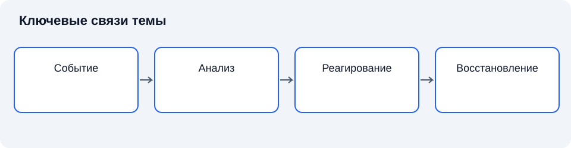

# Лекция 2. ГосСОПКА и реагирование на компьютерные инциденты

Дисциплина: «Основы информационной безопасности». Пункт РП: 1.2.

**Цель:** различать обнаружение атак, обмен информацией, реагирование и восстановление.

**Задачи:** различить событие, атаку и инцидент; объяснить распределение функций обнаружения и реагирования; раскрыть требования к качеству обмена; показать роль происхождения и сохранности технических свидетельств.

## Введение

На предыдущей лекции мы рассмотрели объекты и зависимости КИИ. Теперь перейдём к взаимодействию участников защиты. Изолированная организация видит только часть происходящего: наблюдения становятся полезнее, когда их сопоставляют с контекстом и сведениями других участников.

На этом занятии мы будем различать техническую возможность наблюдать событие и организационную способность использовать наблюдение. Датчик создаёт запись, но запись ещё не является решением. Между ними находятся проверка происхождения, интерпретация, оценка последствий, выбор действия и подтверждение результата. Если хотя бы одно звено не определено, быстрое получение сигнала может не привести к своевременной защите.

Историческое развитие сетевого взаимодействия усилило значение обмена сведениями. Локальная система способна видеть только собственный участок процесса. Распределённые услуги и внешние зависимости создают необходимость сотрудничества. Вместе с тем расширение обмена увеличивает требования к качеству и ограничениям раскрытия. Поэтому вопрос состоит не в максимальном количестве переданных данных, а в обоснованной передаче того, что меняет решение.

## Схема темы

*Рисунок 2. Упрощённые связи понятий. Схема поясняет текст и не заменяет условия применения правил.*

## 1. Назначение государственной системы

**ГосСОПКА** — государственная система обнаружения, предупреждения и ликвидации последствий компьютерных атак на информационные ресурсы Российской Федерации. Её назначение связано с организацией взаимодействия, получением и анализом информации, предупреждением атак и реагированием. Правовую основу следует рассматривать через 187-ФЗ и акты уполномоченного органа [6].

Государственная система не заменяет ответственность владельца инфраструктуры. Доступность внешней координации не освобождает организацию от контроля собственных средств, определения ответственных и подготовки восстановления. Система взаимодействия полезна, когда участники способны своевременно сформировать понятное сообщение и выполнить согласованные действия.

### 1.1. Распределение функций и полномочий

В реагировании можно выделить несколько функций: получение сообщения, первичная оценка, технический анализ, выбор действия, исполнение и проверка результата. Они могут выполняться разными людьми или совмещаться. Но сама последовательность должна оставаться различимой. Если автор гипотезы одновременно принимает необратимое решение без независимой проверки, возникает риск закрепления ошибочной версии.

**Ответственный за координацию** обеспечивает согласованность действий и информации между участниками. Он не обязан лично владеть каждым техническим инструментом. Его задача — поддерживать актуальное понимание ситуации, определять следующий шаг в пределах полномочий и обеспечивать передачу существенных сведений. Технический аналитик, в свою очередь, должен различать установленные факты и вероятные объяснения, не подменяя управленческое решение своей оценкой.

**Владелец функции** объясняет значение нарушения для деятельности. Без этого техническая команда может выбрать действие, которое хорошо ограничивает подозрительный поток, но прекращает необходимую услугу. Участие владельца функции позволяет сопоставить последствия вариантов. При этом полномочия и порядок принятия решения задаются заранее: в момент происшествия не должно выясняться, кто вправе разрешить переключение или ограничение сервиса.

Исполнитель нуждается в точной формулировке ожидаемого результата. Указание «проверить систему» слишком неопределённо. Следует понимать, какое предположение проверяется, какие ресурсы охвачены и как представить результат. Иначе разные участники выполняют несопоставимые действия, а координационный центр получает набор общих оценок. Хорошее задание связывает вопрос с доступными свидетельствами и обозначает границы проверки.

Полномочие должно сопровождаться возможностью действия. Если сотрудник назначен ответственным за уведомление, но не имеет доступа к каналу либо актуальным контактам, формальный порядок неработоспособен. Если технический специалист может выполнить действие, но не знает условий его разрешения, он либо задерживает реакцию, либо принимает решение вне установленных границ. Подготовка выявляет такие разрывы до возникновения происшествия.

### 1.2. Каналы взаимодействия и их устойчивость

Канал взаимодействия должен сохранять необходимые свойства при рассматриваемом нарушении. Если все сообщения передаются через систему, которая сама может оказаться недоступной, возникает общая зависимость. Альтернативный канал требует не только наличия технического средства, но и согласованного порядка идентификации участников. В противном случае оперативность создаёт риск передачи чувствительных сведений неподтверждённому получателю.

**Аутентичность сообщения** связана с возможностью установить заявленного отправителя и происхождение. **Целостность сообщения** — с обнаружением неправомерного изменения содержания. **Конфиденциальность** ограничивает раскрытие сведений. Эти свойства различны. Защищённая доставка не доказывает правильности аналитического вывода, а достоверный вывод не отменяет необходимости ограничить доступ к исходным материалам.

Организация должна понимать, какие сведения разрешено передавать в каждом канале. Общее уведомление и полный диагностический материал имеют разную чувствительность. Полезно разделять первоначальное сообщение о факте нарушения и последующую передачу подробностей по установленному порядку. Такое разделение ускоряет координацию, не превращая поспешный обмен в неконтролируемое раскрытие.

Актуальность контактов является эксплуатационным свойством. Список, составленный при внедрении процесса, способен устареть из-за смены должностей, телефонов и внешних исполнителей. Поэтому проверяется не только наличие документа, но и возможность связаться с нужной ролью. Контакт конкретного человека полезен, однако устойчивый процесс должен учитывать отсутствие, смену дежурства и прекращение полномочий.

Сообщение требует подтверждения получения в пределах принятого порядка. Отправка не равнозначна доставке, доставка — прочтению, а прочтение — началу действия. Эти состояния следует различать, особенно если от ответа зависит следующий шаг. Контроль состояния сообщения поддерживает управляемость, но не должен превращаться в бесконечное дублирование. Повторная отправка без связи с исходной версией может создавать несколько несогласованных задач.

### 1.3. Координация и локальная самостоятельность

Общая картина происшествия формируется постепенно. Участники должны сохранять возможность выполнять заранее разрешённые действия, не ожидая полного понимания каждой детали. Но такие действия ограничиваются установленными условиями. **Предварительно разрешённое действие** — операция, допустимость которой определена заранее для определённого класса обстоятельств. Она повышает скорость, если критерии запуска понятны и результат проверяется.

Локальная самостоятельность не означает скрытого принятия решений. Существенные действия фиксируются и сообщаются тем, кого они затрагивают. Если узел изолирован, необходимо знать, какие функции прекращены и какие данные перестали поступать. Иначе другие участники могут принять отсутствие наблюдений за нормализацию ситуации. Информация о собственных действиях является частью картины происшествия.

Чрезмерная централизация способна создавать очередь решений. Каждый незначительный шаг требует согласования, хотя последствия понятны и заранее ограничены. Чрезмерная автономия создаёт противоположную проблему: участники действуют по разным предположениям и мешают восстановлению. Баланс достигается через разделение классов решений, полномочий и условий эскалации, а не через универсальный запрет самостоятельности.

**Эскалация** — передача вопроса на иной уровень полномочий или компетенции при достижении установленных условий. Основанием может быть рост последствий, недостаток знаний, конфликт приоритетов или невозможность выполнить необходимое действие. Эскалация полезна, когда сопровождается ясным описанием вопроса и уже известных обстоятельств. Простая пересылка всей переписки не гарантирует передачи понимания.

### 1.4. Коллективная картина и самостоятельная проверка

Соединение наблюдений разных участников помогает увидеть закономерность, недоступную локально. Но объединение создаёт новые риски интерпретации. Совпадающие признаки могут относиться к разным событиям, а несопоставимые классификации — создавать видимость различий. Для общей картины нужны согласованные определения и сохранение исходного смысла. Стандартизация полезна постольку, поскольку не уничтожает важные особенности контекста.

**Агрегация** — объединение сведений в обобщённое представление. Она уменьшает детализацию и позволяет видеть масштаб. Однако результат зависит от правил группировки. Если несколько повторных сообщений считаются отдельными инцидентами, масштаб завышается. Если разные происшествия объединены по одному адресу, масштаб может быть занижен. Поэтому агрегированные показатели должны иметь понятную единицу учёта.

**Дедупликация** — выявление и согласованная обработка повторных записей об одном и том же объекте или событии. Она не означает простого удаления одинаковых строк. Записи могут различаться по времени получения, источнику и дополнительному контексту. Полезно сохранять связь между объединённым представлением и исходными свидетельствами, чтобы не потерять независимые подтверждения или существенные расхождения.

Самостоятельная проверка получателя необходима потому, что решение применяется к его среде. Наличие общего сигнала не отменяет знания архитектуры. Если признак относится к функции, которая в объекте не используется, действие может быть неприменимо. Если же локальный путь существует, но внешний каталог пока не содержит описания, отсутствие записи не является основанием игнорировать наблюдение. Общая и локальная картины уточняют друг друга.

### 1.5. Краткий вывод

ГосСОПКА обеспечивает согласованное обнаружение, предупреждение и ликвидацию последствий атак. Обмен сведениями дополняет локальное управление; каналы и полномочия должны быть определены заранее.

## 2. Событие, атака и инцидент

**Событие безопасности** — наблюдаемое обстоятельство, потенциально значимое для защиты. **Компьютерная атака** связана с целенаправленным воздействием на информационные ресурсы. **Компьютерный инцидент** описывает факт нарушения либо прекращения функционирования объекта или нарушения безопасности обрабатываемой информации в предусмотренном законом смысле [6].

Не каждое событие свидетельствует об атаке. Неудачная аутентификация может быть обычной ошибкой пользователя. Даже правильно зарегистрированное событие нуждается в интерпретации: важно сопоставить время, субъекта, объект, ожидаемую операцию и другие наблюдения. Вывод об атаке должен опираться на совокупность признаков, а неопределённость необходимо сохранять в сообщении [4].

### 2.1. Временная согласованность и восстановление последовательности

**Временная согласованность сведений** — это возможность непротиворечиво соотнести события с учётом особенностей часов, регистрации и доставки сообщений. В распределённой инфраструктуре запись времени не является безусловным отражением момента действия. Устройства могут иметь разные настройки часового пояса, часы могут расходиться, а журналирование — происходить с задержкой. Если эти особенности неизвестны, аналитик способен перепутать причину и следствие: например, решить, что изменение настройки предшествовало входу пользователя, хотя порядок записей объясняется различиями источников.

Для анализа необходимо различать время самого события, время его регистрации и время получения сведений. Действие могло произойти до появления записи в центральной системе, а сообщение о нём — поступить ещё позже. Такое разделение позволяет объяснить, почему новое сообщение описывает более ранний этап инцидента. Оно также предотвращает ошибку, при которой порядок поступления сообщений принимают за порядок действий. Особенно существенна эта граница при объединении локальных журналов, сетевых наблюдений и сообщений внешних участников.

Точность временной отметки и её достоверность — разные свойства. Запись с подробным указанием долей секунды выглядит точной, но может быть смещена относительно других источников. Поэтому чрезмерная детализация формата не гарантирует правильного сопоставления. Если расхождение часов известно лишь приблизительно, разумнее представлять время как интервал возможных значений. Тогда пересечение интервалов показывает, что строгий порядок событий не установлен. Такая неопределённость является характеристикой доказательств, которую нужно сохранить при передаче, а не устранить произвольным выбором последовательности.

Порядок иногда можно восстановить без полного совпадения часов. Если ответ содержит идентификатор конкретного запроса, он связан с этим запросом независимо от различия временных отметок. Аналогично связь родительского и дочернего процессов помогает установить последовательность запуска. **Причинная связь** в данном контексте означает наличие основания считать одно действие условием или источником другого. Близость во времени сама по себе такой связи не доказывает: независимые операции могут происходить рядом, а связанные действия — быть разделены задержкой.

Актуальность сведений зависит от изменчивости объекта. Адрес может перейти другому владельцу, файл — измениться, учётная запись — быть отключена, а инфраструктура атакующего — перестать использоваться. Поэтому при передаче важно обозначать, к какому наблюдаемому состоянию относится утверждение. Вывод «объект участвовал в подозрительной активности» не равнозначен выводу «любое текущее взаимодействие с объектом опасно». Историческое наблюдение сохраняет значение для расследования, но его применимость к текущей защите требует самостоятельного обоснования.

При восстановлении картины полезно сохранять несколько допустимых последовательностей, если данных недостаточно для выбора одной. Преждевременное построение единой истории заставляет подгонять новые наблюдения под уже принятую версию. Напротив, явное указание неопределённых связей помогает определить, какие дополнительные сведения действительно нужны. Если различие между версиями зависит от момента выдачи полномочий, следует искать подтверждение этого действия, а не просто накапливать записи, которые одинаково совместимы с обеими версиями.

### 2.2. Уровни описания наблюдаемого

Один эпизод может иметь несколько описаний. На низком уровне фиксируются пакеты, обращения к файлам и действия процессов. На следующем уровне появляются события приложения: вход, изменение настройки, выполнение операции. Аналитический уровень связывает события с предположением о нарушении. Управленческий уровень оценивает последствия для деятельности. Эти описания должны согласовываться, но не подменять друг друга.

**Первичное наблюдение** — зафиксированное источником событие до его аналитического объяснения. Даже первичность относительна: датчик уже применяет формат и правила регистрации. Поэтому полезно знать, что именно измеряется и что выводится программно. Счётчик неуспешных обращений может быть рассчитан из нескольких записей; сообщение о подозрительной активности — результатом правила. Источник должен быть понятен, чтобы оценивать силу свидетельства.

**Аналитическая гипотеза** — возможное объяснение наблюдений, допускающее проверку. Она полезна, если указывает, какие дополнительные сведения могут её поддержать или ослабить. Фраза о неизвестной угрозе без проверяемых следствий не направляет работу. Гипотеза должна связываться с конкретными условиями: предполагаемый путь доступа, затронутый ресурс и ожидаемые признаки. При этом отсутствие ожидаемого признака значимо лишь при достаточной видимости источника.

Разные гипотезы могут объяснять одно наблюдение. Повышенная нагрузка возникает из-за разрешённой работы, программной ошибки, сбоя внешней зависимости или атаки. Выбор версии требует признаков, которые различают объяснения. Накопление ещё большего числа однотипных показателей нагрузки может не помочь. Иногда необходимы сведения о характере запросов, изменениях конфигурации или плановых работах. Поэтому качество вопроса важнее количества полученных записей.

### 2.3. Ложные срабатывания и пропуски

**Ложное положительное срабатывание** возникает, когда средство сигнализирует о нарушении, которого в рассматриваемом смысле нет. **Ложное отрицательное решение** связано с отсутствием необходимого сигнала при реально существующем нарушении. Эти понятия относятся к выбранному критерию. Если определение нарушения неясно, оценка качества обнаружения становится неоднозначной.

Повышение чувствительности правила может увеличить число сигналов, но не обязательно улучшить итоговое обнаружение. Аналитики располагают ограниченным временем. Если существенный сигнал теряется в потоке малополезных предупреждений, формальное увеличение охвата не приводит к своевременному решению. Поэтому качество обнаружения рассматривается вместе с процессом обработки, контекстом и возможностью приоритизации.

Снижение числа ложных сигналов тоже не является самостоятельной целью. Правило, которое никогда не срабатывает, может выглядеть удобным, но пропускать необходимые события. Настройка требует баланса в пределах допустимого риска. Для критичной функции редкий пропуск может иметь более тяжёлые последствия, чем некоторое число дополнительных проверок. Но конкретное решение должно опираться на назначение и ресурсы, а не на универсальное предпочтение одной метрики.

Для проверки необходима определённость исходных случаев. Если неизвестно, какие события действительно относятся к нарушению, нельзя уверенно вычислить долю ошибок. Учебные испытания помогают исследовать конкретные сценарии, но их состав ограничивает вывод. Высокая точность на подготовленном наборе не доказывает такую же эффективность в меняющейся среде. В отчёте следует сохранять условия получения показателя.

### 2.4. От признака к подтверждённому инциденту

Подтверждение инцидента является процессом уменьшения неопределённости. Сначала устанавливается достоверность самого наблюдения: относится ли оно к нужному объекту, не является ли повторной записью, правильно ли понято время. Затем проверяется контекст: выполнялись ли разрешённые работы, какие права имел участник и какие изменения ожидались. После этого оцениваются последствия и соответствие принятому определению инцидента.

Не все решения можно отложить до полного подтверждения. Иногда потенциальные последствия требуют временного ограничения до завершения анализа. Такое действие не должно превращать гипотезу в якобы доказанный факт. В записи указывается, что мера принята при определённой неопределённости и по определённому основанию. Это позволяет впоследствии оценить решение по доступным в тот момент сведениям.

**Статус происшествия** — принятое обозначение стадии рассмотрения и степени подтверждения. Он полезен, если смысл понятен участникам. «Подозрение», «проверяется», «подтверждено» и «закрыто» описывают разные состояния работы, но не должны использоваться произвольно. Закрытие задачи может означать прекращение анализа без подтверждения, устранение причины или передачу в другой процесс. Если эти значения смешаны, статистика теряет содержательность.

Подтверждение требует достаточности, а не обязательно абсолютной полноты. Невозможно наблюдать каждое действие во всех компонентах. Но вывод должен объяснять, какие факты установлены, какие версии исключены и какие вопросы остаются открытыми. Уверенность формируется из согласованности свидетельств, знания ограничений и понятной причинной модели. Авторитетное заявление без такой опоры не заменяет анализ.

### 2.5. Краткий вывод

Событие является наблюдением, атака — целенаправленным воздействием, инцидент — нарушением. Вывод требует контекста и проверки: тревога не равна подтверждённому инциденту.

## 3. Цикл реагирования

**Реагирование** — организованная последовательность действий по оценке происшествия, ограничению последствий и восстановлению управляемого состояния. Подготовка начинается до происшествия: определяются полномочия, источники данных, каналы связи, порядок фиксации решений и условия подключения специалистов [1; 5].

Ограничение воздействия иногда требует компромисса между доступностью и сохранением доказательств. Немедленное отключение системы может остановить распространение, но нарушить критическую функцию. Универсального решения нет: выбор зависит от последствий, имеющейся альтернативы и полномочий. Восстановление завершается проверкой корректности работы, а не только успешным запуском приложения.

### 3.1. Корреляция, проверка гипотез и обратная связь

**Корреляция сведений об инцидентах** — это сопоставление наблюдений для выявления связей между объектами, действиями и обстоятельствами. Она позволяет перейти от отдельных сигналов к проверяемой картине происходящего. Например, подозрительный вход, запуск необычного процесса и исходящее соединение могут образовать связанную последовательность. Однако объединение оправдано только при наличии подходящих признаков: общего узла, процесса, сеанса или иной объяснимой связи. Само совпадение части значений ещё не показывает, что события относятся к одному инциденту.

Надёжность сопоставления зависит от специфичности признака. Совпадение распространённого имени файла даёт слабое основание, поскольку такое имя встречается в обычной работе. Более содержательная комбинация свойств может сильнее поддерживать гипотезу, но и её необходимо оценивать с учётом среды. Один внешний адрес иногда обслуживает множество независимых ресурсов, а один внутренний адрес может последовательно принадлежать разным устройствам. Следовательно, идентификатор полезен лишь вместе с пониманием того, какой объект и при каких условиях он обозначает.

Перед сопоставлением данные часто приводят к общему представлению. **Нормализация** — это преобразование разных форм записи к согласованной форме с сохранением значимых различий. Она помогает сравнивать адреса, имена и категории событий, но способна создавать ложные совпадения, если правила выбраны без учёта смысла. Например, изменение регистра символов допустимо не для любого идентификатора. Поэтому результат нормализации желательно связывать с исходным значением, чтобы неожиданное совпадение можно было проверить и при необходимости пересмотреть.

Корреляция должна включать проверку альтернативных объяснений. Последовательность, похожая на действия нарушителя, может возникнуть при сопровождении системы, работе средств защиты или разрешённом тестировании. Это не повод отвергать подозрение, а основание искать признаки, различающие версии. Подтверждение штатной операции уменьшает силу одной гипотезы, тогда как отсутствие такого подтверждения само по себе ещё не доказывает другую. Доказательная ценность наблюдения определяется тем, насколько оно помогает выбирать между объяснениями, а не тем, насколько тревожно выглядит.

Особое значение имеет независимость подтверждений. Несколько средств обнаружения могут использовать один исходный журнал или одинаковое правило, поэтому их согласие не обязательно означает независимую проверку. Сильнее поддерживает вывод сочетание наблюдений, полученных разными способами и связанных понятной моделью события. Вместе с тем отсутствие сигнала в другом источнике значимо только при условии, что этот источник мог зафиксировать рассматриваемое действие. Иначе молчание датчика отражает границы видимости, а не опровержение гипотезы.

**Обратная связь** — это передача отправителю результатов использования сведений, обнаруженных ограничений и необходимых уточнений. Она замыкает обмен в процесс совместного улучшения знания. Получатель может сообщить, что признак обнаружен, что проверка не дала результата либо что интерпретация оказалась неверной. Эти ответы имеют разный смысл: отсутствие находки может объясняться отсутствием события, ограниченным охватом данных или неподходящим способом поиска. Поэтому полезная обратная связь описывает условия проверки и основания результата.

Исправления и уточнения должны сохранять прослеживаемость изменений. Если признак признан недостаточно специфичным, важно обозначить, какое утверждение пересмотрено и почему. Тогда другие участники смогут оценить зависимые выводы и решения. При этом обратная связь сама подчиняется требованиям качества и минимизации: сообщение об успешном обнаружении не должно неоправданно раскрывать устройство защищаемой системы. Участники обмениваются ровно теми основаниями, которые позволяют улучшить совместный анализ и проверить применимость первоначальных сведений.

### 3.2. Подготовка как часть реагирования

Процесс реагирования начинается до первого сигнала. Подготовка формирует возможность действовать: определяет роли, доступные сведения, допустимые операции и способы проверки. Без неё время расходуется на поиск полномочий, инструментов и контактов. Даже квалифицированный специалист не может быстро выполнить действие, если неизвестно, где находятся необходимые данные и кто разрешает их использовать.

Подготовка включает понимание архитектуры. Для локализации нужно знать, какие функции прекратятся при ограничении узла или канала. Для восстановления — какие зависимости должны быть доступны раньше приложения. Для анализа — какие источники наблюдают существенные действия. Поэтому реагирование тесно связано с инвентаризацией, управлением конфигурацией и непрерывностью. Его нельзя изолировать в виде одной инструкции без связи с устройством объекта.

**Сценарный план** описывает порядок решений для определённого класса обстоятельств. Он не обязан перечислять каждый технический шаг для всех версий среды. Более устойчивый план задаёт цели, условия выбора действий, полномочия и критерии результата. Подробные инструкции могут дополнять его для конкретных операций. Такое разделение позволяет сохранять общую логику при изменении инструментов.

Подготовка также предполагает доступность материалов при нарушении основных средств связи. Если инструкции хранятся только в недоступном сервисе, их наличие не помогает. Если доступ к резервным сведениям зависит от той же системы аутентификации, которая нарушена, возникает круговая зависимость. Эти условия выявляются проверкой сценариев, а не простым подтверждением существования документов.

### 3.3. Ограничение воздействия

**Локализация** — уменьшение области или возможностей дальнейшего воздействия. Она может включать ограничение определённого взаимодействия, временное изменение полномочий или перевод функции в иной режим. Конкретный выбор зависит от архитектуры и допустимых последствий. Нельзя считать отключение всего объекта универсальным способом правильного реагирования.

Мера локализации имеет собственные риски. Она способна прекратить сбор свидетельств, нарушить обслуживание или перенести нагрузку на неподготовленный резерв. Поэтому решение связывают с ожидаемым результатом и способом проверки. Если ограничение выполнено, необходимо убедиться, что предполагаемый путь действительно закрыт и не возник новый недопустимый режим. Успешная команда настройки не равнозначна успешной локализации.

**Обратимость действия** характеризует возможность вернуть прежнее состояние без неприемлемых потерь. При неопределённости обратимые меры часто полезны, но обратимость не делает действие автоматически безопасным. Даже кратковременное прекращение функции может иметь необратимые последствия для процесса. Следовательно, оцениваются не только технические настройки, но и деятельность, которая зависит от них.

Решение о локализации должно сопровождаться фиксацией времени, основания, исполнителя и затронутых ресурсов. Эти сведения нужны для последующего анализа: часть наблюдаемых изменений будет вызвана собственными действиями команды. Если их не учитывать, аналитик способен принять эффект защитной меры за развитие атаки. История реагирования становится частью доказательной картины.

### 3.4. Обратимость, пределы и контроль действия

Для каждого существенного действия желательно знать предел его воздействия. Ограничение одной учётной записи отличается от изменения общей политики, а изоляция одного интерфейса — от остановки сети. Чем шире область, тем больше зависимостей требуется оценить. Но узкое действие не всегда достаточно: если путь распространяется через общий механизм, локальное изменение может создать ложное ощущение контроля.

**Контроль исполнения** отвечает на вопрос, выполнена ли операция так, как предполагалось. **Контроль результата** проверяет, достигнуто ли нужное свойство. Команда может выполниться без ошибки, но не изменить действующий путь из-за иной конфигурации или обходного интерфейса. Поэтому оба контроля необходимы. Их смешение является распространённой причиной преждевременного завершения локализации.

Действие нуждается в условиях прекращения или пересмотра. Временная блокировка может сохраняться после исчезновения основания, затрудняя деятельность и скрываяся в накопленных настройках. Полезно фиксировать владельца ограничения и вопрос, который должен быть проверен перед его снятием. Снятие защиты тоже является изменением и требует понимания последствий.

При выполнении нескольких действий важно учитывать взаимодействие. Изменение маршрута влияет на источники наблюдения, переключение на резерв — на актуальность данных, обновление программы — на воспроизводимость следов. Последовательность должна поддерживать цель, а не отражать случайный порядок доступности специалистов. Координация сохраняет общую картину этих взаимных влияний.

### 3.5. Краткий вывод

Реагирование объединяет подготовку, обнаружение и анализ, локализацию, устранение причин, восстановление и разбор результатов. Действия проверяют по последствиям для защищаемого процесса.

## 4. Качество обмена информацией

**Индикатор компрометации** — наблюдаемый признак, который в контексте может указывать на нарушение. Индикатор не является самостоятельным доказательством: адрес, имя файла или характерная последовательность могут встречаться и в допустимой деятельности. Значение имеет происхождение сведений и пределы уверенности [2; 4].

Сообщение об инциденте должно отделять известные факты от предположений. Полезны единая временная шкала, перечень затронутых функций, выполненные действия и контакт ответственного. Передача избыточных персональных или конфиденциальных сведений создаёт дополнительный риск. Обмен организуется по установленным правилам и через разрешённые каналы; конкретные сроки нельзя выводить из общей схемы реагирования.

### 4.1. Качество сведений как условие обоснованного решения

**Обмен сведениями об инцидентах** — это передача наблюдений, оценок и выводов о событиях, способных нарушить конфиденциальность, целостность или доступность информации, между участниками, которым эти сведения нужны для анализа и защиты. Его результат определяется не объёмом сообщений, а тем, насколько получатель может обоснованно использовать их в своей ситуации. Сообщение о подозрительном соединении полезно, если позволяет понять, что наблюдалось, где получены данные и какие выводы ими подтверждаются. Передача длинного журнала без объяснения контекста может увеличить нагрузку, не уменьшив неопределённость.

**Качество сведений** — это совокупность свойств, определяющих пригодность информации для конкретной аналитической задачи. К таким свойствам относятся точность, полнота относительно задачи, актуальность, непротиворечивость и проверяемость. Они не заменяют друг друга. Точный адрес узла мало помогает, если неизвестно, какое действие с ним связано. Подробное описание события может оказаться непригодным, если оно относится к другой системе или иной версии программного обеспечения. Поэтому оценивать качество необходимо относительно решения: поиска следов, проверки гипотезы, ограничения доступа или восстановления работы.

Основное требование к содержанию сообщения — различать наблюдение и интерпретацию. Запись о запуске программы является наблюдением, если она получена из доступного источника и её происхождение можно проверить. Утверждение о том, что запуск выполнил злоумышленник, представляет собой интерпретацию, для которой нужны дополнительные основания. Между этими уровнями может находиться гипотеза: программа могла быть запущена через скомпрометированную учётную запись. Когда наблюдения, гипотезы и выводы смешиваются, получатель рискует принять предположение за установленное обстоятельство и построить дальнейший анализ на неверной основе.

**Проверяемость** означает возможность установить, на каких данных основано утверждение и каким способом из них получен вывод. Она не требует передачи всех исходных материалов каждому участнику. Иногда достаточно указать источник, способ отбора записей, выполненные преобразования и доступные способы дополнительной проверки. Например, при передаче фрагмента журнала следует пояснить, какие записи исключены и почему. Иначе отсутствие события в выборке можно ошибочно истолковать как отсутствие события в системе. Проверяемость связывает сообщение с доказательствами и позволяет обнаруживать ошибки обработки.

Полнота также не равна максимальному объёму. Для установления связи между сетевым обращением и процессом могут понадобиться сведения об узле, процессе и времени наблюдения, но не содержание пользовательских документов. Неполнота становится существенной тогда, когда недостающие данные способны изменить вывод. Полезно прямо обозначать такие пробелы: журнал охватывает только часть инфраструктуры, источник не фиксирует успешность операции, сведения об инициаторе отсутствуют. Явно обозначенная граница наблюдения помогает получателю выбирать следующий шаг, тогда как скрытый пробел создаёт ложное ощущение определённости.

Качество может снижаться при каждом преобразовании информации. Автоматическая нормализация способна объединить разные значения, перевод — изменить смысл технического термина, краткое изложение — убрать важное исключение. Поэтому вместе с содержанием необходимо сохранять существенные условия его получения. Если утверждение справедливо только для определённой конфигурации, это условие относится к самому знанию, а не к необязательным пояснениям. Отделённый от условий вывод может выглядеть убедительно и при этом оказаться неприменимым к системе получателя.

### 4.2. Доверие к источнику и обоснованность утверждения

**Доверие при обмене сведениями** — это обоснованное ожидание того, что участник корректно сообщает известное ему, обозначает ограничения и соблюдает согласованные условия использования информации. Доверие уменьшает неопределённость взаимодействия, но не устраняет необходимость анализа. Даже добросовестный источник может ошибаться из-за неполных журналов, неверной настройки датчика или недостаточного понимания события. Поэтому доверие к участнику и достоверность отдельного сообщения следует оценивать раздельно: хорошая репутация не превращает предположение в доказанный факт.

Значимую роль играет **происхождение сведений** — прослеживаемая связь сообщения с источниками и преобразованиями, через которые оно прошло. Получатель должен различать непосредственное наблюдение, пересказ чужого сообщения и аналитическое обобщение. Если несколько организаций передают один и тот же вывод, восходящий к единственному исходному наблюдению, это не создаёт нескольких независимых подтверждений. Без понимания происхождения возникает круговое подтверждение: сведения возвращаются к участникам через разные каналы и воспринимаются как новые доказательства, хотя основание остаётся прежним.

Техническая защита передачи решает лишь часть задачи доверия. Проверка отправителя помогает установить, от кого поступило сообщение, а контроль целостности — обнаружить изменение содержимого. Однако корректно подписанное сообщение может включать ошибочную интерпретацию. Защищённый канал подтверждает свойства доставки, но не истинность описанного события. Эта граница важна при автоматическом использовании сведений: подлинность источника позволяет принять сообщение к рассмотрению, тогда как решение о блокировке или изменении настроек требует оценки содержания и возможных последствий.

**Уверенность в выводе** — это выраженная оценка того, насколько имеющиеся основания поддерживают конкретное утверждение. Она должна сопровождаться объяснением причин: обнаружены согласованные следы в разных источниках, часть данных отсутствует, альтернативная версия пока не исключена. Само обозначение уверенности без таких оснований плохо переносится между участниками: один аналитик называет уверенность высокой при наличии прямого наблюдения, другой — при соответствии знакомому сценарию. Объяснение позволяет получателю пересмотреть оценку с учётом собственных данных.

Доверие укрепляется, когда источник способен исправлять сообщения и объяснять причины изменений. Отказ от прежнего вывода после обнаружения ошибки показывает работу проверки, а не обязательно ненадёжность участника. Напротив, сохранение заведомо неточной формулировки ради последовательности делает последующий обмен менее безопасным. При этом исправление должно сохранять связь с исходным утверждением: получателю важно понимать, что именно изменилось, какие решения могли опираться на прежнюю версию и какие основания теперь считаются недостаточными.

Условия использования сведений также влияют на возможность обмена. Участник может располагать полезными данными, но воздерживаться от передачи, если не понимает, кто получит к ним доступ и в каких целях их применят. Предсказуемые границы использования позволяют передавать необходимые детали без неоправданного раскрытия. Однако ограничение распространения не является признаком достоверности: конфиденциальное сообщение нуждается в той же содержательной проверке, что и открытое. Чувствительность информации характеризует последствия её раскрытия, а не качество доказательств.

### 4.3. Завершение обмена и сохранение результата

Обмен не заканчивается отправкой последнего уведомления. Необходимо понимать, какие задачи закрыты, какие сведения исправлены и какие ограничения продолжают действовать. Если признак оказался неточным, получатели должны иметь возможность пересмотреть зависимые решения. Если мера была временной, нужен ответственный за её дальнейшую судьбу. Иначе информация продолжает влиять на систему после утраты основания.

Сохранение результатов помогает будущим анализам, но требует управления доступом и сроками. Диагностические материалы могут иметь высокую чувствительность, а их полезность изменяется со временем. Решение о хранении должно учитывать назначение, применимые правила и возможность последующей проверки. Бесконечное накопление не является универсальным способом повышения качества.

Знание, полученное из одного происшествия, необходимо обобщать осторожно. Конкретный признак может не повториться, тогда как механизм зависимости или ошибка управления сохраняет значение. Полезно отделять частные индикаторы от более общих выводов о процессе. Такое различие помогает превратить историю инцидента в улучшение архитектуры и подготовки, не выдавая единичный случай за универсальную закономерность.

### 4.4. Краткий вывод

Для обмена нужны источник, контекст, ограничения достоверности и понятное требуемое действие. Получение сообщения и прекращение атаки — разные результаты; принятый вывод пересматривают при новых данных.

## Заключение

Организационная готовность определяет, смогут ли технические наблюдения превратиться в обоснованное решение. Следующая лекция посвящена категорированию: там значимость последствий станет основанием дифференцированного подхода к защите.

Итак, обнаружение является началом познавательного и управленческого процесса. Сведения приобретают значение через контекст, а действие — через цель и полномочие. Нельзя считать процесс успешным только потому, что сформировано много сообщений или быстро выполнена техническая команда. Важен результат для защищаемой функции и возможность проверить, почему он признан достигнутым.

Пять опорных вопросов помогают сохранить целостность: что известно, откуда это известно, какие последствия возможны, кто принимает решение и чем подтверждается результат? Они применимы на разных уровнях — от локального анализа до межорганизационного обмена. Если ответ отсутствует, это не повод скрывать пробел; это указание на следующий шаг.

## Вопросы для самопроверки

1. Каково назначение ГосСОПКА?
2. Почему внешняя координация не заменяет локальную защиту?
3. Чем событие отличается от инцидента?
4. Почему один индикатор не доказывает атаку?
5. Какие решения принимают до происшествия?
6. Почему отключение системы требует оценки последствий?
7. Как проверить завершённость восстановления?
8. Что необходимо отделять в сообщении об инциденте?

## Глоссарий

- **ГосСОПКА** — государственная система обнаружения, предупреждения и ликвидации последствий компьютерных атак.
- **Событие** — наблюдаемое обстоятельство.
- **Атака** — целенаправленное воздействие на информационный ресурс.
- **Инцидент** — нарушение функционирования или безопасности информации.
- **Реагирование** — организованное управление происшествием.
- **Индикатор** — наблюдаемый признак возможного нарушения.
- **Контекст** — условия интерпретации наблюдения.
- **Локализация** — ограничение области воздействия.
- **Восстановление** — возвращение необходимых функций.
- **Доказательство** — проверяемое основание вывода.
- **Координация** — согласование действий участников.
- **Готовность** — наличие подготовленных процессов и ресурсов.

## Список литературы

1. Anderson, R. Security Engineering: A Guide to Building Dependable Distributed Systems / R. Anderson. — 3rd ed. — Hoboken : Wiley, 2020. — Текст : непосредственный.
2. Bishop, M. Computer Security: Art and Science / M. Bishop. — 2nd ed. — Boston : Addison-Wesley, 2018. — Текст : непосредственный.
3. Saltzer, J. H. The Protection of Information in Computer Systems / J. H. Saltzer, M. D. Schroeder // Proceedings of the IEEE. — 1975. — Vol. 63, no. 9. — P. 1278–1308. — DOI 10.1109/PROC.1975.9939. — Текст : электронный.
4. National Institute of Standards and Technology. Guide for Conducting Risk Assessments : NIST SP 800-30 Rev. 1. — Gaithersburg : NIST, 2012. — DOI 10.6028/NIST.SP.800-30r1. — Текст : электронный.
5. National Institute of Standards and Technology. Security and Privacy Controls for Information Systems and Organizations : NIST SP 800-53 Rev. 5. — Gaithersburg : NIST, 2020. — DOI 10.6028/NIST.SP.800-53r5. — Текст : электронный.
6. Российская Федерация. Законы. О безопасности критической информационной инфраструктуры Российской Федерации : Федеральный закон от 26 июля 2017 г. № 187-ФЗ. — URL: http://www.kremlin.ru/acts/bank/42128 (дата обращения: 11.11.2026). — Текст : электронный.

7. Федеральная служба по техническому и экспортному контролю. Требования к созданию систем безопасности значимых объектов критической информационной инфраструктуры Российской Федерации и обеспечению их функционирования : утверждены приказом ФСТЭК России от 21 декабря 2017 г. № 235. — Текст : электронный.
8. Федеральная служба по техническому и экспортному контролю. Требования по обеспечению безопасности значимых объектов критической информационной инфраструктуры Российской Федерации : утверждены приказом ФСТЭК России от 25 декабря 2017 г. № 239. — Текст : электронный.

7. Kent, K. Guide to Integrating Forensic Techniques into Incident Response / K. Kent, S. Chevalier, T. Grance, H. Dang. — Gaithersburg : NIST, 2006. — NIST SP 800-86. — DOI 10.6028/NIST.SP.800-86. — Текст : электронный.
