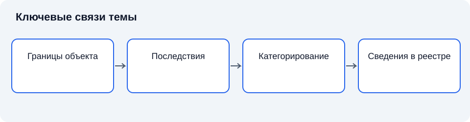

# Лекция 3. Категорирование объектов КИИ, реестр и система безопасности

Дисциплина: «Основы информационной безопасности». Пункт РП: 1.3.

**Цель:** объяснить переход от анализа последствий к обоснованным требованиям безопасности.

**Задачи:** определить основные понятия темы; объяснить их взаимосвязь; установить границы применимости рассмотренных подходов.

## Введение

Ранее мы установили, что общественная значимость определяется функцией объекта и последствиями нарушения. Теперь рассмотрим процедуру, которая связывает эту идею с организационными решениями. Категорирование требует доказательств, а не субъективного впечатления о важности оборудования.

## Схема темы

*Рисунок 3. Упрощённые связи понятий. Схема поясняет текст и не заменяет условия применения правил.*

## 1. Назначение категорирования

**Категорирование** — установление соответствия объекта критериям значимости и показателям их значений с присвоением одной из предусмотренных категорий и проверкой сведений. Актуальная организация категорирования учитывает отраслевые перечни и отраслевые особенности, введённые изменениями законодательства; прежнее описание процедуры без этих условий не следует считать полным [9]. Закон предусматривает первую, вторую и третью категории значимости. Если установленные значения критериев не достигаются, категория не присваивается [6].

Категория характеризует значимость объекта в установленной системе оценки. Она не обозначает уровень секретности данных, класс антивируса или оценку зрелости службы защиты. Необходимо удерживать это различие: одинаковая конфиденциальность информации не означает одинаковых последствий прекращения деятельности.

### 1.1. Границы объекта: что именно оценивается

**Методологическое разграничение.** Ниже рассматривается общая инженерная оценка значимости, помогающая подготовить исходные сведения. Она не заменяет нормативное категорирование КИИ. Для присвоения категории применяются установленные законом и подзаконными актами критерии, показатели, отраслевые перечни и отраслевые особенности. Внутренние баллы, усреднение и экспертные шкалы не подменяют обязательные правила [6; 9].

**Оценка значимости** — это обоснованное определение того, насколько существенными могут быть последствия нарушения работы объекта, утраты его свойств или неправильного использования его ресурсов. В информационной безопасности объектом оценки может выступать информационная система, отдельный сервис, совокупность данных, технологический процесс или деятельность организации, поддерживаемая несколькими системами. Результат оценки зависит от выбранного объекта: значимость базы данных нельзя автоматически приравнять к значимости всей организации, а последствия отказа отдельного сервера — к последствиям прекращения услуги.

Работу начинают с описания назначения объекта. Необходимо установить, какую задачу он выполняет, кто получает результат и какие действия становятся невозможными при нарушении его работы. Например, для системы учёта учебных результатов важны не только хранение записей и доступ пользователей, но и подготовка ведомостей, подтверждение освоения дисциплин, исправление ошибок. Такое описание связывает технические компоненты с деятельностью. Без этой связи оценка часто подменяется перечнем оборудования: количество серверов известно, но причины, по которым их отказ имеет значение, остаются неясными.

**Граница объекта оценки** — это явно установленное разделение между тем, что включено в рассматриваемый объект, и тем, что учитывается как его внешнее окружение. Граница должна охватывать компоненты, данные, роли и связи, необходимые для выбранной задачи оценки. Если рассматривается электронная запись на приём, внутри границы могут находиться приложение, база расписания и операции сотрудников. Сервис отправки уведомлений может оставаться внешним, но его влияние необходимо описать. Исключение компонента из границы не означает отсутствия зависимости от него.

Особое внимание уделяют общим ресурсам. Несколько сервисов могут использовать единую службу идентификации, канал связи, источник питания или группу администраторов. Изолированная оценка каждого сервиса способна скрыть общий источник нарушения. Поэтому полезно различать границу самого объекта и область анализа его зависимостей. Первая задаёт предмет вывода о значимости, вторая показывает, какие внешние условия нужны для понимания последствий. Расширять объект до всей инфраструктуры не всегда необходимо; достаточно сделать существенные зависимости видимыми и проверить их влияние.

Границы устанавливают также по времени, территории и режиму деятельности. Один и тот же отказ может иметь разные последствия во время обычной работы и в период выполнения критичной операции. Для распределённой организации важно, затронуто ли одно подразделение или прекращён общий процесс. Временная граница определяет, рассматривается ли только непосредственный сбой или также накопление ошибок, восстановление данных и отложенные последствия. Эти ограничения необходимо назвать до выставления оценки, иначе участники будут сравнивать разные ситуации под одним названием.

Описание объекта проверяют через конкретные вопросы: какие результаты он выдаёт, кто от них зависит, где проходят точки передачи ответственности, какие ручные операции сохраняются при отказе. Источниками служат схемы процессов, эксплуатационная документация, наблюдения и объяснения ответственных сотрудников. Расхождения между источниками фиксируют. Если схема показывает резервный способ работы, а сотрудники не умеют им пользоваться, наличие схемы ещё не доказывает устойчивость процесса. Граница считается пригодной для оценки, когда другой специалист способен по её описанию понять состав объекта и воспроизвести логику включения существенных зависимостей.

### 1.2. Почему нужна дифференциация требований

Объекты различаются по назначению и последствиям нарушения. Если устанавливать одинаковый подход без анализа различий, возможны две ошибки: недостаточная защита более значимой функции и необоснованная нагрузка на менее значимую. Категорирование создаёт предусмотренный законом способ дифференциации. Однако оно не заменяет дальнейшего изучения архитектуры и угроз: общий уровень требований нуждается в конкретной реализации.

**Дифференциация** — установление различий в подходе на основании определённых признаков. Для правовой процедуры признаки и правила не выбираются исполнителем произвольно. Инженер может применять собственные модели для подготовки сведений, но итоговый правовой вывод должен следовать установленному порядку. Это сохраняет сопоставимость решений разных участников и возможность проверки.

Категория не должна восприниматься как награда или оценка качества работы организации. Высокая значимость не означает лучшую защищённость, а отсутствие категории не является подтверждением безупречной безопасности. Категория отвечает на вопрос о значении последствий в установленной системе, тогда как состояние защиты — на вопрос о выполнении требований и остаточных слабостях. Смешение этих вопросов делает рассуждение круговым.

Нельзя также связывать категорию напрямую с размером бюджета. Затраты могут зависеть от архитектуры, исходного состояния, доступности компетенций и способов реализации. Два объекта с одинаковым статусом способны требовать разных изменений. Поэтому бюджет является результатом обоснования работ, а не самостоятельным доказательством значимости или защищённости.

### 1.3. Значимость и конфиденциальность

Ограничение доступа к информации имеет собственные основания. Категория значимости объекта не является грифом секретности и не устанавливает автоматически режим всех обрабатываемых сведений. Открытая информация может быть необходима для критичной функции, а конфиденциальные сведения — обрабатываться в процессе с иными последствиями нарушения доступности. Эти признаки связаны через деятельность, но не тождественны.

**Режим доступа** определяет допустимость получения и использования сведений. **Значимость объекта** в рассматриваемой процедуре связывается с последствиями нарушения функционирования и безопасности. Поэтому анализ должен различать данные, систему и поддерживаемую функцию. Назвать базу конфиденциальной недостаточно, чтобы сделать вывод о категории объекта.

Внутри одного объекта могут находиться ресурсы с разными режимами. Публичный интерфейс, служебная конфигурация и ключевой материал требуют неодинаковых ограничений. При этом они совместно поддерживают функцию. Общее правовое положение объекта не отменяет необходимости разграничивать доступ к конкретным ресурсам и учитывать разные свойства информации.

Ошибкой является и обратное утверждение: если сведения опубликованы, их не нужно защищать. Целостность и доступность открытого сообщения могут иметь большое значение. Подмена опубликованного указания способна изменить действия получателей, а отсутствие доступа — нарушить процесс. Следовательно, конфиденциальность является одним свойством, а не синонимом информационной безопасности в целом.

### 1.4. Значимость и техническая сложность

Сложность архитектуры не равнозначна значимости. Небольшая система способна поддерживать необходимую функцию, тогда как большой комплекс — выполнять вспомогательную задачу. Количество серверов, объём кода и число пользователей являются характеристиками, но их значение выводится через последствия. Нельзя выбирать категорию по впечатлению о техническом масштабе.

Сложность влияет на возможность анализа и сопровождения. Чем больше взаимодействий, тем труднее установить все зависимости и проверить изменения. Поэтому она может увеличивать неопределённость оценки и требования к доказательствам. Но это другой вопрос. Необходимо отдельно описать значимость результата и трудность обеспечения его свойств.

**Единая точка зависимости** — ресурс или условие, утрата которого нарушает несколько необходимых функций. Такой ресурс может быть простым и дешёвым. Служба времени, общий каталог или административный доступ иногда имеют системное значение, не отражённое в их стоимости. Анализ последствий помогает обнаружить подобные случаи.

Техническая мощность резервов также не определяет полноту альтернативы. Большой запас вычислительных ресурсов бесполезен без доступных данных и полномочий. Поэтому описание значимости должно учитывать реальную функциональную возможность, а не перечень приобретённого оборудования. Это связывает оценку с доказательствами и предотвращает формальное снижение последствий на основании неподтверждённых ресурсов.

### 1.5. Краткий вывод

Категорирование КИИ устанавливает соответствие нормативным критериям и показателям, а не субъективному впечатлению. Инженерная оценка последствий готовит сведения, но не заменяет обязательную процедуру.

## 2. Обоснование исходных данных

**Сценарий последствий** — логически связанное описание нарушения функции и его результатов. Для него нужны границы объекта, зависимости, назначение процесса, возможные масштабы и длительность нарушения. Исходные предположения фиксируют, чтобы другой специалист мог проверить вывод [4].

Занижение последствий из-за предположения о безотказности защиты создаёт логический круг: требования к защите выводятся из уже принятой уверенности в её эффективности. Необходимо различать оценку значимости и оценку остаточного риска. Первая отвечает на вопрос о значении последствий, вторая учитывает конкретные меры и условия реализации угроз.

### 2.1. Сценарии последствий: от нарушения к ущербу

**Сценарий последствий** — это последовательное описание того, как определённое нарушение свойств объекта приводит к изменениям в деятельности и затрагивает интересы людей или организаций. Его основа — причинная цепочка: исходное нарушение, изменение состояния системы, влияние на процесс, конечные последствия. Простого указания «утечка данных» или «отказ сервера» недостаточно. Такие формулировки называют событие, но не объясняют, какие сведения раскрыты, кто получил к ним доступ, какие действия стали возможны и почему возникший результат существенен.

Сценарии удобно строить через нарушения конфиденциальности, целостности и доступности. Раскрытие сведений может создавать условия для обмана или вмешательства в частную жизнь. Изменение данных способно привести к ошибочному решению даже при полностью работающем приложении. Недоступность может остановить процесс, однако её последствия зависят от возможности отложить действие или выполнить его другим способом. Эти направления анализа связаны: незаметная подмена резервной копии может проявиться только при восстановлении после отказа и увеличить продолжительность перерыва.

Следует различать техническое событие и его значение для деятельности. Повреждение файла само по себе не показывает тяжесть последствий. Если существует проверенная актуальная копия и восстановление укладывается в допустимый для процесса интервал, последствия могут быть ограниченными. Если повреждение затрагивает единственный экземпляр сведений, необходимых для подтверждения выполненных действий, восстановление работоспособности оборудования проблему не решит. Причинная цепочка должна доходить до результата для процесса, а не обрываться на сообщении об ошибке или факте замены устройства.

Для каждого сценария устанавливают условия развития. Важно, обнаруживается ли нарушение сразу, продолжается ли обработка ошибочных данных, распространяется ли результат на связанные системы, можно ли отменить уже выполненные действия. Например, неверная запись в расписании создаёт одну ситуацию, если её замечают до начала занятий, и другую, если на её основе уже распределены аудитории и уведомлены участники. Задержка обнаружения здесь является частью механизма последствий, поэтому её нельзя заменять неопределённым выражением «ошибка будет исправлена».

**Прямые последствия** возникают непосредственно из нарушения работы объекта, а **косвенные последствия** развиваются через зависимые процессы и последующие решения. Их разграничение помогает избежать двойного счёта. Простой подразделения и недополученный результат этого же подразделения могут описывать разные стороны одной потери. Складывать их без проверки нельзя. Вместе с тем косвенное последствие нельзя исключать только потому, что оно появляется вне технической системы: ошибочный документ может быть передан внешнему получателю и повлиять на дальнейшие действия.

Набор сценариев должен охватывать существенно различающиеся механизмы последствий. Перечень всех мыслимых неисправностей быстро становится непригодным для анализа, тогда как один «самый страшный» сценарий обычно скрывает важные различия. Практичнее выделить характерные варианты: кратковременное нарушение с восстановлением, длительную потерю функции, скрытое искажение результатов, раскрытие определённой группы сведений. Объединять варианты допустимо, если у них совпадают значимые условия и характер последствий. Разделение требуется, когда меняются затронутые лица, обратимость результата или способ восстановления.

### 2.2. Неопределённость и проверка устойчивости выводов

**Неопределённость оценки** — это недостаток определённости в исходных данных, условиях сценария, причинных связях или правилах интерпретации результатов. Она возникает, например, когда неизвестна фактическая полнота резервных копий, не проверена ручная процедура или не установлено число зависимых пользователей. Неопределённость не равнозначна ошибке: специалист может корректно показать диапазон возможных последствий при ограниченных сведениях. Ошибка появляется, когда недостаток знаний скрывают и представляют условный вывод как установленный факт.

Необходимо отличать тяжесть последствий от вероятности их возникновения. Редкое событие способно иметь тяжёлые последствия, а частый сбой — ограниченные. **Риск** обычно рассматривает сочетание возможности события и его последствий в рамках выбранной методики. Если задача состоит именно в оценке значимости объекта через последствия, снижение уровня только на основании предполагаемой редкости нападения может подменить предмет исследования. Вероятностные предположения учитывают отдельно, когда этого требует цель оценки и существуют основания для их использования.

Работу с неопределённостью начинают с разделения подтверждённых сведений и предположений. Утверждение о возможности восстановления желательно подкреплять результатами проверки, а сведения о зависимости процесса — его фактическим устройством. Разные доказательства отвечают на разные вопросы: инструкция подтверждает предусмотренный порядок, но не его выполнимость; интервью выявляет практику, но может содержать неточности; журнал событий показывает наблюдавшиеся случаи, но не все возможные состояния. Надёжность вывода повышает согласование независимых источников с пониманием ограничений каждого из них.

Если точное значение неизвестно, используют интервалы, условные ветви или несколько вариантов сценария. Можно отдельно рассмотреть последствия успешного восстановления и ситуацию, когда копия оказывается непригодной. При этом нельзя автоматически выбирать крайний вариант без объяснения его условий. **Консервативное допущение** — это сознательно принятое предположение, которое позволяет избежать необоснованного занижения последствий. Оно полезно при недостатке данных, но должно оставаться видимым, чтобы последующая проверка могла уточнить оценку.

**Анализ чувствительности** — это проверка того, как меняется результат при изменении существенных исходных предположений. Если разные реалистичные сроки восстановления дают один уровень значимости, вывод относительно устойчив к этой неопределённости. Если небольшое изменение срока изменяет уровень по внутренней аналитической шкале, нужно точнее исследовать соответствующую зависимость. Такой анализ помогает выбирать следующие действия: проверять прежде всего те сведения, уточнение которых способно изменить решение, а не собирать все доступные данные без разбора.

Проверка устойчивости включает поиск пропущенных условий и альтернативных объяснений. Например, низкие последствия отказа могут объясняться наличием ручной процедуры, но она может требовать тех же недоступных данных или тех же сотрудников, которые заняты восстановлением. Здесь формальная независимость резервного способа оказывается мнимой. Полезно проследить весь путь его применения: получение исходных сведений, принятие решений, оформление результатов и последующее внесение накопленных изменений. Это выявляет ограничения, которые не видны при проверке одного технического компонента.

### 2.3. Последовательность подготовки исходных сведений

Подготовка начинается с определения назначения объекта и поддерживаемых функций. Затем уточняются данные, участники, зависимости и допустимые режимы. После этого строятся сценарии нарушения и исследуются последствия. Такая последовательность не является самостоятельной нормативной процедурой; это инженерный способ получить содержательные исходные сведения для установленного процесса.

Если начинать с желаемого результата, возникает риск подгонки. Исследователь выбирает удобный уровень, а затем ищет подтверждающие сведения. Более надёжный подход отделяет сбор фактов от применения критерия. Разумеется, задача оценки направляет сбор: не нужно изучать всё без разбора. Но направление определяется вопросом, а не заранее выбранной категорией.

**Исходное сведение** — факт или описание, используемые для построения сценария и вывода. Для него полезно знать источник, дату, область и степень подтверждения. Например, утверждение о возможности ручного выполнения может происходить из инструкции, интервью или фактической проверки. Эти источники имеют разную силу относительно выполнимости и должны быть различимы.

Существенность сведения определяется его влиянием на решение. Неточное число второстепенных устройств может не менять оценку, тогда как неизвестная зависимость от общего сервиса меняет последствия целиком. Поэтому проверка должна уделять больше внимания предпосылкам, способным изменить вывод. Это рациональное распределение усилий, а не разрешение игнорировать неудобные данные.

### 2.4. Краткий вывод

Границы объекта, сценарий нарушения и исходные данные определяют обоснованность оценки. Неизвестное значение не равно нулевому; существенные допущения документируют и проверяют.

## 3. Реестр значимых объектов

**Значимый объект КИИ** — объект, которому присвоена категория значимости и который включён в реестр значимых объектов. **Реестр** выполняет функцию упорядоченного государственного учёта сведений. Нельзя отождествлять отправку документов, решение о категории и внесение сведений в реестр [6].

Учёт имеет смысл при поддержании актуальности. Изменение назначения системы, состава функций или зависимостей способно изменить основания прежней оценки. Поэтому документы рассматриваются как отражение состояния объекта на определённых условиях, а не как бессрочная замена анализа. Конкретный порядок пересмотра и представления сведений устанавливается применимыми актами.

### 3.1. Учёт как самостоятельная функция

Государственный реестр выполняет функцию учёта установленного статуса и связанных сведений. Это отличает его от каталога угроз, инвентарной ведомости и внутренней базы конфигураций. Каталог помогает анализировать возможные воздействия, ведомость показывает состав ресурсов, а реестр фиксирует сведения в рамках предусмотренного правового режима. Смешение назначений создаёт ошибочные ожидания: наличие записи в реестре не является технической проверкой всех настроек объекта.

**Учётная запись объекта** в общем информационном смысле связывает идентифицирующие сведения с состоянием, к которому они относятся. Для профессионального анализа важно понимать, какой объект описан, какие границы приняты и какие изменения уже учтены. Однако состав обязательных сведений и порядок их представления определяются применимыми актами. Их нельзя восстанавливать по аналогии с обычной базой данных или по учебному примеру.

Реестр позволяет использовать единое представление об установленном статусе, но не заменяет эксплуатационную модель. Между государственным учётом и текущей архитектурой существует различие масштаба и назначения. Эксплуатационная модель может содержать значительно больше технических подробностей, необходимых для сопровождения. При этом она должна быть согласована с описанием объекта, на котором основан его статус.

Сведения в учёте относятся к определённым условиям. Если изменяется назначение или состав значимых функций, прежнее описание может перестать быть достаточным. Поэтому поддержание актуальности связано с управлением изменениями. Конкретные основания, действия и сроки пересмотра требуют нормативной проверки. Общий принцип состоит в том, чтобы изменение реальности не оставалось незамеченным только потому, что документ когда-то был принят.

### 3.2. Идентичность объекта при изменениях

Система существует во времени и меняет компоненты. Заменяется оборудование, обновляется программа, переносятся данные, подключается новый сервис. При этом возникает вопрос: остаётся ли рассматриваемый объект тем же самым в принятой модели или изменение требует иной границы? Универсального ответа по одному техническому признаку нет. Требуется сопоставить назначение, функции, зависимости и применимые правила.

**Идентичность объекта** в инженерном описании — возможность отнести разные состояния к одному выделенному объекту при сохранении существенных признаков. Это рабочее понятие помогает сопровождению и не подменяет юридическую процедуру. Если сменился сервер, но функция и границы взаимодействия сохранены, техническое изменение может не означать полной смены объекта. Если к системе добавлена новая общественно значимая функция, значение изменения может быть существенно больше.

История изменений необходима для объяснения перехода между состояниями. Без неё текущий состав можно описать, но трудно понять, какие предположения утратили силу. Например, ранее независимые резервы после объединения управления получают общую причину отказа. Оборудование осталось прежним, однако структура риска изменилась. Следовательно, анализ существенности не должен ограничиваться перечнем заменённых устройств.

Полезно различать изменение ресурса и изменение зависимости. Добавление диска расширяет возможность хранения, а перенос на общий внешний сервис может изменить границу доверия. Одинаковый объём работ не означает одинакового значения для безопасности. Для оценки важна причинная связь с функцией и последствиями. Документирование должно помогать увидеть эту связь, а не только подтверждать завершение технической операции.

### 3.3. Согласованность нескольких описаний

Один объект может иметь описание для руководства, эксплуатации, анализа угроз и правового учёта. Разная детализация допустима, если представления согласованы. В противном случае участники обсуждают разные системы под одним именем. Например, схема для оценки последствий включает внешнюю функцию, а эксплуатационная документация считает её независимым сервисом без определённого владельца. Такое расхождение способно скрыть ответственность за восстановление.

**Согласование описаний** — проверка того, что различающиеся представления относятся к одному объекту и не содержат существенных противоречий. Для этого сопоставляют назначение, границы, функции и идентификаторы. Не требуется механически копировать все подробности во все документы. Необходимо сохранить связи, позволяющие перейти от общего утверждения к техническому основанию.

Особое внимание уделяют названиям. Одно коммерческое название может использоваться для нескольких экземпляров приложения, а одно внутреннее обозначение — сохраняться после существенного изменения состава. Поэтому имя не является достаточным доказательством тождества. Нужны дополнительные признаки: назначение, размещение, связи и история. Идентификатор полезен как ссылка, но его смысл должен поддерживаться процессом учёта.

Согласованность снижает риск двойного счёта и пропусков. Если один общий компонент ошибочно описан как несколько независимых, последствия отказа могут быть недооценены. Если две разные функции объединены без анализа, трудно определить применимость мер и владельцев. Правильная детализация делает отношения видимыми и поддерживает понятную единицу ответственности.

### 3.4. Достоверность и актуальность сведений

Достоверность означает соответствие описания фактическому состоянию в пределах проверенных характеристик. Актуальность связывает описание с текущими условиями. Документ способен быть достоверным как историческое свидетельство и одновременно неприменимым к сегодняшней архитектуре. Поэтому дата и основание проверки являются содержательной частью вывода, а не формальной подписью.

Проверка сведений опирается на несколько источников. Документы показывают утверждённый порядок, технические настройки — состояние механизмов, интервью — практику, наблюдения — реальные взаимодействия. Противоречия не следует устранять произвольным выбором удобного источника. Сначала выясняется, почему они возникли: устаревшая схема, временная настройка, ошибочная интерпретация или неучтённое изменение.

**Ответственный за сведения** обеспечивает их поддержание и уточнение в установленной области. Это не означает, что он лично знает каждую техническую подробность. Важна возможность организовать получение подтверждений от соответствующих участников. Если никто не отвечает за согласованность, каждый документ может быть корректен в узком смысле, а общая картина останется противоречивой.

Недостаток данных следует отражать явно. Неизвестный параметр не равен безопасному значению. Но и автоматический выбор наиболее тяжёлого варианта без объяснения не является универсальным решением. Необходимо показать, какие выводы зависят от неизвестного условия и какие действия нужны для уточнения. Это делает оценку управляемой и помогает расставить приоритеты проверки.

### 3.5. Реестр и эксплуатационная безопасность

Установленный статус создаёт основу определённых обязанностей, но защищённость поддерживается ежедневными процессами. Управление доступом, изменение конфигурации, регистрация событий и подготовка восстановления действуют независимо от того, когда была оформлена запись. Поэтому учёт и эксплуатация должны быть связаны, сохраняя разные назначения.

Нельзя рассматривать реестр как перечень разрешённых к использованию программ или как свидетельство универсальной безопасности продукта. Объектом учёта и предметом оценки являются разные сущности. Это различие продолжится в теме сертификации: сведения о средстве защиты подтверждают определённые свойства средства, тогда как безопасность объекта зависит от состава, настройки и эксплуатации.

Практический смысл связи состоит в прослеживаемости. От описанного объекта можно перейти к его функциям, от функций — к требованиям, от требований — к мерам и доказательствам. Если такой переход невозможен, правовой документ и техническая работа существуют отдельно. Формальное выполнение одной части не позволяет уверенно судить о результате другой.

### 3.6. Краткий вывод

Реестр фиксирует сведения о значимых объектах, но запись сама не обеспечивает защиту. Изменения состава и назначения объекта требуют анализа актуальности сведений и применимых обязанностей.

## 4. Система безопасности объекта

**Система безопасности значимого объекта** объединяет организационные и технические меры, силы и средства, предназначенные для обеспечения безопасности. Её нельзя свести к перечню закупленных продуктов. Необходимы распределение ответственности, управление доступом, контроль событий, реагирование и поддержание работоспособности [5; 6].

В классической инженерии безопасности Джером Солтцер и Майкл Шрёдер сформулировали принципы минимальных привилегий и полного посредничества. Их значение сохраняется: полномочия ограничиваются необходимым, а решения о доступе проверяются при каждом существенном обращении. Реализация принципов требует учитывать действительные границы доверия и обходные пути [3].

### 4.1. Документирование допущений и обоснование результата

**Допущение** — это положение, которое принимается в качестве условия анализа без достаточного подтверждения в пределах выполняемой оценки. Оно отличается от установленного факта статусом доказательности, а от границы объекта — своей ролью: граница определяет область рассмотрения, допущение задаёт условие рассуждения внутри неё. Например, исключение внешнего сервиса из состава объекта является решением о границе, а предположение о его непрерывной доступности — допущением, способным повлиять на итог.

Для существенного допущения фиксируют содержание, основание принятия, связанные сценарии и возможное влияние на вывод. Полезно также указать способ проверки и обстоятельства, при которых потребуется пересмотр. Формулировка «резервирование работает» слишком неопределённа: непонятно, какие данные защищены, от каких нарушений и каким свидетельством это подтверждено. Более пригодная запись описывает конкретную возможность восстановления, источник сведений о ней и пределы выполненной проверки. Детализация должна помогать воспроизведению рассуждения, а не просто увеличивать объём документа.

**Прослеживаемость оценки** — это возможность восстановить связь между исходными сведениями, допущениями, сценарием, выбранным критерием и итоговым уровнем значимости. Для неё недостаточно таблицы с готовыми категориями. Должно быть понятно, какое нарушение рассматривалось, каким образом оно влияет на деятельность и какой признак шкалы обосновывает вывод. Если один из переходов основан на экспертном суждении, это отмечают и приводят аргументы. Ссылка на мнение специалиста без объяснения причин не позволяет проверить результат.

Разногласия между участниками оценки полезно документировать по существу. За разными уровнями могут стоять разные представления о длительности нарушения, составе затронутых данных или доступности обходного процесса. Усреднение мнений не устраняет эти различия. Сначала необходимо установить источник расхождения, затем проверить соответствующие сведения или сохранить несколько условных вариантов. Если разногласие связано с ценностью последствий, решение требует согласования критериев с теми, кто отвечает за процесс и понимает положение затронутых участников.

Документ должен показывать, для какого состояния объекта справедлив результат. Изменение состава данных, подключение нового зависимого процесса, отказ от ручного способа или перенос функций внешнему исполнителю способны изменить причинные цепочки. Поэтому пересмотр связывают с существенными изменениями объекта и обнаружением новых сведений, а не только с наступлением очередного срока. Предыдущая оценка при этом сохраняет значение как описание прежних условий: её сопоставление с новой помогает объяснить причину изменения вывода.

Качество завершённой оценки определяется возможностью её содержательно оспорить и проверить. Проверяющий должен видеть, где заканчиваются подтверждённые сведения, какие условия приняты и почему выбран определённый уровень. Обоснованный результат не обещает описать каждое будущее событие. Он предоставляет достаточные основания для решения в обозначенных границах и показывает, какие новые сведения способны это решение изменить.

### 4.2. Система безопасности как управляемое целое

Система безопасности значимого объекта должна обеспечивать выполнение установленных требований в реальной эксплуатации. Её нельзя описать только перечнем средств. Средство проверяет определённое условие, но процесс определяет, кто устанавливает правило, как оно изменяется и кто реагирует на отклонение. Поэтому техническая и организационная части соединяются через полномочия, сведения и критерии результата.

**Цель безопасности** — необходимое состояние или свойство, которое поддерживает защищаемую деятельность. **Задача безопасности** конкретизирует действие по достижению цели. Например, ограничение неправомерного изменения данных является целью, а управление правами и контроль изменений — связанными задачами. Такое разделение помогает не начинать проектирование с привычного продукта без понимания требуемого результата.

Для значимого объекта задачи выводятся из применимых требований, его назначения и актуальных угроз. Категория влияет на режим обязательств, но не описывает каждую техническую особенность. Два объекта одной категории могут иметь разные интерфейсы, процессы и зависимости. Следовательно, одинаковый правовой уровень не означает идентичного набора настроек. Унификация полезна, когда она сохраняет соответствие реальной архитектуре.

**Архитектура безопасности** — согласованное описание механизмов, границ доверия и процессов, обеспечивающих необходимые свойства. Она показывает, где проверяются полномочия, как обнаруживаются отклонения, какие данные используются для решения и как ограничивается распространение нарушения. Архитектура соединяет отдельные меры в объяснимую систему, а не просто располагает значки средств на схеме.

### 4.3. Силы, средства и меры

Люди и организационные роли обеспечивают принятие решений и выполнение работ. Технические средства реализуют определённые механизмы. Меры охватывают как технические действия, так и порядок деятельности. Эти стороны взаимозависимы. Самый точный механизм не помогает, если его сигналы не рассматриваются, а правильно назначенная роль не действует без доступа к необходимым сведениям.

**Ресурс системы безопасности** — возможность, используемая для выполнения её задач. Ресурсом является не только бюджет или оборудование, но и время специалиста, доступность канала, запас ёмкости и накопленное знание. Проектирование должно учитывать реальные ограничения. Обязанность круглосуточно оценивать сигналы не реализуется одним документом, если отсутствует доступность компетентных участников.

Разделение обязанностей ограничивает возможность незаметного злоупотребления сочетанием полномочий. Подготовка изменения, разрешение и проверка могут быть разнесены между ролями. Однако формальное число согласующих не гарантирует контроля. Каждый участник должен понимать свой вопрос и обладать необходимыми сведениями. Подпись без возможности содержательной проверки не создаёт независимого свидетельства [3].

Технические средства тоже нуждаются в обслуживании. Они имеют версии, настройки, источники данных и зависимости. Система контроля, исключённая из процесса управления изменениями, постепенно перестаёт соответствовать объекту. Поэтому эксплуатация защиты включает наблюдение за её собственным состоянием. Недоступность датчика или истечение ресурса хранения должны быть видимыми событиями, а не обнаруживаться лишь после происшествия.

### 4.4. Связь требований с моделью угроз

Требование объясняет необходимое свойство, модель угроз — возможные способы его нарушения. Между ними устанавливают связь через сценарии. Если рассматривается неправомерное изменение конфигурации, необходимо определить возможного субъекта, интерфейс, текущие проверки и последствия. Только после этого оценивается, какой набор мер закрывает путь или ограничивает результат.

**Покрытие сценария** — наличие обоснованного влияния мер на существенные условия его реализации. Это рабочее аналитическое понятие. Оно не означает абсолютной невозможности нарушения. Покрытие может быть частичным: мера ограничивает один интерфейс, но не другой; обнаруживает изменение, но не предотвращает его; уменьшает длительность, но не исключает первоначальный ущерб. Такие ограничения необходимо показывать.

Отсутствие известного сценария в каталоге не освобождает от анализа очевидной архитектурной слабости. И наоборот, наличие записи не делает угрозу актуальной для любого объекта. Применимость устанавливают по составу и условиям. Для значимого объекта важен обоснованный набор сценариев, а не максимальное количество переписанных карточек. Формальная полнота перечня не равна полноте причинного рассмотрения.

Модель должна обновляться вместе с архитектурой и знанием. Новый внешний интерфейс, изменение полномочий подрядчика или объединение контуров управления способны создать иной путь. Пересмотр оценивает, какие выводы затронуты, и не требует произвольного повторения всей работы после каждого малого изменения. Важно сохранить прослеживаемость между причиной пересмотра и обновлённым решением [4; 5].

### 4.5. Краткий вывод

Система безопасности объединяет ответственных участников, средства и организационные меры. Для каждого существенного требования нужно понимать способ реализации, подтверждение результата и порядок сопровождения.

## Заключение

Категорирование связывает сведения об объекте с последствиями нарушения, а система безопасности превращает требования в работающие процессы. Далее рассмотрим, как требования обосновываются, реализуются и проверяются.

## Вопросы для самопроверки

1. Чем категория отличается от грифа конфиденциальности?
2. Возможен ли объект без присвоенной категории?
3. Зачем фиксировать предположения о последствиях?
4. Чем значимость отличается от остаточного риска?
5. Что означает включение в реестр?
6. Почему изменение функции важно для оценки?
7. Из чего складывается система безопасности?
8. Как принцип минимальных привилегий связан с эксплуатацией?

## Глоссарий

- **Категорирование** — оценка по установленным критериям значимости.
- **Категория** — установленный уровень значимости объекта.
- **Значимый объект** — категорированный объект, включённый в реестр.
- **Реестр** — упорядоченный государственный учёт сведений.
- **Критерий** — признак, используемый для оценки.
- **Показатель** — измеряемая характеристика критерия.
- **Сценарий** — связанное описание развития событий.
- **Последствие** — значимый результат нарушения.
- **Остаточный риск** — риск после применения мер.
- **Система безопасности** — совокупность сил, средств и мер защиты.
- **Привилегия** — предоставленная возможность действия.
- **Актуальность** — соответствие сведений текущему состоянию.

## Список литературы

1. Anderson, R. Security Engineering: A Guide to Building Dependable Distributed Systems / R. Anderson. — 3rd ed. — Hoboken : Wiley, 2020. — Текст : непосредственный.
2. Bishop, M. Computer Security: Art and Science / M. Bishop. — 2nd ed. — Boston : Addison-Wesley, 2018. — Текст : непосредственный.
3. Saltzer, J. H. The Protection of Information in Computer Systems / J. H. Saltzer, M. D. Schroeder // Proceedings of the IEEE. — 1975. — Vol. 63, no. 9. — P. 1278–1308. — DOI 10.1109/PROC.1975.9939. — Текст : электронный.
4. National Institute of Standards and Technology. Guide for Conducting Risk Assessments : NIST SP 800-30 Rev. 1. — Gaithersburg : NIST, 2012. — DOI 10.6028/NIST.SP.800-30r1. — Текст : электронный.
5. National Institute of Standards and Technology. Security and Privacy Controls for Information Systems and Organizations : NIST SP 800-53 Rev. 5. — Gaithersburg : NIST, 2020. — DOI 10.6028/NIST.SP.800-53r5. — Текст : электронный.
6. Российская Федерация. Законы. О безопасности критической информационной инфраструктуры Российской Федерации : Федеральный закон от 26 июля 2017 г. № 187-ФЗ. — URL: http://www.kremlin.ru/acts/bank/42128 (дата обращения: 11.11.2026). — Текст : электронный.

7. Федеральная служба по техническому и экспортному контролю. Требования к созданию систем безопасности значимых объектов критической информационной инфраструктуры Российской Федерации и обеспечению их функционирования : утверждены приказом ФСТЭК России от 21 декабря 2017 г. № 235. — Текст : электронный.
8. Федеральная служба по техническому и экспортному контролю. Требования по обеспечению безопасности значимых объектов критической информационной инфраструктуры Российской Федерации : утверждены приказом ФСТЭК России от 25 декабря 2017 г. № 239. — Текст : электронный.

9. Российская Федерация. Законы. О внесении изменений в Федеральный закон «О безопасности критической информационной инфраструктуры Российской Федерации» : Федеральный закон от 7 апреля 2025 г. № 58-ФЗ. — URL: http://www.kremlin.ru/acts/bank/51814 (дата обращения: 11.11.2026). — Текст : электронный.
