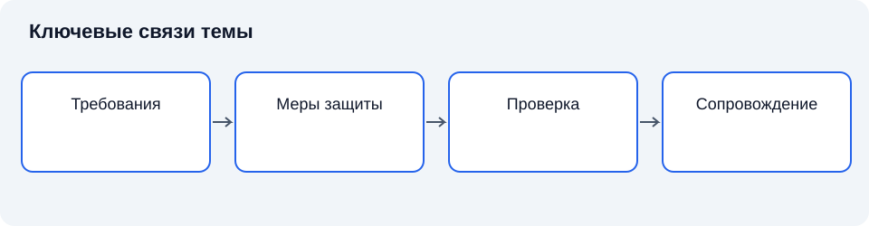

# Лекция 4. Обеспечение безопасности значимых объектов КИИ

Дисциплина: «Основы информационной безопасности». Пункт РП: 1.4.

**Цель:** раскрыть логику формирования, реализации и проверки требований защиты.

**Задачи:** определить основные понятия темы; объяснить их взаимосвязь; установить границы применимости рассмотренных подходов.

## Введение

Категория показывает значимость объекта, но не описывает все необходимые действия по защите. Перейдём от статуса объекта к инженерным решениям. Наша задача — увидеть, почему требования должны связываться с угрозами, функциями и доказательствами выполнения.

## Схема темы

*Рисунок 4. Упрощённые связи понятий. Схема поясняет текст и не заменяет условия применения правил.*

## 1. Требование и мера

**Требование безопасности** — условие или свойство, которое должно выполняться для достижения установленной цели защиты. **Мера защиты** — организационное действие или технический механизм, реализующий такое условие. Требование ограничить доступ можно реализовать несколькими согласованными мерами: учётом субъектов, проверкой полномочий, настройкой интерфейсов и контролем журналов [5].

Формальное наличие средства не гарантирует выполнения требования. Механизм должен охватывать необходимые ресурсы, работать в применимых режимах и сохранять свойства при изменениях. Для значимых объектов правовую основу конкретизируют специальные акты, включая требования к созданию систем безопасности и обеспечению безопасности объектов; их применимость устанавливают отдельно [6].

### 1.1. Краткий конспект

Требование описывает необходимое свойство, мера — способ его обеспечить. Между ними нужна проверяемая связь.

## 2. Многоуровневая защита

**Эшелонирование защиты** предполагает несколько согласованных рубежей, снижающих вероятность или последствия нарушения. Его ценность зависит от независимости предпосылок. Две проверки, использующие одну скомпрометированную базу полномочий, могут отказать одновременно [1].

Полезно различать предотвращение, обнаружение и восстановление. Предотвращение снижает возможность реализации сценария; обнаружение сокращает период неопределённости; восстановление возвращает необходимые функции. Ни один класс не заменяет остальные. Классическая идея экономичности механизмов у Солтцера и Шрёдера напоминает, что сложность защиты сама создаёт условия ошибок: больше компонентов не всегда означает больше уверенности [3].

### 2.1. Краткий конспект

Рубежи оцениваются по функциям и независимости. Сложность должна быть обоснована.

## 3. Жизненный цикл защиты

**Управление изменениями** — контролируемое рассмотрение, согласование, выполнение и проверка изменений системы. Новая версия приложения может устранить уязвимость, но нарушить совместимость со средством контроля. Поэтому защиту рассматривают на протяжении проектирования, внедрения, эксплуатации и вывода из эксплуатации [2; 5].

Эксплуатационная документация должна объяснять допустимые состояния, ответственность и порядок восстановления. Запись о выполненной операции позволяет воспроизвести основания решения. Однако накопление документов само по себе не создаёт управляемости: записи должны соответствовать реальным действиям и помогать выявлять отклонения.

### 3.1. Краткий конспект

Защита меняется вместе с объектом. Контроль изменений поддерживает согласованность функций и мер.

## 4. Доказательства и ограничения

**Проверка выполнения требования** — сопоставление наблюдаемого состояния с заранее установленным условием. Доказательствами могут служить результаты испытаний, настройки, записи событий и подтверждённые процедуры. Они имеют область действия: испытание одного режима не доказывает защищённость всех остальных [4; 5].

Нужно различать качество механизма и качество эксплуатации. Правильно разработанное средство может быть отключено, неправильно настроено или не охватывать новый ресурс. Обратная связь связывает результаты контроля с пересмотром мер. Остаточный риск не исчезает после приёмки; он становится предметом осознанного управленческого решения в пределах допустимых требований.

### 4.1. Краткий конспект

Доказательство ограничено проверенными условиями. Эксплуатационный контроль необходим после внедрения.

## Заключение

Мы завершили вводный раздел о КИИ. Дальше систематизируем понятия информационной безопасности, чтобы описывать требования, угрозы и меры единым языком.

## Вопросы для самопроверки

1. Чем требование отличается от меры?
2. Почему наличие продукта не доказывает защиту?
3. Зачем разделять предотвращение и обнаружение?
4. Когда два рубежа зависимы?
5. Как изменение приложения влияет на защиту?
6. Что доказывает протокол испытания?
7. Почему документация должна отражать действия?
8. Как управляют остаточным риском?

## Глоссарий

- **Требование** — необходимое условие защищённости.
- **Мера** — действие или механизм обеспечения требования.
- **Рубеж** — выделяемый уровень противодействия.
- **Эшелонирование** — сочетание согласованных рубежей.
- **Предотвращение** — снижение возможности реализации сценария.
- **Обнаружение** — выявление признаков нарушения.
- **Восстановление** — возвращение необходимых функций.
- **Изменение** — переход системы в новое состояние.
- **Испытание** — проверка свойств в заданных условиях.
- **Доказательство** — проверяемое основание вывода.
- **Эксплуатация** — использование и сопровождение системы.
- **Остаточный риск** — сохраняющийся после мер риск.

## Список литературы

1. Anderson, R. Security Engineering: A Guide to Building Dependable Distributed Systems / R. Anderson. — 3rd ed. — Hoboken : Wiley, 2020. — Текст : непосредственный.
2. Bishop, M. Computer Security: Art and Science / M. Bishop. — 2nd ed. — Boston : Addison-Wesley, 2018. — Текст : непосредственный.
3. Saltzer, J. H. The Protection of Information in Computer Systems / J. H. Saltzer, M. D. Schroeder // Proceedings of the IEEE. — 1975. — Vol. 63, no. 9. — P. 1278–1308. — DOI 10.1109/PROC.1975.9939. — Текст : электронный.
4. National Institute of Standards and Technology. Guide for Conducting Risk Assessments : NIST SP 800-30 Rev. 1. — Gaithersburg : NIST, 2012. — DOI 10.6028/NIST.SP.800-30r1. — Текст : электронный.
5. National Institute of Standards and Technology. Security and Privacy Controls for Information Systems and Organizations : NIST SP 800-53 Rev. 5. — Gaithersburg : NIST, 2020. — DOI 10.6028/NIST.SP.800-53r5. — Текст : электронный.
6. Российская Федерация. Законы. О безопасности критической информационной инфраструктуры Российской Федерации : Федеральный закон от 26 июля 2017 г. № 187-ФЗ. — URL: http://www.kremlin.ru/acts/bank/42128 (дата обращения: 11.11.2026). — Текст : электронный.

7. Федеральная служба по техническому и экспортному контролю. Требования к созданию систем безопасности значимых объектов критической информационной инфраструктуры Российской Федерации и обеспечению их функционирования : утверждены приказом ФСТЭК России от 21 декабря 2017 г. № 235. — Текст : электронный.
8. Федеральная служба по техническому и экспортному контролю. Требования по обеспечению безопасности значимых объектов критической информационной инфраструктуры Российской Федерации : утверждены приказом ФСТЭК России от 25 декабря 2017 г. № 239. — Текст : электронный.
