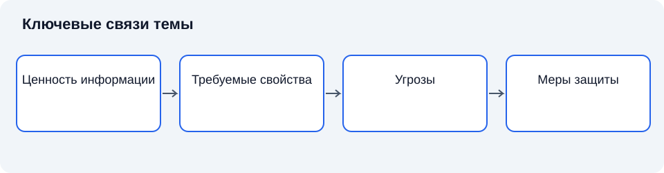

# Лекция 5. Сущность информационной безопасности: термины и определения

Дисциплина: «Основы информационной безопасности». Пункт РП: 2.1.

**Цель:** сформировать системное понимание свойств информации и целей защиты.

**Задачи:** определить основные понятия темы; объяснить их взаимосвязь; установить границы применимости рассмотренных подходов.

## Введение

После рассмотрения КИИ перейдём к общим понятиям. Они нужны, чтобы сравнивать различные системы, не подменяя анализ перечислением продуктов. Защищённость всегда относится к определённым ресурсам, субъектам, условиям и последствиям.

## Схема темы

*Рисунок 5. Упрощённые связи понятий. Схема поясняет текст и не заменяет условия применения правил.*

## 1. Информация и её представление

**Информация** связана со сведениями, которые интерпретируются участником деятельности. **Данные** — представление сведений в форме, пригодной для хранения, передачи и обработки. **Носитель** — материальная среда такого представления. Разграничение важно: уничтожение одного носителя не означает уничтожения всех копий сведений [1; 2].

Смысл зависит от контекста. Последовательность символов становится командой только в определённой системе интерпретации. Поэтому защита должна учитывать не только сохранность байтов, но и корректность использования: достоверные данные, применённые вне допустимого контекста, способны привести к ошибочному решению.

### 1.1. Краткий конспект

Информация, данные и носитель описывают разные стороны объекта защиты.

## 2. Основные свойства безопасности

**Конфиденциальность** означает сохранение установленных ограничений на доступ и раскрытие. **Целостность** связана с защитой от неправомерного изменения и разрушения. **Доступность** означает возможность уполномоченного использования при необходимых условиях [2; 5].

Эти свойства не образуют универсальную шкалу важности. Для опубликованного расписания конфиденциальность может не требоваться, тогда как целостность остаётся существенной. Доступность нельзя понимать как открытость всем: она относится к уполномоченным субъектам. Целостность также не означает запрет любых изменений — разрешённое обновление является нормальной функцией системы.

### 2.1. Краткий конспект

Свойства формулируются относительно разрешённых действий. Приоритет зависит от назначения.

## 3. Политика и механизм

**Политика безопасности** определяет разрешённые и запрещённые состояния и действия. **Механизм защиты** обеспечивает выполнение конкретных ограничений. Политика отвечает на вопрос о допустимости, механизм — о способе контроля [2; 3].

Правильно работающий механизм может реализовывать ошибочную политику. Например, точная проверка полномочий не спасает от чрезмерных полномочий, выданных всем сотрудникам. Поэтому проверка защиты включает анализ правила и анализ его исполнения. Принцип минимальных привилегий требует обосновывать предоставляемые возможности действительной потребностью.

### 3.1. Краткий конспект

Ошибки политики и ошибки реализации различаются и требуют разных способов исправления.

## 4. Безопасность как управляемое свойство

**Риск** выражает связь неопределённости реализации угроз с последствиями для целей деятельности. Простое произведение вероятности и ущерба применимо лишь при обоснованных числовых предпосылках; это не универсальное определение [4].

Абсолютная защищённость без указания условий не проверяема. Инженерное утверждение должно содержать границы системы, принятые возможности нарушителя, доверенные компоненты и критерий результата. Такое описание делает вывод ограниченным, но содержательным. Историческое развитие защиты многопользовательских систем показало, что разделение полномочий и контроль обращений являются фундаментальными задачами, а не свойствами одного продукта [3].

### 4.1. Краткий конспект

Обоснованная оценка указывает условия и пределы уверенности.

## Заключение

Общие понятия образуют язык дальнейшего курса. На следующей лекции свяжем ресурсы, угрозы, уязвимости и меры в концептуальную модель.

## Вопросы для самопроверки

1. Чем данные отличаются от носителя?
2. Почему копии меняют задачу защиты?
3. Что означает доступность для уполномоченного пользователя?
4. Почему целостность допускает изменения?
5. Чем политика отличается от механизма?
6. Как избыточные права нарушают минимальные привилегии?
7. Когда числовая формула риска обоснована?
8. Какие условия необходимы для проверяемого утверждения о защите?

## Глоссарий

- **Информация** — интерпретируемые сведения.
- **Данные** — представление сведений для обработки.
- **Носитель** — материальная среда представления.
- **Конфиденциальность** — сохранение ограничений на доступ и раскрытие.
- **Целостность** — защита от неправомерных изменений.
- **Доступность** — возможность уполномоченного использования.
- **Политика** — правила допустимых действий.
- **Механизм** — средство выполнения ограничений.
- **Привилегия** — предоставленная возможность действия.
- **Риск** — связь неопределённости и последствий.
- **Доверие** — принятое предположение о поведении компонента.
- **Защищённость** — состояние выполнения требований безопасности.

## Список литературы

1. Anderson, R. Security Engineering: A Guide to Building Dependable Distributed Systems / R. Anderson. — 3rd ed. — Hoboken : Wiley, 2020. — Текст : непосредственный.
2. Bishop, M. Computer Security: Art and Science / M. Bishop. — 2nd ed. — Boston : Addison-Wesley, 2018. — Текст : непосредственный.
3. Saltzer, J. H. The Protection of Information in Computer Systems / J. H. Saltzer, M. D. Schroeder // Proceedings of the IEEE. — 1975. — Vol. 63, no. 9. — P. 1278–1308. — DOI 10.1109/PROC.1975.9939. — Текст : электронный.
4. National Institute of Standards and Technology. Guide for Conducting Risk Assessments : NIST SP 800-30 Rev. 1. — Gaithersburg : NIST, 2012. — DOI 10.6028/NIST.SP.800-30r1. — Текст : электронный.
5. National Institute of Standards and Technology. Security and Privacy Controls for Information Systems and Organizations : NIST SP 800-53 Rev. 5. — Gaithersburg : NIST, 2020. — DOI 10.6028/NIST.SP.800-53r5. — Текст : электронный.
6. Российская Федерация. Законы. О безопасности критической информационной инфраструктуры Российской Федерации : Федеральный закон от 26 июля 2017 г. № 187-ФЗ. — URL: http://www.kremlin.ru/acts/bank/42128 (дата обращения: 11.11.2026). — Текст : электронный.
