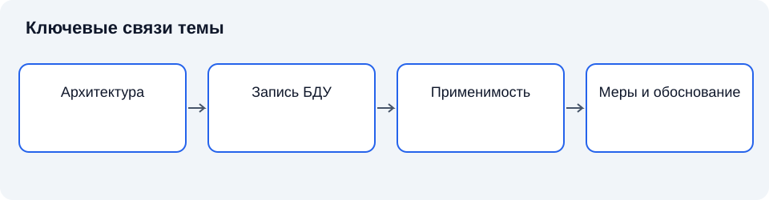

# Лекция 7. Банк данных угроз ФСТЭК России, объекты воздействия и информационные ресурсы

Дисциплина: «Основы информационной безопасности». Пункт РП: 2.3.

**Цель:** объяснить использование каталога угроз при анализе ресурсов организации.

**Задачи:** определить основные понятия темы; объяснить их взаимосвязь; установить границы применимости рассмотренных подходов.

## Введение

Концептуальная модель задаёт связи, но специалисту необходимы сведения о известных сценариях воздействия. Каталоги помогают использовать накопленный опыт. Их применение требует отбора и интерпретации: внешний перечень не знает всех особенностей конкретной системы.

## Схема темы

*Рисунок 7. Упрощённые связи понятий. Схема поясняет текст и не заменяет условия применения правил.*

## 1. Назначение каталога угроз

**Банк данных угроз безопасности информации ФСТЭК России** — официальный информационный ресурс, содержащий сведения об угрозах и уязвимостях. Каталог обеспечивает общую терминологическую опору и позволяет сопоставлять описания. При работе необходимо различать сведения об угрозах и сведения об уязвимостях: они относятся к разным уровням модели [4].

Карточка угрозы не является готовой моделью организации. Наличие записи означает, что описан определённый сценарий или класс воздействий, но применимость устанавливают по составу системы и условиям. Идентификатор служит устойчивой ссылкой, а не оценкой вероятности. Адрес официального ресурса [7]: https://bdu.fstec.ru/.

### 1.1. Краткий конспект

Каталог поддерживает анализ, но не заменяет обоснование актуальности.

## 2. Информационные ресурсы

**Информационный ресурс организации** — организованные сведения и связанные средства их использования, имеющие значение для деятельности. Для анализа полезно отделять содержание данных, сервис, базу, экземпляры копий и средства обработки [1; 2].

Ресурс может существовать одновременно в нескольких местах: основной базе, резервной копии, выгрузке и журнале. У каждого представления отличаются доступные субъекты и пути воздействия. Поэтому инвентаризация должна учитывать не только серверы, но и потоки данных, владельцев процессов и внешних участников. Название ресурса без описания функции недостаточно для оценки последствий.

### 2.1. Краткий конспект

Разные представления одного набора сведений требуют самостоятельного рассмотрения путей воздействия.

## 3. Объекты воздействия

**Объект воздействия** — компонент, данные, процесс или иная выделяемая часть системы, на которую направлено воздействие. Объект непосредственного воздействия может отличаться от актива, для которого наступают последствия [4; 5].

Нарушение работы средства аутентификации способно сделать недоступными несколько сервисов. Слабость журнала может затруднить расследование, даже если основные данные сохранились. Причинная цепочка должна объяснять такие переходы. Для каждого объекта уточняют интерфейсы, состояния, зависимости и контролирующие механизмы; это позволяет избежать формального копирования общих описаний.

### 3.1. Краткий конспект

Непосредственный объект и конечный ущерб не всегда находятся на одном уровне системы.

## 4. От карточки к модели

**Адаптация сценария** — конкретизация общего описания применительно к границам, ресурсам и условиям объекта. Сначала устанавливают наличие необходимых компонентов, затем доступный путь воздействия, возможности источника и ожидаемые последствия [3; 4].

Отсутствие подходящей записи в каталоге не позволяет исключить угрозу, если её сценарий следует из архитектуры. Напротив, известная запись может быть неприменима при отсутствии необходимой функции. Решение должно сопровождаться обоснованием и версией использованных сведений. Изменение каталога само по себе не меняет объект, но служит основанием пересмотреть прежние предположения.

### 4.1. Краткий конспект

Обоснованный отбор фиксирует как включение, так и исключение сценариев.

## Заключение

Каталог даёт материал для рассуждения, а модель организации определяет его значение. Следующая лекция уточнит, как описывать источники угроз и цели воздействия.

## Вопросы для самопроверки

1. Чем каталог отличается от модели угроз?
2. Почему идентификатор не является вероятностью?
3. Какие представления данных включают в инвентаризацию?
4. Чем объект воздействия отличается от актива?
5. Почему отказ одного компонента затрагивает несколько сервисов?
6. Какие условия проверяют при адаптации карточки?
7. Можно ли рассматривать угрозу, которой нет в каталоге?
8. Зачем фиксировать дату использованных сведений?

## Глоссарий

- **БДУ** — банк данных угроз безопасности информации.
- **Каталог** — систематизированная совокупность описаний.
- **Карточка** — структурированное описание отдельной записи.
- **Идентификатор** — обозначение записи для ссылки.
- **Ресурс** — значимые сведения и средства их использования.
- **Копия** — дополнительное представление данных.
- **Поток** — передача данных между участниками.
- **Объект воздействия** — часть системы, непосредственно подвергаемая воздействию.
- **Адаптация** — конкретизация общего сценария.
- **Отбор** — обоснованное включение или исключение.
- **Версия** — зафиксированное состояние сведений.
- **Инвентаризация** — систематический учёт ресурсов.

## Список литературы

1. Anderson, R. Security Engineering: A Guide to Building Dependable Distributed Systems / R. Anderson. — 3rd ed. — Hoboken : Wiley, 2020. — Текст : непосредственный.
2. Bishop, M. Computer Security: Art and Science / M. Bishop. — 2nd ed. — Boston : Addison-Wesley, 2018. — Текст : непосредственный.
3. Saltzer, J. H. The Protection of Information in Computer Systems / J. H. Saltzer, M. D. Schroeder // Proceedings of the IEEE. — 1975. — Vol. 63, no. 9. — P. 1278–1308. — DOI 10.1109/PROC.1975.9939. — Текст : электронный.
4. National Institute of Standards and Technology. Guide for Conducting Risk Assessments : NIST SP 800-30 Rev. 1. — Gaithersburg : NIST, 2012. — DOI 10.6028/NIST.SP.800-30r1. — Текст : электронный.
5. National Institute of Standards and Technology. Security and Privacy Controls for Information Systems and Organizations : NIST SP 800-53 Rev. 5. — Gaithersburg : NIST, 2020. — DOI 10.6028/NIST.SP.800-53r5. — Текст : электронный.
6. Российская Федерация. Законы. О безопасности критической информационной инфраструктуры Российской Федерации : Федеральный закон от 26 июля 2017 г. № 187-ФЗ. — URL: http://www.kremlin.ru/acts/bank/42128 (дата обращения: 11.11.2026). — Текст : электронный.

7. Федеральная служба по техническому и экспортному контролю. Банк данных угроз безопасности информации. — URL: https://bdu.fstec.ru/ (дата обращения: 11.11.2026). — Текст : электронный.
