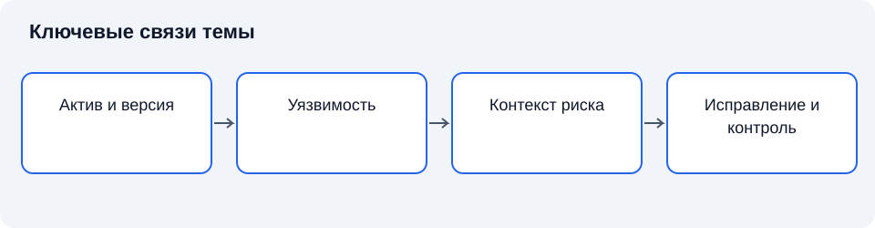

# Лекция 9. Уязвимости: понятие, классификация и оценка

**Дисциплина:** Основы информационной безопасности.

**Цель:** Объяснить, как свойства системы создают условия реализации угроз и как эти условия исследуют и устраняют.

**Задачи:** различить угрозу, слабость и риск; классифицировать причины уязвимостей; проверять применимость записи; объяснить цикл исправления.

## Введение

После рассмотрения источников угроз необходимо понять, почему один и тот же источник способен воздействовать на одни системы и не способен воздействовать на другие. Ответ связан с уязвимостями, условиями эксплуатации и границами доверия.

План занятия: понятие уязвимости и причинная цепочка; основания классификации; описание, идентификаторы и оценка опасности; управление уязвимостями.

## Схема темы

*Рисунок 9. Упрощённые связи понятий. Схема поясняет текст и не заменяет условия применения правил.*

## 1. Понятие уязвимости и причинная цепочка

**Уязвимость** — слабость системы, её процедур, механизмов управления или реализации, которая может быть использована либо вызвана источником угрозы и привести к неблагоприятным последствиям. Такое определение охватывает программные ошибки, архитектурные недостатки и организационные условия. Оно не означает, что любой недостаток автоматически становится успешной атакой. Для реализации сценария нужны доступность слабого места, необходимые возможности источника и конкретные условия [4].

Разделим три понятия. Угроза описывает возможность нежелательного воздействия; уязвимость характеризует слабое место; риск связывает возможность события с его последствиями в заданном контексте. Уязвимость существует в системе, угроза относится к сценарию воздействия, а риск оценивается относительно интересов владельца ресурсов. Подмена этих понятий делает анализ непроверяемым: нельзя устранить «высокий риск» одной командой, не установив его причин.

**Поверхность атаки** — совокупность доступных точек взаимодействия, через которые возможно воздействие на систему. Открытый интерфейс сам по себе не обязательно является уязвимостью: он может быть предусмотренной функцией. Уязвимость появляется, например, когда интерфейс допускает действие вопреки политике доступа. Уменьшение поверхности атаки сокращает число доступных путей, однако не доказывает отсутствие ошибок в оставшихся компонентах.

Отдельно различают проектную и реализационную слабость. Первая возникает из неверного распределения доверия, чрезмерных полномочий или отсутствия необходимой проверки. Вторая связана с тем, как правильное требование воплощено в коде и настройках. Исправление реализации не всегда устраняет проектную причину: можно корректно проверить пароль, но продолжать предоставлять каждому пользователю права администратора [2].

### 1.1. Намеренное и случайное возникновение условий

Источником неблагоприятного воздействия может быть нарушитель, ошибающийся пользователь, отказ оборудования или внешнее событие. Уязвимость не требует злого умысла для своего проявления. Неограниченный рост очереди способен остановить сервис как при специально сформированном воздействии, так и при неожиданном увеличении законной нагрузки. Причины различаются, но условие недостаточности ресурса может быть общим.

Это наблюдение не отменяет разделения угроз. Намеренный противник способен выбирать момент, сочетать действия и адаптироваться к ответным мерам. Случайный поток обычно описывается иной моделью. Поэтому устойчивость к среднему объёму законной нагрузки не доказывает устойчивость к целенаправленному воздействию. И наоборот, средства обнаружения атак не заменяют проектирования достаточной производительности.

**Предпосылка безопасности** — условие, на истинность которого опирается выбранное обоснование защиты. К таким условиям относятся недоступность ключей посторонним, корректность доверенного компонента, выполнение правил обновления и отсутствие определённых физических воздействий. Предпосылки необходимо делать явными. Иначе исследователь проверяет систему в одном наборе условий, а эксплуатирующая сторона использует её в другом.

Уязвимость может существовать внутри компонента, а может возникать на его стыке с другим компонентом. Каждый из двух модулей по отдельности способен выполнять собственную спецификацию, но их соединение создаёт опасное поведение. Например, один компонент считает вход уже проверенным, а другой предполагает, что проверку выполнит получатель. Анализ интерфейса должен устанавливать, кто именно отвечает за каждое существенное условие.

### 1.2. Уязвимость и защищённость отдельного экземпляра

Публикация уязвимости продукта относится к определённому множеству затронутых реализаций. Организация же эксплуатирует конкретные экземпляры. Установить наличие названия продукта недостаточно: важны версия, поставка, включённые функции, параметры и взаимодействующие компоненты. В то же время отсутствие известного номера версии в реестре не позволяет произвольно объявить экземпляр безопасным. Неизвестное состояние требует уточнения.

**Инвентаризация** — установление состава и характеристик активов для последующего управления. В контексте уязвимостей она связывает опубликованное описание с фактическими экземплярами. Полезность инвентаризации зависит от актуальности. Реестр, не отражающий временные узлы, тестовые среды и восстановленные образы, создаёт систематический пробел обследования.

Отдельно учитываются зависимости. Приложение может включать библиотеку, которая не представлена пользователю как самостоятельный продукт. Название основного приложения не объясняет состав встроенных компонентов. Поэтому подтверждение применимости иногда требует сведений о поставке и сборке. Это организационная задача взаимодействия с владельцами и поставщиками, а не только запуск одного сканера.

Проверенный экземпляр может перестать соответствовать исследованному состоянию после изменения. Если обновлена библиотека, изменён сетевой путь или подключена новая интеграция, необходимо оценить влияние на прежний вывод. Безопасность относится к состоянию системы и условиям, а не бессрочно прикрепляется к названию оборудования.

### 1.3. Наблюдаемое поведение и скрытое условие

Уязвимость нельзя свести к одному наблюдаемому сообщению об ошибке. Сообщение представляет собой результат работы системы, тогда как слабое место относится к причинному устройству. Программа может аварийно завершаться из-за случайного повреждения оборудования, некорректных исходных данных или недостаточного контроля границ. Одинаковая внешняя картина не доказывает одинаковой причины. Поэтому исследование начинается с точного описания того, что наблюдалось, и отдельно формулирует гипотезу о причине.

**Свидетельство уязвимости** — проверяемое наблюдение или совокупность сведений, подтверждающих наличие определённого слабого места. Свидетельством может быть анализ реализации, воспроизводимый результат безопасного испытания, установленное нарушение конфигурационного требования или достоверное уведомление поставщика. Каждое свидетельство имеет область действия. Уведомление о затронутой версии не подтверждает наличие этой версии на конкретном узле. Наличие версии не всегда подтверждает включение функции, необходимой для сценария.

Полезно разделять утверждения на три уровня. Первый уровень — факт о составе: определённый компонент действительно установлен. Второй — факт об условии: затронутая функция работает при параметрах, указанных в описании. Третий — вывод о возможном последствии: источник угрозы при данных возможностях способен воздействовать на значимый ресурс. Проверка первого уровня не заменяет двух следующих. Вместе с тем отсутствие сведений о третьем уровне не отменяет установленного факта слабости.

В учебной и профессиональной речи встречается выражение «потенциальная уязвимость». Его следует использовать осторожно. Иногда речь идёт о подозрении, которое ещё не подтверждено. Иногда слабость подтверждена, но неизвестна возможность её использования в конкретной среде. Иногда просто рассматривается теоретический класс ошибок. Эти ситуации различаются по степени знания и требуемым действиям. В отчёте лучше прямо писать, что именно установлено и что требует проверки.

Противоположная ошибка — считать слабостью всё необычное поведение. Нестандартный ответ, открытый порт и наличие административной функции могут быть предусмотрены проектом. Для вывода необходимы требование и нарушение его исполнения. Если требование запрещает предоставление административной функции из внешней сети, доступность такого интерфейса становится значимым условием. Если функция изолирована в разрешённой области и корректно проверяет полномочия, одно её существование не доказывает нарушение.

### 1.4. Связь уязвимостей с надёжностью и качеством

**Надёжность** характеризует способность выполнять требуемые функции в установленных условиях в течение заданного времени. Безопасность рассматривает выполнение требований при нежелательных воздействиях, включая действия противника. Между ними есть пересечение: отказ ресурса может нарушать доступность, а недостаточная проверка ошибок — создавать опасные состояния. Но тождество отсутствует. Надёжно работающая функция может стабильно предоставлять данные не тому получателю.

Качество программного продукта также шире безопасности. Удобство, производительность, сопровождаемость и совместимость влияют на защищённость косвенно и прямо. Слишком сложная процедура доступа способна побуждать пользователей создавать обходные способы работы. Недостаточная сопровождаемость увеличивает трудность исправления. Низкая производительность защиты может нарушать доступность. Поэтому безопасность нельзя добавлять к качеству как полностью независимый внешний модуль.

Вместе с тем удобство не оправдывает произвольное снятие ограничений. Требуется анализировать задачу пользователя и находить способ её выполнения при сохранении требований. Если сотрудники регулярно обходят процедуру, полезно установить причину: недостаток обучения, неясность правила, отсутствие необходимой функции или несоответствие процесса реальной деятельности. Назвать всё «человеческим фактором» означает потерять причинную информацию.

Организационная слабость отличается от моральной оценки человека. Отсутствие ответственного за обновления, невозможность проверить права и неучтённая передача оборудования создают условия, которые могут воспроизводиться при смене сотрудников. Их устранение требует изменения распределения функций и контроля. Персональная дисциплина важна, но она не заменяет ясного процесса.

Краткий итог подразделов: факты и гипотезы разделяются; слабость относится к нарушению требования; безопасность исследуется через состояния, переходы и предпосылки; качество, надёжность и защищённость связаны, но не взаимозаменяемы.

### 1.5. Краткий вывод

Уязвимость — слабое место, угроза — возможность воздействия, риск учитывает условия и последствия. Слабость компонента должна быть сопоставлена с конкретной конфигурацией и достижимыми путями воздействия.

## 2. Основания классификации

Классификация полезна, когда её признаки отвечают цели исследования. По происхождению выделяют ошибки требований, проектирования, программирования, конфигурирования и эксплуатации. По месту проявления рассматривают прикладное программное обеспечение, операционную систему, оборудование, сетевую инфраструктуру и организационные процессы. По нарушаемому свойству оценивают влияние на конфиденциальность, целостность и доступность. Эти основания независимы: одна слабость может иметь несколько последствий.

**Ошибка конфигурации** — состояние параметров системы, не соответствующее требованиям безопасности или условиям безопасной работы. Её нельзя считать менее важной только потому, что программный код формально исправен. Если резервная копия доступна всем пользователям, свойства основного хранилища не предотвращают чтение копии. Объект защиты должен включать все представления данных.

Слабости контроля доступа возникают, когда решение о разрешении операции отсутствует, применяется к неправильному объекту или обходится через иной путь. Проверка только интерфейса пользователя недостаточна: решение должно действовать на стороне компонента, управляющего объектом. Здесь проявляется принцип полного посредничества: каждый существенный доступ должен проходить через механизм проверки [3].

**Граница доверия** отделяет компоненты или области с различными предположениями о допустимых действиях. Данные, пересекающие такую границу, нельзя автоматически считать достоверными. Проверка формата, проверка полномочий и проверка допустимости бизнес-операции решают разные задачи. Корректно сформированный запрос может быть запрещён конкретному субъекту.

Уязвимости доступности не сводятся к сетевому потоку. Неограниченное потребление памяти, блокировка ресурса без освобождения, отсутствие резервирования и ошибки восстановления также могут сделать сервис недоступным. При этом отсутствие резервирования оценивается относительно требований: одинаковая архитектура может быть допустимой для учебного стенда и неприемлемой для критического процесса [1].

### 2.1. Классы слабостей и конкретные случаи

**Класс слабостей** объединяет причины или конструкции, способные приводить к сходным нарушениям. **Конкретная уязвимость** относится к определённому продукту, версии, функции или конфигурации. Различие позволяет совместить два уровня работы. На уровне конкретного случая устанавливается исправление; на уровне класса совершенствуются требования, архитектура и процесс разработки.

В профессиональной практике CWE используется для описания типов слабостей, а CVE — для идентификации опубликованных записей о конкретных уязвимостях. Их обозначения нельзя считать взаимозаменяемыми. Одна причина может проявиться в разных продуктах, а один конкретный случай иногда связан с несколькими типами слабостей. БДУ ФСТЭК является отдельным источником сведений, поэтому сопоставление записей требует проверки содержания и указанных связей, а не совпадения числовых частей обозначения.

Рассмотрим несколько классов без разбора способов эксплуатации. Недостаточная проверка полномочий означает, что субъект получает действие вне своей области разрешений. Неверная обработка границ ресурса связана с обращениями за пределами предусмотренного пространства или допустимого состояния. Неограниченное выделение ресурсов создаёт возможность исчерпания памяти, времени или числа соединений. Нарушение порядка проверки и использования возникает, когда состояние, обоснованное при проверке, успевает измениться до выполнения действия.

Эти классы не следует смешивать с последствиями. Раскрытие данных является нарушением конфиденциальности, но оно может возникнуть из ошибки полномочий, неверной изоляции, недостаточной защиты копии или слабости обработки памяти. Если классифицировать всё только как «утечку», профилактика будет слишком общей. Для предотвращения повторения нужно сохранять причинный уровень описания.

### 2.2. Управление ресурсами как источник слабостей

Ресурсом является не только файл или запись базы. Память, процессорное время, число соединений, очередь задач, место хранения и возможность блокировки также ограничены. Система должна определять, кто вправе потреблять ресурс, в каком объёме и как он возвращается после завершения. Отсутствие этих правил способно привести к нарушению доступности даже при корректном контроле чтения и изменения данных.

**Исчерпание ресурса** — состояние, при котором необходимый ресурс перестаёт быть доступным для законной деятельности вследствие чрезмерного расходования или невозможности освобождения. Причиной бывает единичная операция с неоправданно большим потреблением, накопление незавершённых действий или ошибка учёта. Внешний симптом сходен, но профилактика различается: ограничение допустимого объёма, управление очередью, тайм-ауты и корректное освобождение решают разные задачи.

Ограничение также может создавать нежелательные последствия. Слишком жёсткий предел блокирует законную работу, а единый предел для всех субъектов позволяет одному участнику повлиять на остальных. Следовательно, ресурсная политика должна учитывать изоляцию, справедливость распределения и приоритеты функций. Это показывает, почему доступность нельзя свести к максимальной производительности: существенна возможность выполнить необходимую задачу при неблагоприятном распределении нагрузки.

Блокировки обеспечивают согласованность доступа к общему состоянию, но неправильное использование может остановить выполнение. Если операция удерживает ресурс неопределённо долго, другие участники остаются в ожидании. При анализе учитывают условия получения и освобождения, возможность отмены и последствия частичного завершения. Эти вопросы относятся к архитектуре состояний, а не только к настройке сетевого устройства.

**Деградация** означает ухудшение характеристик без полного прекращения работы. Для пользователя различие между полным отказом и задержкой, превышающей допустимый срок, может быть несущественным: задача всё равно не выполнена вовремя. Поэтому при описании последствий необходимо использовать требования процесса. Утверждение «сервер отвечает» не доказывает сохранение доступности в требуемом смысле.

### 2.3. Изоляция и совместное использование

Совместное использование ресурсов повышает эффективность, но создаёт связи между участниками. Даже если данные размещены отдельно, общий управляющий компонент или общий предел потребления может допускать взаимное влияние. **Изоляция** — ограничение нежелательного взаимодействия между областями исполнения и ресурсами. Её нельзя оценивать только по визуальному разделению интерфейсов.

На логическом уровне устанавливаются отдельные пространства имён, права и контексты выполнения. На архитектурном уровне рассматриваются общие службы, управление, хранилища и коммуникации. На эксплуатационном уровне учитываются общие административные полномочия и процедуры обслуживания. Слабость одного уровня способна сделать бессмысленным разделение на другом.

При исследовании изоляции важно различать запланированное взаимодействие и нарушение границы. Сервис может законно получать данные из другой области через определённый интерфейс. Требование состоит не в полном отсутствии связей, а в ограничении их содержания и условий. Избыточно широкая связь превращает посредника в носителя полномочий, которые не требуются его функции.

**Доверенная вычислительная база** — совокупность компонентов, от корректности которых зависит исполнение рассматриваемой политики безопасности. Включение компонента в такую базу не означает его безошибочности. Напротив, оно указывает, что ошибка этого компонента имеет особую значимость. Уменьшение объёма доверенной базы облегчает анализ, но должно сопровождаться проверкой реальных зависимостей [2].

Техническое разделение пользователей не устраняет доверие к администратору автоматически. Если администратор управляет механизмом, от него зависит реализация ограничения. Для повышения устойчивости применяются распределение полномочий, контроль значимых действий и отдельные средства подтверждения. Однако эти меры также имеют предпосылки и не должны описываться как абсолютная защита от любого внутреннего источника.

### 2.4. Данные, команды и неоднозначность интерпретации

Система получает сообщения, которые должны интерпретироваться по установленным правилам. Слабость возникает, когда компонент придаёт внешним данным смысл управляющей конструкции вопреки ожидаемому ограничению. В фундаментальном анализе важно не конкретное название приёма, а нарушение границы между описанием содержания и указанием действия. Проверка длины сообщения не решает автоматически проблему его смысла.

**Проверка входных данных** устанавливает соответствие входа допустимому формату и ограничениям предметной области. **Кодирование для контекста** обеспечивает корректное представление данных в конкретной среде. **Проверка полномочий** определяет допустимость действия для субъекта. Эти механизмы выполняют разные функции. Корректный формат не даёт права изменить объект; наличие права не делает любое представление безопасным для обработки.

Неоднозначная интерпретация особенно существенна на стыке компонентов. Один участник считает пробельный символ разделителем, другой — частью значения; один использует один порядок нормализации, другой — иной. Если решение о доступе принимается до преобразования, а обращение к объекту — после него, может нарушиться соответствие между проверенным и использованным представлением. Предмет проверки должен совпадать с предметом действия.

Сведения о таких классах полезны для разработки требований и проверки архитектуры. Однако общая фраза «очищать все данные» недостаточна и иногда вводит в заблуждение. Необходимо знать контекст, допустимый язык сообщений и точку преобразования. Универсальная фильтрация может как пропустить значимое различие, так и повредить законное содержание.

### 2.5. Краткий вывод

Классифицировать слабости можно по причине, уровню системы и затрагиваемому свойству. CWE обозначает класс слабостей, CVE — учётную запись конкретной уязвимости; один признак не заменяет полного описания.

## 3. Описание, идентификаторы и оценка опасности

**Идентификатор уязвимости** — обозначение записи в определённой системе учёта. Он помогает однозначно сопоставлять сообщения, но не заменяет техническое описание. Для применения записи необходимо установить продукт, версию, конфигурацию, необходимые права и доступность уязвимого компонента. Совпадение названия продукта ещё не доказывает применимость сообщения.

Банк данных уязвимостей и угроз — источник сведений для анализа. Запись об уязвимости обычно содержит описание и условия проявления; сведения об угрозе описывают возможный сценарий воздействия. Их нельзя механически смешивать. Идентификатор из одного каталога не означает, что в другом каталоге существует запись с тем же номером.

**Опасность уязвимости** характеризует технический потенциал неблагоприятного воздействия при определённых предположениях. **Риск организации** дополнительно зависит от ценности ресурса, его доступности источнику угрозы, защитных мер и последствий для деятельности. Поэтому одинаковая техническая оценка не задаёт одинаковый приоритет исправления на всех узлах [4].

Рассмотрим последовательность проверки. Сначала подтверждают наличие затронутого компонента. Затем выясняют версию и условия эксплуатации. После этого исследуют доступные пути воздействия и действующие ограничения. Наконец определяют последствия для процессов и принимают решение. Пропуск любого звена превращает анализ в сортировку чисел без связи с системой.

Сканирование выявляет признаки, доступные конкретному инструменту. Оно может давать ложные положительные результаты и пропускать слабости. Обнаружение требует подтверждения; отсутствие находок не является доказательством безопасности. Особенно трудно автоматизировать проверку смысловых нарушений, когда разрешённые по отдельности операции в совокупности нарушают правило деятельности [2].

### 3.1. Содержание качественного описания

Описание слабого места должно позволять независимому специалисту понять границы утверждения. Для этого указывают затронутый компонент, условия проявления, ожидаемое поведение, фактическое нарушение и возможные последствия. Если хотя бы одна часть отсутствует, читатель вынужден достраивать смысл. Такая достройка особенно опасна, когда принимается решение о срочном изменении работающей системы.

Название записи служит кратким ориентиром и неизбежно сокращает содержание. Нельзя определять применимость только по заголовку. Термин «удалённое воздействие» не говорит сам по себе, требуется ли предварительная аутентификация, включённая функция или определённый контекст. Термин «повышение привилегий» не определяет, какие исходные права и какие новые возможности рассматриваются. Полное описание и указанные условия имеют приоритет перед краткой меткой.

**Диапазон затронутых версий** задаёт область известных реализаций, к которым относится сообщение. В нём могут быть исключения, ветви сопровождения и отдельные поставки. Номер версии не всегда является простой десятичной величиной, поэтому арифметическое сравнение обозначений может быть неверным. Необходимо использовать правила производителя и сведения о конкретной сборке.

**Статус исправления** характеризует наличие и состояние решения в определённый момент. Он отличается от статуса установки в организации. Производитель мог выпустить исправление, но конкретный экземпляр ещё не обновлён. Возможна и обратная ситуация: организация ограничила сценарий компенсирующей мерой до выпуска исправления. Эти состояния нужно отражать отдельно, иначе отчёт скрывает фактический остаточный риск.

Уведомления обновляются по мере уточнения сведений. Может измениться перечень затронутых версий, оценка последствий или рекомендуемый способ обработки. Поэтому в рабочей записи полезно сохранять дату получения и основание решения. Это позволяет понять, почему прежнее действие было разумным при доступных тогда сведениях и почему оно требует пересмотра теперь.

### 3.2. Условия сложного сценария

Реальные сценарии нередко включают несколько слабостей. Одна создаёт возможность получить исходный доступ, другая расширяет полномочия, третья позволяет воздействовать на целевой ресурс. В такой цепочке значение отдельного условия определяется местом в последовательности. Технически небольшая слабость может быть существенной, если связывает ранее раздельные области доверия.

Это не означает, что любые найденные недостатки можно произвольно соединить в опасную историю. Каждое звено должно быть совместимо с предыдущим по состоянию, полномочиям и доступности. Если первое действие прекращает работу компонента, дальнейшие шаги, требующие его работы, могут стать невозможными. Если условия требуют разных несовместимых конфигураций, цепочка не относится к одному реальному экземпляру.

**Предусловие** — состояние или возможность, необходимые до выполнения действия. **Постусловие** — свойство состояния после действия при выполненных предположениях. Для связного сценария постусловие одного шага должно обеспечивать нужное предусловие следующего. Такое рассуждение помогает проверять причинность без рассмотрения технических приёмов воздействия.

Защитная мера может разрывать цепочку в разных точках. Ограничение исходного доступа уменьшает достижимость; разделение полномочий ограничивает переход; контроль целостности помогает обнаружить результат. Однако обнаружение после наступления последствия не равно предотвращению. Решение должно учитывать допустимое время и возможность восстановления, а не только сам факт регистрации.

Приоритет отдельного исправления зависит от его роли в нескольких сценариях. Если одна архитектурная слабость открывает множество путей, её устранение может иметь больший эффект, чем обработка нескольких частных проявлений. Для такого вывода необходима карта зависимостей, иначе общее утверждение о «ключевой» проблеме остаётся предположением.

### 3.3. Язык профессионального заключения

Профессиональное заключение отделяет утверждение, основание и ограничение. Например, фраза о выявленной затронутой реализации относится к составу; указание включённой функции — к условиям; описание доступности из определённой области — к достижимости. Затем формулируется вывод о возможном нарушении. Такая структура облегчает проверку и последующее обновление при изменении одного условия.

Не следует подменять техническое описание словами «критическая дыра», «полная незащищённость» или «абсолютное устранение риска», если они не определены методикой. Эмоциональное усиление не добавляет сведений. Умеренная формулировка с точными границами полезнее категорического заявления, которое нельзя подтвердить.

Указание ограничения не ослабляет качественный вывод, а делает его применимым. Если проверен один сегмент, результат относится к этому сегменту. Если сведения о версии получены косвенно, степень подтверждения должна быть видна. Если мера временная, это отражается в статусе. Такая дисциплина особенно важна при передаче работы между специалистами: следующий участник не должен угадывать, где факт, а где предположение.

### 3.4. Методы получения уверенности

Разные методы исследования дают разные виды сведений. Анализ документации показывает заявленные функции и условия. Проверка конфигурации устанавливает фактические параметры. Анализ реализации исследует устройство механизма. Испытание наблюдает поведение при выбранных входах и состояниях. Ни один из этих методов не является универсальным заменителем остальных: их результаты относятся к разным основаниям вывода.

**Анализ «белого ящика»** использует сведения о внутреннем устройстве объекта. Он помогает искать причинные ошибки, но зависит от полноты и соответствия исследуемого материала реальной поставке. **Анализ «чёрного ящика»** рассматривает наблюдаемые входы и выходы без полного знания внутренней реализации. Он приближен к определённой позиции внешнего участника, но ограничен исследованными взаимодействиями. Промежуточные варианты используют частичные сведения.

Эти обозначения характеризуют доступ исследователя к информации, а не автоматически качество работы. Подробный доступ к коду не гарантирует обнаружения ошибки, если исследование пропускает существенную зависимость. Успешное внешнее испытание подтверждает конкретное нарушение, но не объясняет все причины. Метод выбирают относительно вопроса, на который требуется ответ, и сохраняют ограничения результата.

**Статический анализ** исследует представление программы без выполнения исследуемой операции в обычном рабочем режиме. Он способен обнаруживать признаки определённых классов ошибок, но часто нуждается в проверке достижимости и контекста. **Динамический анализ** исследует поведение при выполнении. Он показывает фактическую реакцию на выбранные условия, но не охватывает все возможные состояния. Сочетание методов повышает уверенность, если их результаты содержательно сопоставляются.

Важна связь между находкой и требованием. Инструмент может отметить подозрительную конструкцию, но исследователь должен установить, создаёт ли она нарушение в данном контексте. С другой стороны, отсутствие отмеченной конструкции не подтверждает исполнение всей политики. Если средство ищет ошибки памяти, оно не обязательно обнаружит нарушение назначения ролей. Область метода должна быть известна до интерпретации результатов.

### 3.5. Техническая оценка и приоритет исправления

**CVSS (Common Vulnerability Scoring System)** — система описания технической опасности уязвимости через согласованные метрики и вектор. При чтении оценки указывают версию методики, исходные условия и вектор, а не только итоговый балл. Разные версии используют разные модели: баллы нельзя считать автоматически взаимозаменяемыми [6].

CVSS не является вероятностью атаки и сам по себе не устанавливает риск организации. Приоритет исправления дополнительно зависит от достижимости компонента, назначения актива, существующих мер, сведений об эксплуатации и последствий для деятельности. Высокая оценка в недостижимом компоненте и умеренная оценка в критичном открытом сервисе требуют сопоставления контекста, а не механической сортировки. Каталог и численная оценка помогают анализу, но не заменяют решения владельца риска.

### 3.6. Краткий вывод

Применимость записи определяется продуктом, версией и условиями. Техническая опасность по CVSS не равна риску организации; приоритет зависит также от доступности компонента, критичности и действующих ограничений.

## 4. Управление уязвимостями

**Управление уязвимостями** — повторяющийся процесс выявления, оценки, обработки и контроля слабых мест. Начальным условием является учёт активов: невозможно уверенно оценить состояние неизвестного компонента. Реестр должен отражать владельца, назначение, версии и зависимости. Приоритеты определяются последствиями и достижимостью воздействия, а не только датой публикации сообщения.

Обработка может включать исправление, изменение конфигурации, отключение ненужной функции, изоляцию или замену компонента. **Компенсирующая мера** уменьшает вероятность либо последствия использования слабости, когда непосредственное исправление пока невозможно. Она должна соответствовать конкретному пути воздействия. Формальное наличие межсетевого экрана не компенсирует любую ошибку приложения [5].

Обновление также является изменением системы и требует проверки совместимости. Это не довод против исправлений: это основание организовать испытания, резервное восстановление и контроль результата. Состояние «обновление установлено» отличается от состояния «слабость устранена во всех затронутых компонентах». Проверяются фактическая версия, перезапуск, охват узлов и отсутствие уязвимой копии.

**Остаточный риск** сохраняется после применения мер. Его принятие должно быть осознанным решением уполномоченного владельца, а не неявным следствием отсутствия времени. В решении фиксируются основание, срок пересмотра и условия, при которых оценку необходимо повторить. Изменение архитектуры, появление нового способа воздействия или повышение значимости ресурса могут изменить приоритет.

Исторически развитие защиты сопровождалось переходом от исправления отдельных ошибок к анализу архитектурных причин. Принципы минимальных привилегий и уменьшения сложности, систематизированные Солтцером и Шрёдером, помогают сокращать целые классы слабостей, но не отменяют сопровождение конкретной реализации [3].

### 4.1. Подтверждение закрытия и контроль повторного появления

**Закрытие уязвимости** — подтверждённое состояние, при котором выбранное решение реализовано и проверено в определённой области. Административная запись о выполнении задания не тождественна техническому результату. Проверяют все затронутые экземпляры, фактическое состояние и необходимые условия завершения изменения.

Необходимо различать отсутствие слабости и недоступность известного пути её использования. Если компонент изолирован временной мерой, слабость остаётся и требует сопровождения. Возвращение прежнего подключения может восстановить возможность воздействия. Поэтому временное решение связывают с условием пересмотра и владельцем ответственности.

Повторное появление возможно после восстановления из старой копии, установки прежнего образа или подключения ранее неучтённого узла. Состояние защищённости поддерживается учётом эталонных конфигураций, управлением образами и проверкой после восстановления. Процесс исправления тем самым связан с непрерывностью и сопровождением инфраструктуры [5].

### 4.2. Метрики процесса и их ограничения

Метрика полезна, если отражает конкретную управленческую задачу. Количество найденных слабостей может увеличиться из-за улучшения обследования, а не ухудшения системы. Количество закрытых записей может вырасти вследствие удаления дубликатов. Поэтому числовые показатели должны интерпретироваться вместе с охватом обследования, значимостью активов и качеством подтверждения.

Важны полнота учёта, длительность нахождения существенного риска без обработки, доля подтверждённых исправлений и причины повторного появления. Но и эти показатели нельзя использовать без контекста. Цель процесса состоит в снижении обоснованно оценённого риска, а не в достижении привлекательного числа записей в отчёте.

### 4.3. Координация решения между владельцами

Технический специалист устанавливает условия слабости и возможные меры. Владелец информационного ресурса определяет значимость последствий. Владелец процесса оценивает влияние остановки и изменения. Эксплуатационная сторона планирует внедрение, а уполномоченный руководитель принимает решение в пределах своих полномочий. Эти роли могут совмещаться в небольшой организации, но сами вопросы не исчезают.

Если решение принимается только по технической опасности, можно недооценить последствия изменения для деятельности. Если оно принимается только по удобству эксплуатации, существенная слабость может сохраняться неопределённо долго. Согласование необходимо для выбора обоснованного варианта, а не для распределения ответственности таким образом, чтобы никто не мог завершить задачу.

Для каждого решения важна проверяемая формулировка: какой экземпляр затронут; какой сценарий рассматривается; что будет сделано; кто отвечает; как подтверждается результат; когда необходим пересмотр. Фраза «усилить безопасность» не позволяет проверить выполнение. Фраза о подтверждении устранения конкретного условия в определённой области создаёт предмет контроля.

**Исключение из стандартного порядка** допускает особое решение при обоснованной необходимости. Оно не должно становиться скрытым постоянным режимом. Исключение включает причину, область, дополнительные меры и условие завершения. Его пересмотр особенно важен, когда первоначальное препятствие — например, несовместимость — перестало существовать.

### 4.4. Подготовка и внедрение изменения

Изменение работающей системы — управляемый переход из одного состояния в другое. До начала необходимо понимать исходное состояние, целевое состояние и условия успешного завершения. Если эти состояния неизвестны, невозможно определить, выполнено ли исправление и как восстановить деятельность при сбое.

**Испытательная среда** предназначена для проверки изменения без недопустимого воздействия на рабочий процесс. Её ценность зависит от сходства существенных условий: версии, конфигурации, зависимостей и характера использования. Полное физическое совпадение не всегда нужно, но отличия, влияющие на вывод, должны быть известны. Успешная установка на произвольный тестовый компьютер не доказывает совместимость всей инфраструктуры.

**План возврата** определяет действия при неуспешном изменении. Он должен сохранять возможность восстановления, но не превращаться в автоматическое бессрочное возвращение уязвимого состояния. Если возврат необходим, риск исходной слабости остаётся и требует временных ограничений либо иного решения. Техническая неудача внедрения не закрывает задачу обработки.

Изменение может затрагивать несколько владельцев. Приложение зависит от базы, средства защиты — от поддерживаемой версии системы, а автоматическое задание — от формата интерфейса. Поэтому оценка совместимости охватывает отношения, а не только обновляемый файл. Уведомление участников позволяет выявить зависимости, отсутствующие в техническом реестре.

После внедрения подтверждают две группы свойств. Первая связана с целью безопасности: устранено ли установленное слабое место либо ограничен ли путь. Вторая относится к законной деятельности: выполняются ли необходимые функции, сохраняются ли данные и работает ли восстановление. Проверка только одного направления недостаточна. Исправление, остановившее критическую функцию, создаёт новую проблему доступности.

Перед внедрением определяют порядок изменения и восстановления. Резервная копия полезна лишь тогда, когда известны её состав, совместимость и способ восстановления. Возврат прежней версии может оказаться невозможным после преобразования структуры данных либо вернуть уже устранённую уязвимость. Поэтому план восстановления рассматривает и работоспособность, и безопасность. Иногда приемлемее отключить отдельную функцию или переключиться на подготовленный экземпляр, чем полностью возвращать уязвимое состояние. Выбранный вариант должен соответствовать допустимому времени нарушения работы и возможностям команды.

### 4.5. Граница между обследованием и постоянным управлением

Разовое обследование показывает состояние в определённый момент и в заданном охвате. **Постоянное управление** поддерживает способность организации обнаруживать изменения и реагировать на них. Различие состоит не только в частоте запуска инструмента. Необходимы владельцы, актуальный состав, получение уведомлений, решения, внедрение и подтверждение.

Частое сканирование без обработки результатов создаёт накопление записей, но не гарантирует снижение риска. Напротив, редкое обследование при хорошем процессе изменений может выявить меньше повторяющихся ошибок, однако не заменяет достаточного наблюдения. Система должна сочетать источники: изменения состава, уведомления, результаты проверок и события эксплуатации.

Процесс полезно рассматривать как обратную связь. Наблюдение формирует сведения о состоянии; оценка сопоставляет их с требованиями; решение изменяет систему; подтверждение проверяет результат. Если одно звено отсутствует, обратная связь разрывается. Например, установка без подтверждения не позволяет установить, достигнута ли цель, а оценка без владельца решения не приводит к изменению.

**Улучшение процесса** направлено на сокращение причин повторных ошибок и времени неопределённости. Оно может выражаться в автоматическом учёте, ясном распределении ответственности, стандартизации конфигураций и более точных требованиях. При этом автоматизация не устраняет необходимость понимать объект и последствия. Она воспроизводит заложенные правила и поэтому требует контроля их корректности.

Краткий итог: поддержка продукта определяет возможности будущего исправления; внешняя услуга требует ясного распределения ответственности; резервные и временные компоненты входят в охват; сведения о слабостях защищаются; управление образует постоянную обратную связь, а не набор разрозненных проверок.

### 4.6. Краткий вывод

Управление уязвимостями — цикл учёта, выявления, оценки, обработки и контроля. Установка исправления проверяется по фактическому результату; исключения и остаточный риск требуют ответственного решения и пересмотра.

## Заключение

Уязвимость является слабым местом, а не самим событием атаки. Её значение определяется доступными путями воздействия, последствиями и действующими ограничениями. Каталог помогает находить сведения, но решение о приоритете принимается после проверки применимости и риска. В лекции 10 рассмотрим свойства защищаемой информации: они позволяют точно назвать последствия использования слабости.

## Вопросы для самопроверки

1. Чем уязвимость отличается от угрозы?
2. Почему открытый интерфейс не всегда является уязвимостью?
3. Какие основания классификации независимы?
4. Почему одинаковая оценка опасности не задаёт одинаковый риск?
5. Как проверяют применимость записи каталога?
6. Что ограничивает достоверность сканирования?
7. Чем компенсирующая мера отличается от исправления?
8. Что необходимо проверить после установки обновления?

## Глоссарий

- **Уязвимость** — слабость системы, её процедур, механизмов управления или реализации, которая может быть использована либо вызвана источником угрозы и привести к неблагоприятным последствиям.
- **угроза** — возможность воздействия, способного нарушить требуемые свойства информации или условия деятельности.
- **риск** — оценка возможности неблагоприятного события и тяжести его последствий в заданном контексте.
- **Поверхность атаки** — совокупность доступных точек взаимодействия, через которые возможно воздействие на систему.
- **Граница доверия** отделяет компоненты или области с различными предположениями о допустимых действиях.
- **Ошибка конфигурации** — состояние параметров системы, не соответствующее требованиям безопасности или условиям безопасной работы.
- **идентификатор** — обозначение записи в определённой системе учёта.
- **применимость** — соответствие описанных условий уязвимости фактическому составу и состоянию системы.
- **опасность** — технический потенциал неблагоприятного воздействия при заданных предположениях.
- **Компенсирующая мера** уменьшает вероятность либо последствия использования слабости, когда непосредственное исправление пока невозможно.
- **Управление уязвимостями** — повторяющийся процесс выявления, оценки, обработки и контроля слабых мест.
- **Остаточный риск** сохраняется после применения мер.

## Литература

1. Anderson, R. Security Engineering : A Guide to Building Dependable Distributed Systems / R. Anderson. — 3rd ed. — Indianapolis : Wiley, 2020. — Текст : непосредственный.
2. Bishop, M. Computer Security : Art and Science / M. Bishop. — 2nd ed. — Boston : Addison-Wesley, 2018. — Текст : непосредственный.
3. Saltzer, J. H. The Protection of Information in Computer Systems / J. H. Saltzer, M. D. Schroeder // Proceedings of the IEEE. — 1975. — Vol. 63, no. 9. — P. 1278–1308. — DOI 10.1109/PROC.1975.9939. — Текст : электронный.
4. National Institute of Standards and Technology. Guide for Conducting Risk Assessments. — Gaithersburg : NIST, 2012. — NIST SP 800-30 Rev. 1. — DOI 10.6028/NIST.SP.800-30r1. — Текст : электронный.
5. National Institute of Standards and Technology. Security and Privacy Controls for Information Systems and Organizations. — Gaithersburg : NIST, 2020. — NIST SP 800-53 Rev. 5. — DOI 10.6028/NIST.SP.800-53r5. — Текст : электронный.

6. FIRST. Common Vulnerability Scoring System SIG. — Текст : электронный. — URL: https://www.first.org/cvss/ (дата обращения: 12.11.2026).
