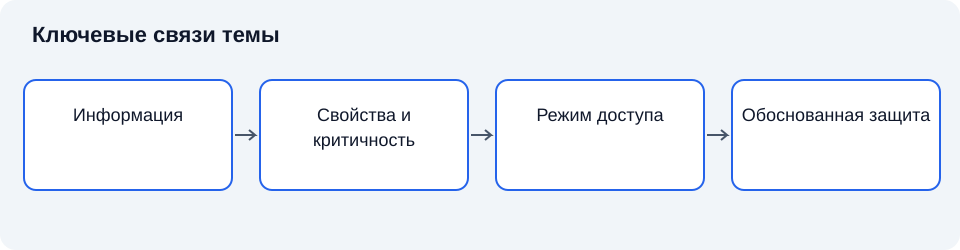

# Лекция 10. Свойства информации и категории доступа

**Дисциплина:** Основы информационной безопасности.

**Цель:** Систематизировать свойства информации и основания ограничения доступа.

**Задачи:** сопоставить свойства информации; различить категорию доступа и режим; классифицировать охраняемые сведения; вывести требования к операциям.

## Введение

После изучения угроз и уязвимостей необходимо уточнить, какие свойства защищают и почему разные сведения требуют разных режимов обращения.

План занятия: информация как объект защиты; категории доступа и правовое основание; виды охраняемых сведений; от классификации к требованиям защиты.

## Схема темы

*Рисунок 10. Упрощённые связи понятий. Схема поясняет текст и не заменяет условия применения правил.*

## 1. Информация как объект защиты

**Информация** в учебном анализе — сведения, имеющие значение для участников деятельности. Для защиты существенны содержание, представление, носитель, контекст и правила использования. Один документ может существовать в виде файла, распечатки, резервной копии и сообщения. Защита только одного представления не обеспечивает защиту сведений в целом [1].

**Конфиденциальность** означает сохранение установленных ограничений на доступ и раскрытие информации. **Целостность** связана с защитой от ненадлежащего изменения и уничтожения, а также с поддержанием требуемой правильности состояния. **Доступность** означает возможность своевременного и надёжного использования уполномоченными субъектами. Эти свойства задаются относительно требований, а не существуют в виде абсолютных ярлыков [2].

Открытые сведения также нуждаются в защите. Для общедоступного расписания конфиденциальность может не иметь значения, но изменение времени занятий нарушит целостность, а недоступность публикации затруднит обучение. Следовательно, категория доступа не определяет всю совокупность мер безопасности.

Свойства могут конфликтовать на уровне реализации. Дополнительная проверка доступа увеличивает задержку; резервирование создаёт новые копии, которые требуют защиты; ограничение распространения уменьшает удобство совместной работы. Правильное решение опирается на допустимый риск и назначение системы. Требование максимизировать каждое свойство без ограничений технически и организационно бессодержательно.

Отдельно рассматриваются подлинность, подотчётность и достоверность. **Подлинность** — свойство сущности быть той, за которую она себя выдаёт; подтверждение этого свойства является отдельной процедурой. **Подотчётность** — возможность проследить действие до определённого субъекта; установление юридической ответственности требует самостоятельных оснований. **Достоверность** касается соответствия сведений реальному положению дел. Криптографически подтверждённое происхождение документа не доказывает истинность каждого утверждения автора.

### 1.1. Содержание, представление и носитель

Для анализа информации необходимо различать то, что сообщается, способ выражения и материальную основу записи. **Содержание** относится к смыслу сведений для участников деятельности. **Представление** задаёт форму: текст, таблицу, изображение, сигнал или структурированную запись. **Носитель** обеспечивает физическое существование представления. Один и тот же смысл может передаваться в разных формах, а один носитель — содержать сведения разных категорий.

Защитное решение должно учитывать все три уровня. Ограничение чтения файла относится к определённому представлению и механизму доступа. Оно не препятствует раскрытию того же содержания через распечатку или устное сообщение. Уничтожение одного носителя не удаляет другие экземпляры. Изменение формата может сохранить содержание, но нарушить возможность его достоверного использования, если потеряны связи, подписи или порядок полей [1].

Именно поэтому выражение «защитить документ» требует уточнения. Защищается ли содержание от ознакомления? Поддерживается ли правильность записи? Нужно ли сохранить доказуемость происхождения? Должен ли документ быть доступен через определённое время? Ответы задают разные требования, хотя объект в обыденной речи называется одним словом.

Данные в вычислительной системе являются представлением сведений, пригодным для обработки. Без контекста набор символов может не иметь для наблюдателя понятного смысла, но это не делает его автоматически незначимым. Контекст может быть известен другому участнику либо восстановлен через связи. Поэтому оценка чувствительности включает возможность интерпретации в заданной модели, а не только непосредственную понятность записи.

### 1.2. Подлинность и достоверность на разных уровнях

Подлинность сущности означает соответствие заявленной идентичности. Для сообщения это может относиться к заявленному источнику, для участника — к тому, кем он себя представляет, для программного компонента — к происхождению и принадлежности определённой поставке. Проверка подлинности использует свидетельства, но их качество зависит от доверия к источнику и способу проверки.

Достоверность относится к соответствию содержания действительности. Подлинный автор может ошибаться, располагать неполными сведениями или намеренно сообщать ложное. Поэтому подтверждение авторства не является проверкой фактов. Обратное также возможно: содержание оказывается верным, но сведения об источнике подменены. Эти различия особенно существенны при работе с электронными документами и сообщениями.

**Актуальность** характеризует соответствие сведений рассматриваемому времени и состоянию. Достоверная в прошлом запись может перестать отвечать текущей задаче. Это не обязательно означает нарушение целостности файла: файл мог сохраниться без изменений. Однако использование устаревшего содержания способно привести к ошибочному решению, поэтому требования должны определять обновление и срок применимости.

**Полнота** означает достаточность состава сведений для поставленной задачи. Она также относительна: невозможно требовать всех сведений вообще. Для одной операции достаточно идентификатора и статуса, для другой необходимы основания и история изменений. Минимизация состава должна согласовываться с достаточностью, иначе сокращение данных сделает законную задачу невыполнимой.

### 1.3. Синтаксическая целостность: сохранение формы и структуры

Для разграничения уровней анализа будем называть **синтаксической целостностью** сохранение установленных правил представления, структуры и допустимых преобразований информации. Это поясняющая классификация, а не замена общего определения целостности. На этом уровне рассматривают последовательность символов, формат полей, взаимосвязи записей и соответствие сообщения заданной схеме. Вопрос о том, правильно ли сведения описывают действительность, пока не ставится. Электронный документ может иметь корректную структуру, открываться без ошибок и проходить формальные проверки, но содержать ошибочный вывод. И наоборот, верное наблюдение иногда записывают в повреждённый файл, из которого программа уже не может извлечь содержание.

Необходимо различать сохранность конкретной последовательности данных и соблюдение структурных ограничений. Если в таблице заменить одну допустимую дату другой, формат останется правильным, хотя исходное значение изменится. Если переставить столбцы без изменения отдельных значений, содержимое ячеек сохранится, но программа может истолковать его иначе. Поэтому утверждение «целостность обеспечена» требует уточнения: сохранены ли байты, структура документа, отношения между объектами или определённые правила состояния системы. Проверка одного уровня не доказывает сохранность остальных.

Правила целостности задают относительно модели объекта. Для записи об оборудовании можно потребовать уникальности инвентарного номера, наличия обязательных полей и существования подразделения, которому передано устройство. Такие ограничения предотвращают некоторые противоречия внутри системы. Однако запись с уникальным номером и существующим подразделением всё равно может описывать оборудование, которого там нет. Модель проверяет отношения между представленными данными, а связь этих данных с внешним миром требует другого основания.

Контрольная сумма позволяет сравнить вычисленную характеристику данных с ожидаемым значением. Её доказательная сила зависит от выбранного алгоритма и защиты самого ожидаемого значения. Простые контрольные суммы помогают обнаруживать случайные повреждения, но не предназначены для противодействия подготовленному нарушителю. Криптографическая хеш-функция предъявляет более строгие требования к устойчивости против подбора совпадений. Тем не менее, если злоумышленник заменит и файл, и опубликованный рядом хеш, успешное сравнение подтвердит согласованность подменённых объектов.

Отсюда следует необходимость доверенного эталона. Эталонное значение должно поступать по каналу или из хранилища, защищённого в соответствии с рассматриваемой угрозой. Проверка целостности всегда связывает проверяемый объект с некоторой опорной точкой: ранее сохранённой копией, подписанным манифестом, защищённой записью журнала. Без такой точки можно исследовать внутреннюю корректность объекта, но нельзя доказать, что он соответствует требуемой версии. Сам факт успешного вычисления хеша ничего не сообщает о допустимости содержания файла.

Целостность не означает запрета любых изменений. Рабочие документы редактируют, базы данных обновляют, сообщения преобразуют при передаче. **Допустимое преобразование — это изменение, которое соответствует установленным правилам и сохраняет значимые для задачи отношения.** Например, перенос таблицы в другой формат может менять кодирование и порядок служебных элементов, сохраняя значения и связи записей. Поэтому защита целостности включает не только обнаружение изменений, но и определение того, кто, при каких условиях и с каким проверяемым результатом вправе их выполнять.

### 1.4. Краткий вывод

Конфиденциальность, целостность и доступность отвечают разным требованиям. Подлинность происхождения, достоверность содержания и целостность представления нельзя считать взаимозаменяемыми.

## 2. Категории доступа и правовое основание

**Категория доступа** характеризует установленную возможность получения сведений определённым кругом лиц. В российском правовом контексте различают общедоступную информацию и информацию, доступ к которой ограничен. Основания ограничения определяются законом [6]. Само желание владельца не превращает любые сведения в законно охраняемую тайну.

**Правовой режим информации** — совокупность правил её получения, использования, предоставления и защиты. Он включает основания доступа, обязанности участников и последствия нарушения. Техническая метка «секретно» в файле не создаёт режим государственной тайны. Локальная группировка по критичности полезна для управления риском, но введение ограничения доступа требует применимого правового основания и необходимых полномочий.

При изучении категорий важно различать информацию, носитель и информационную систему. Документ может содержать одновременно открытые и ограниченные сведения. Ограничение доступа к части содержания не всегда означает необходимость полного отказа в предоставлении остальной части. Решение требует анализа применимого режима, а не механического обращения с файлом как неделимым объектом.

**Принцип необходимости доступа** означает предоставление сведений в объёме, требуемом для законной задачи. Он связан с минимальными привилегиями, но не тождествен им: привилегия определяет разрешённые действия, а необходимость доступа — обоснованность получения конкретного содержания [3].

Сведения не становятся общедоступными для любого последующего использования только потому, что технически доступны в сети. Необходимо различать возможность загрузки, законность публикации и допустимые цели обработки. Утечка ограниченной информации также не отменяет автоматически ранее установленные обязанности её защиты.

### 2.1. Несколько независимых оснований классификации

Классификация информации не ограничивается категорией доступа. Сведения можно группировать по форме представления, назначению, времени использования, владельцу процесса, требуемой доступности и последствиям нарушения свойств. Эти основания решают разные задачи. Деление на общедоступную информацию и информацию ограниченного доступа относится к допустимости получения, а деление по критичности — к значимости нарушения для деятельности.

**Критичность информации** характеризует степень зависимости задач от сохранения её свойств. Открытые сведения могут быть критичными, если определяют безопасное действие или работу общественно значимого процесса. Напротив, ограниченная информация может иметь небольшой объём и редко использоваться, но требовать строгой конфиденциальности. Следовательно, открытость и критичность образуют независимые измерения.

Классификация по времени различает текущие, исторические и прогнозные сведения. Она помогает установить период актуальности и необходимость обновления. Однако историческое содержание не становится автоматически открытым: режим может сохраняться независимо от прекращения оперативного использования. Срок хранения, срок ограничения доступа и срок актуальности — разные характеристики, которые могут совпадать только в определённых случаях.

По роли в процессе различают исходные сведения, промежуточные результаты и итоговые документы. Это различие помогает обнаружить незаметные представления, которые оказываются за пределами привычной защиты. Черновик может содержать больше подробностей, чем опубликованный результат. Промежуточная таблица может сохранять идентифицирующие признаки после обезличивания итогового отчёта. Поэтому назначение документа не определяет режим без анализа содержания.

**Метка классификации** является способом выразить принятое решение в доступной участникам форме. Она помогает исполнению правил, но не заменяет основание. Ошибочная метка может привести к избыточному ограничению либо раскрытию. Поэтому устанавливают полномочие на назначение и изменение метки, а также порядок проверки спорных случаев.

### 2.2. Ограничение доступа и ограничение использования

Получение сведений и последующее использование являются связанными, но различными действиями. Участник может законно ознакомиться с документом для одной цели, не приобретая права публиковать его или передавать неопределённому кругу лиц. Разрешение чтения не тождественно разрешению изменения, объединения, распространения и хранения без срока.

**Предоставление информации** относится к передаче определённому получателю или кругу получателей в установленной ситуации. **Распространение информации** связано с доведением до неопределённого круга лиц в применимом правовом смысле. Для анализа важно сохранять различие адресности и условий. Передача документа уполномоченному специалисту не означает превращения его содержания в общедоступное [6].

Условия использования могут вытекать из закона, договора и законно установленных локальных правил. Их нельзя смешивать с технической возможностью. Устройство позволяет сохранить копию, но это не определяет допустимость такого действия. Система может запретить копирование штатным интерфейсом, однако пользователь продолжает иметь обязанность соблюдать режим и в отношении иных представлений.

В правовом анализе необходимо учитывать полномочия лица, установившего ограничение. Наличие документа с подписью ещё не доказывает законность любого запрета. Локальное решение действует в пределах предоставленных полномочий и не может произвольно отменять обязательное предоставление сведений. Поэтому специалист по защите должен различать техническое исполнение принятого режима и проверку его правового основания.

### 2.3. Незаконное раскрытие и сохранение обязанностей

Факт появления сведений вне установленной области не доказывает законного изменения режима. Утечка характеризует нарушение обращения, а изменение режима требует собственного основания. Если сотрудник увидел опубликованную посторонним копию, из этого не следует автоматическое право распространить её дальше.

После раскрытия необходимо оценивать разные последствия. Конфиденциальность конкретного содержания могла быть нарушена, но продолжают иметь значение целостность, подлинность и доступность правильной версии. Также могут сохраняться ограничения относительно других экземпляров, связанных сведений и дальнейших действий. Защита не прекращается только потому, что одно свойство уже нарушено.

Ложная открытость может возникнуть из-за ошибки настройки. Ресурс доступен по ссылке без запроса полномочий, но его содержание предназначено ограниченному кругу. Техническая доступность в таком случае является свидетельством конфигурационного состояния, а не правового решения. Специалист должен установить основание доступа и сообщить о несоответствии, а не считать любую загрузку разрешённой.

Краткий итог: классификаций несколько; категория доступа независима от критичности; получение не означает разрешения любого использования; законное раскрытие и утечка имеют разные основания и последствия.

### 2.4. Участники информационных отношений

Классификация требует определить не только сведения, но и участников. **Обладатель информации** располагает определёнными правами в отношении содержания в применимом правовом смысле. **Пользователь** получает и использует ресурс в рамках предоставленных возможностей. **Получатель** является адресатом конкретного предоставления. Эти роли могут совпадать, но не должны предполагаться тождественными во всех случаях [6].

Технический администратор управляет инфраструктурой, однако это не означает неограниченного права использовать содержание в личных целях. Возможность обслуживания и право ознакомления различаются. Поэтому организационный порядок должен определять, какие действия необходимы для технической функции и каким образом ограничивается избыточное раскрытие.

Для персональных данных особое значение имеет роль оператора и отношения с лицами, выполняющими обработку на предусмотренном основании. Нельзя автоматически переносить все полномочия вместе с технической передачей. Требуется установить цели, действия и обязанности. В учебном анализе важно понимать структуру ролей, а конкретное юридическое оформление проверяется по действующим нормам и условиям [7].

Внешний подрядчик может получать доступ к среде для ремонта или сопровождения. Его задача не обязательно требует чтения всего содержания. Выбор режима обслуживания должен учитывать минимально необходимый состав, возможность использования условных данных и контроль действий. Договорное обещание конфиденциальности дополняет, но не заменяет техническое ограничение.

### 2.5. Полномочие на классификацию

Право предложить категорию и право окончательно утвердить решение могут принадлежать разным участникам. Автор лучше знает содержание, владелец процесса — назначение, уполномоченный специалист — применимые основания. Для воспроизводимости необходимо определить, кто принимает решение, кто проверяет и как разрешаются сомнения.

**Ответственность за классификацию** включает обязанность поддерживать соответствие решения содержанию и условиям. Она не сводится к первоначальному выбору метки. При существенном изменении документа может потребоваться повторное рассмотрение. Передача файла другому сотруднику не должна терять сведения о том, кто вправе изменить его режим.

Автоматическое назначение по шаблону способно помогать, но имеет ограничения. Если все документы определённой папки получают одну категорию, необходимо убедиться, что состав действительно однороден. Если правило ориентируется на отдельное слово, оно может ошибаться в контексте. Автоматическая рекомендация должна иметь понятную область применения и путь проверки спорных случаев.

Сомнение не разрешается универсальным повышением закрытости. Такая практика создаёт препятствия законной деятельности и затрудняет выполнение обязанности предоставления. Не менее опасно автоматически выбирать открытость ради удобства. Корректный процесс направляет вопрос уполномоченному участнику, временно ограничивает только необходимую область и сохраняет основание решения.

### 2.6. Краткий вывод

Правовое ограничение доступа требует основания и компетентного решения. Классификация по критичности и последствиям является отдельной аналитической задачей и сама не создаёт правового режима.

## 3. Виды охраняемых сведений

**Государственная тайна** — охраняемые государством сведения в установленных законом областях, распространение которых может нанести ущерб безопасности государства. Отнесение сведений к этому режиму и их засекречивание осуществляются в установленном порядке [9]. Нельзя считать государственной тайной любую внутреннюю информацию государственного учреждения.

**Коммерческая тайна** представляет собой режим конфиденциальности информации, позволяющий её обладателю при существующих или возможных обстоятельствах получать экономическую пользу при соблюдении установленных условий. Существенны не только ценность сведений, но и введение режима. Обозначение «коммерческая тайна» без предусмотренных организационных действий не заменяет правовую работу.

**Персональные данные** — информация, относящаяся к прямо или косвенно определённому либо определяемому физическому лицу. Принципиальна возможность связи с человеком. Удаление имени не всегда устраняет такую возможность: совокупность других признаков может позволить определить лицо. Защита зависит также от целей и оснований обработки. Персональные данные не следует автоматически считать тайной одного универсального режима: закон определяет основания обработки, предоставления и распространения. Правомерное раскрытие в определённой ситуации не означает свободы любой последующей обработки [7].

Профессиональные тайны связаны с определёнными отношениями и деятельностью: врачебной помощью, адвокатской деятельностью, банковским обслуживанием. Их нельзя объединить в единый режим с одинаковыми основаниями доступа. Уполномоченный получатель в одном отношении не получает автоматически права на любые сведения другого вида.

Для классификации полезна последовательность вопросов: что представляют собой сведения; какое основание применимо; кто является обладателем или оператором; кому и для какой цели разрешён доступ; какие обязанности возникают. При пересечении режимов учитывают совокупность требований. Документ о работнике может одновременно содержать персональные данные и сведения коммерческой деятельности. При этом коммерческий характер содержания сам по себе не устанавливает коммерческую тайну: требуется правомерное введение режима и учёт предусмотренных законом исключений [8].

### 3.1. Государственная тайна и границы учебной классификации

При изучении государственной тайны необходимо различать содержание сведений, основание отнесения и полномочие конкретного участника. Законодательство устанавливает области и порядок, в рамках которых сведения могут получить этот режим [9]. Специалист не присваивает его произвольно на основании собственной оценки важности. Иначе техническая классификация подменяет правовую процедуру.

Категория важности для организации и степень секретности не являются одной шкалой. Отказ общедоступного сервиса может иметь тяжёлые последствия, но это не делает все его сведения государственной тайной. И наоборот, редкое использование засекреченного документа не отменяет установленного режима. Для выбора мер необходимо учитывать оба измерения, сохраняя их самостоятельность.

**Засекречивание** относится к установленным действиям по ограничению распространения сведений, отнесённых к государственной тайне. **Рассекречивание** связано со снятием соответствующих ограничений в предусмотренном порядке. Эти решения не равны изменению метки пользователем в информационной системе. Технический интерфейс должен поддерживать правомерное решение, а не создавать полномочие на него.

Допуск лица и доступ к конкретным сведениям также следует различать. Наличие общего установленного основания работы в соответствующей области не означает необходимости ознакомления с любым документом. Конкретная задача и полномочие продолжают иметь значение. Принцип минимальной необходимой осведомлённости помогает ограничивать распространение, но его правовое воплощение определяется применимым режимом.

Учебный пример не должен включать реальные защищаемые сведения. Для объяснения достаточно условных обозначений и общих категорий, предусмотренных открытым нормативным материалом. Цель состоит в понимании оснований и различий, а не в составлении произвольного перечня секретного содержания. При сомнении решение передаётся уполномоченным специалистам, а неопределённость не заполняется догадкой.

### 3.2. Персональные данные: определяемость и основание обработки

Для персональных данных центральна связь сведений с определённым или определяемым человеком. Прямой идентификатор упрощает эту связь, но не исчерпывает её. Совокупность места, времени, роли и иных признаков может позволить установить лицо без имени. Поэтому оценка не должна ограничиваться поиском одного поля «ФИО» [7].

**Обезличивание** направлено на такое изменение, при котором определение принадлежности сведений конкретному субъекту требует дополнительных условий в предусмотренном смысле. Его результат нельзя считать автоматически необратимым. Необходимо учитывать доступные связи, внешние источники и цель использования. Замена имени кодом сохраняет возможность обратного сопоставления у участника, владеющего таблицей соответствий.

**Псевдонимизация** в общем аналитическом употреблении означает замену прямого обозначения условным при сохранении определённой связи. Она может снижать прямую видимость личности, но не тождественна полной невозможности определения. При описании конкретной правовой процедуры следует использовать терминологию применимого закона, а не переносить автоматически понятия из иной юрисдикции.

Основание обработки и основание предоставления конкретному получателю рассматриваются отдельно. Организация может законно хранить сведения для выполнения установленной обязанности, но не иметь права публиковать их без дополнительного основания. Наличие согласия также требует понимания его содержания, цели и области; слово «согласие» не является универсальным разрешением на любые будущие действия.

Законное раскрытие определённой части не превращает весь связанный массив в свободный ресурс. Необходимо учитывать состав, цель и условия дальнейшего использования. Поэтому в учебной классификации не следует ставить знак равенства между «персональные данные» и «любая тайна»: это область регулирования с различными основаниями, действиями и требованиями защиты.

### 3.3. Законное исключение и отсутствие произвольного разрешения

Режимы охраны могут предусматривать случаи предоставления уполномоченным органам и другим участникам. Наличие такого случая не означает универсальной открытости. Требуются соответствующий получатель, цель, основание и состав. Проверка этих условий является частью правомерного обращения.

Не следует формулировать исключение как «можно передать по любому запросу». Запрос должен иметь необходимое основание и исходить от надлежащего участника. Техническая система может помочь проверить адресата и зафиксировать действие, но правовой смысл запроса не всегда определяется автоматически. При сомнении решение рассматривается уполномоченной стороной.

С другой стороны, ссылка на конфиденциальность не должна автоматически блокировать законную обязанность предоставления. Задача состоит в определении разрешённого состава и безопасного порядка исполнения. Это ещё раз показывает различие режима, полномочия и механизма. Все три уровня должны быть согласованы.

### 3.4. Производные сведения и изменение категории

Новый документ может содержать данные из нескольких источников. Автор способен убрать прямые обозначения, изменить детализацию и сформировать итог. Категория результата определяется не механическим суммированием меток, а его содержанием, возможностью связи и применимыми правилами. При этом необходимо учитывать условия, на которых исходные сведения были получены.

**Производная информация** — содержание, полученное обработкой исходных сведений. Оно может сохранять исходную чувствительность, уменьшать её либо создавать новую значимую связь. Нельзя универсально утверждать, что любой итоговый показатель открыт или что любая обработка сохраняет прежнюю категорию без изменений.

Если исходные записи уничтожены, производный результат продолжает существовать самостоятельно. Это важно для сроков хранения, контроля распространения и проверки допустимости. Прекращение доступа к источнику не отзывает уже созданные выводы. Правила процесса должны учитывать такие результаты до их появления, а не только после обнаружения спорной ситуации.

### 3.5. Краткий вывод

Государственная и коммерческая тайна, персональные данные и профессиональные тайны имеют разные основания и правила. Несколько режимов могут пересекаться; коммерческий характер документа сам не устанавливает коммерческую тайну.

## 4. От классификации к требованиям защиты

**Классификация информации** — отнесение сведений к категориям по выбранным признакам для определения правил обращения. Она должна быть воспроизводимой: два уполномоченных специалиста при одинаковых исходных данных должны получать сопоставимый результат. Для этого фиксируют основание, владельца решения, правила маркирования и пересмотра.

Следующий шаг — определение допустимых действий. Право читать не включает право изменять, передавать или публиковать. В модели доступа субъект, объект и операция описываются отдельно. Такое разделение помогает не смешивать категорию информации с ролью сотрудника и технической возможностью выполнения действия [2].

Требования применяются ко всему жизненному циклу: созданию, обработке, хранению, передаче, архивированию и уничтожению. Меняются носители и участники, но основание защиты не исчезает при смене формы. Распечатка, черновик и журнал приложения могут содержать те же защищаемые сведения, что и основной файл.

Оценка последствий определяет значимость нарушения каждого свойства. Для оценки риска дополнительно рассматривают источники угроз, уязвимости, условия и вероятность реализации сценария [4]. Для одних ресурсов критично раскрытие, для других — изменение результата расчёта или задержка получения. Сравнение мер защиты проводится относительно этих последствий, а не универсального представления о «самой защищённой» системе [4].

Проверка эффективности включает подтверждение ограничений доступа и возможности законной работы. Система, полностью препятствующая выполнению необходимых задач, не достигает цели доступности. Защита должна поддерживать деятельность в установленных границах и обеспечивать проверяемость решений [5].

### 4.1. Границы классифицируемого объекта

Первым шагом является определение того, что именно классифицируется. Объектом может быть отдельное поле, документ, набор записей, поток сообщений или информационный ресурс. Выбор влияет на результат. Если массив содержит сведения разных режимов, одна общая метка может либо раскрыть часть содержания, либо создать избыточное ограничение. Поэтому уровень детализации выбирают относительно реальных операций и возможностей исполнения.

**Единица классификации** — объект, для которого принимается самостоятельное решение о категории и правилах обращения. Её не следует путать с физическим файлом. Один файл может включать несколько единиц, а одна единица — существовать в нескольких файлах. Принятое решение должно прослеживаться при копировании и преобразовании, иначе одинаковое содержание получает противоречивые режимы без основания.

Важны границы процесса. Сведения могут поступать извне, формироваться внутри, уходить получателю и возвращаться в уточнённом виде. На каждом переходе меняется участник и иногда цель. Классификация только конечного документа не охватывает исходные записи и промежуточные результаты. Однако необходимость учитывать процесс не означает, что все его сведения имеют одну категорию: каждый состав оценивается по основанию.

Владелец процесса понимает назначение, специалист по правовым вопросам — основания, а техническая сторона — представления и пути. Их совместное рассмотрение уменьшает риск того, что решение будет формально правильным, но технически неисполнимым. Например, требование скрыть одно поле требует понимать, не сохраняется ли оно в выгрузке и истории изменений.

### 4.2. Информационный ресурс и карта представлений

**Информационный ресурс** — организованная совокупность сведений и средств их представления, используемая в деятельности. Для управления полезно знать владельца, назначение, состав, места хранения и основные способы обращения. Реестр ресурсов связывает правовое решение с конкретной областью исполнения, но требует обновления при изменениях.

**Карта представлений** показывает, где и в какой форме возникает значимое содержание. В неё могут входить основная запись, резерв, отчёт, журнал, временная выгрузка и печатная копия. Это не требование собирать каждую возможную частицу сведений в одном месте. Цель — обнаружить существенные пути, на которых режим может потеряться.

Преобразование представления должно сохранять необходимые правила. Экспорт в таблицу может удалить метку и ограничения приложения, но оставить содержание. Печатная копия перестаёт зависеть от программного доступа, однако требует физического режима. Сжатый архив остаётся носителем тех же сведений, а сложность открытия не является самостоятельной правовой категорией.

Полезно отдельно учитывать метаданные. Название проекта, получатель, время создания и структура каталога способны раскрывать содержание отношений и деятельности. Они не всегда имеют тот же режим, что основной документ, но нуждаются в собственной оценке. Автоматическое предположение об их безвредности создаёт пробел классификации.

### 4.3. Определение операций и условий

После категории устанавливают допустимые действия. Чтение, изменение, удаление, предоставление, публикация и извлечение в иной формат различаются последствиями. **Разрешение** связывает определённого субъекта или роль с операцией над объектом при установленных условиях. Категория информации сама по себе не перечисляет всех получателей.

Условия могут включать служебную задачу, период действия, принадлежность к проекту и состояние процесса. Их выбор должен быть исполнимым и проверяемым. Если условие сформулировано как «только по необходимости», но никто не определяет необходимость, решение будет непоследовательным. Необходим уполномоченный владелец и понятный порядок предоставления.

**Запрет** также требует точного предмета. Запрет распространения не обязательно означает запрет передачи конкретному уполномоченному участнику. Запрет изменения не означает запрет чтения. Техническая система должна различать операции настолько, насколько это требуется задачей. Грубое разделение на «есть доступ» и «нет доступа» иногда не позволяет реализовать правомерный режим.

Особое внимание уделяется совокупным полномочиям. Пользователь может иметь несколько ролей, а автоматический процесс — обращаться от имени разных участников. Каждая роль отдельно кажется ограниченной, но их сочетание позволяет выполнить нежелательную последовательность. Следовательно, проверка классификации связана с проверкой модели доступа, которая подробно рассматривается далее в курсе [2].

### 4.4. Преобразование последствий в требования

Последствия нарушения описывают относительно деятельности и затронутых интересов. Недостаточно назвать «утечку» или «потерю». Необходимо установить, какие сведения раскрываются, какие решения и лица затрагиваются, есть ли возможность исправления и как нарушение распространяется на связанные процессы. Оценка должна сохранять фактические основания и неопределённость [4].

Из анализа выводятся требования к каждому свойству. Для конфиденциальности определяют допустимый круг и условия раскрытия. Для целостности — уполномоченные изменения, контроль версий и восстановление правильного состояния. Для доступности — допустимые задержки, необходимую готовность и условия восстановления. Подлинность и подотчётность добавляют требования к происхождению и свидетельствам действий.

**Допустимая потеря данных** и **допустимое время восстановления** являются примерами характеристик, связывающих защиту с процессом. Их значения нельзя назначать универсально для всех ресурсов. Они определяются потребностью деятельности и возможностями, после чего проверяются техническим решением. Наличие резервной копии не доказывает выполнение требований без испытания восстановления.

Обнаружение нарушения также имеет время. Если изменение будет замечено после принятия необратимого решения, контроль может оказаться недостаточным. Поэтому требование к целостности иногда включает обнаружение до использования, а иногда — возможность последующего восстановления. Эти варианты нельзя считать равнозначными без анализа последствий.

### 4.5. Пересмотр категории и управление изменениями

Классификация не является бессрочным свойством имени файла. Меняется содержание, цель, состав получателей и правовое основание. Новое объединение данных способно создать чувствительность, которой не было у отдельных частей. Прекращение задачи может изменить необходимость хранения, но не автоматически снять ограничения доступа.

**Пересмотр классификации** — повторное обоснование категории и правил при изменении значимых условий. Поводами служат изменение процесса, состава, источника, нормативного основания и последствий. Результат должен быть доведён до представлений и участников: изменение записи в реестре не изменяет автоматически все ранее созданные копии.

Ошибки бывают в обе стороны. Избыточное ограничение затрудняет законную деятельность и может нарушать обязанность предоставления. Недостаточное ограничение создаёт риск раскрытия. Поэтому качественная классификация не стремится присвоить всем сведениям максимальный запрет. Она стремится к соответствию основанию, задаче и последствиям.

### 4.6. Связь с последующим жизненным циклом

Категория начинает действовать не только в момент окончательного оформления. Исходная запись, черновик и временный результат уже могут содержать охраняемые сведения. Поэтому автор и процесс создания должны знать основные правила до публикации. Позднее присвоение метки не исправляет автоматически прежнее раскрытие.

При хранении категория определяет круг получателей и условия обращения, но отдельно устанавливаются требования целостности и восстановления. При передаче возникают новые экземпляры и участники. При архивировании меняется режим использования, но не обязательно основание ограничения. При уничтожении необходимо учитывать все известные представления. Эти вопросы составят предмет следующей лекции.

### 4.7. Краткий вывод

Классификация превращается в требования через состав данных, допустимые операции и последствия нарушений. Учитываются копии и производные представления; изменения содержания и целей требуют пересмотра.

## Заключение

Категория доступа устанавливает допустимость получения сведений, а требования конфиденциальности, целостности и доступности описывают различные стороны их защиты. Классификация может опираться на критичность, последствия нарушения свойств и назначение сведений. Правовое основание требуется именно для ограничения доступа; его необходимо отличать от технической группировки активов. В лекции 11 проследим, как режим поддерживается при создании, обработке, передаче и завершении использования информации.

## Вопросы для самопроверки

1. Почему общедоступная информация нуждается в защите?
2. Чем подлинность отличается от достоверности?
3. Каково основание ограничения доступа?
4. Может ли одна метка создать режим государственной тайны?
5. Чем доступ к системе отличается от доступа к содержанию?
6. Какие режимы могут пересекаться?
7. Почему удаление имени не всегда исключает идентификацию?
8. Как классификация преобразуется в требования защиты?

## Глоссарий

- **Информация** в учебном анализе — сведения, имеющие значение для участников деятельности.
- **Конфиденциальность** означает сохранение установленных ограничений на доступ и раскрытие информации.
- **Целостность** связана с защитой от ненадлежащего изменения и уничтожения, а также с поддержанием требуемой правильности состояния.
- **Доступность** означает возможность своевременного и надёжного использования уполномоченными субъектами.
- **Подлинность** — свойство сущности быть той, за которую она себя выдаёт; проверка этого свойства является отдельной процедурой.
- **Подотчётность** — возможность проследить действие до определённого субъекта; она сама не устанавливает юридическую ответственность.
- **Достоверность** касается соответствия сведений реальному положению дел.
- **Категория доступа** характеризует установленную возможность получения сведений определённым кругом лиц.
- **правовой режим** — совокупность установленных правил получения, использования, предоставления и защиты сведений.
- **Государственная тайна** — охраняемые государством сведения в установленных законом областях, распространение которых может нанести ущерб безопасности государства.
- **Коммерческая тайна** представляет собой режим конфиденциальности информации, позволяющий её обладателю при существующих или возможных обстоятельствах получать экономическую пользу при соблюдении установленных условий.
- **Персональные данные** — информация, относящаяся к прямо или косвенно определённому либо определяемому физическому лицу.

## Литература

1. Anderson, R. Security Engineering : A Guide to Building Dependable Distributed Systems / R. Anderson. — 3rd ed. — Indianapolis : Wiley, 2020. — Текст : непосредственный.
2. Bishop, M. Computer Security : Art and Science / M. Bishop. — 2nd ed. — Boston : Addison-Wesley, 2018. — Текст : непосредственный.
3. Saltzer, J. H. The Protection of Information in Computer Systems / J. H. Saltzer, M. D. Schroeder // Proceedings of the IEEE. — 1975. — Vol. 63, no. 9. — P. 1278–1308. — DOI 10.1109/PROC.1975.9939. — Текст : электронный.
4. National Institute of Standards and Technology. Guide for Conducting Risk Assessments. — Gaithersburg : NIST, 2012. — NIST SP 800-30 Rev. 1. — DOI 10.6028/NIST.SP.800-30r1. — Текст : электронный.
5. National Institute of Standards and Technology. Security and Privacy Controls for Information Systems and Organizations. — Gaithersburg : NIST, 2020. — NIST SP 800-53 Rev. 5. — DOI 10.6028/NIST.SP.800-53r5. — Текст : электронный.

6. Об информации, информационных технологиях и о защите информации : Федеральный закон от 27 июля 2006 г. № 149-ФЗ. — Текст : электронный. — Президент России : [сайт]. — URL: http://www.kremlin.ru/acts/bank/24157 (дата обращения: 11.11.2026).
7. О персональных данных : Федеральный закон от 27 июля 2006 г. № 152-ФЗ. — Текст : электронный. — Президент России : [сайт]. — URL: http://www.kremlin.ru/acts/bank/24154 (дата обращения: 11.11.2026).
8. О коммерческой тайне : Федеральный закон от 29 июля 2004 г. № 98-ФЗ. — Текст : электронный. — Президент России : [сайт]. — URL: http://kremlin.ru/acts/bank/21227 (дата обращения: 11.11.2026).
9. О государственной тайне : Закон Российской Федерации от 21 июля 1993 г. № 5485-1. — Нормативный правовой акт.

10. Shannon, C. E. A Mathematical Theory of Communication / C. E. Shannon // Bell System Technical Journal. — 1948. — Vol. 27. — P. 379–423, 623–656. — Текст : непосредственный.
