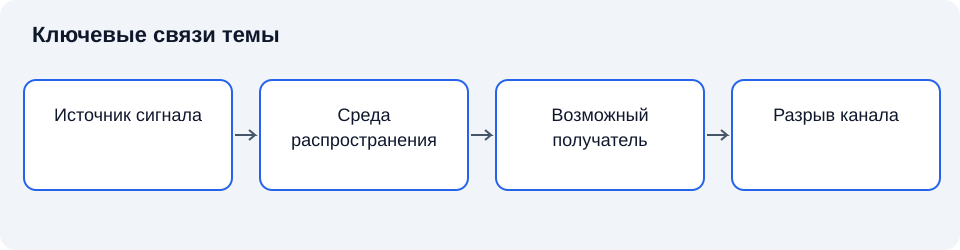

# Лекция 14. Техническая защита информации

**Дисциплина:** Основы информационной безопасности.

**Цель:** Раскрыть модель технических каналов утечки и способы ограничения нежелательного воздействия.

**Задачи:** построить модель канала; сопоставить физические среды; различить активные и пассивные меры; ограничить вывод условиями проверки.

## Введение

Физическая защита ограничивает доступ к материальным объектам. Теперь рассмотрим, как сведения могут проявляться в физических сигналах и как согласуются инженерные меры защиты.

План занятия: предмет технической защиты; виды каналов и условия распространения; пассивные и активные меры; контроль состояния и границы вывода.

## Схема темы

*Рисунок 14. Упрощённые связи понятий. Схема поясняет текст и не заменяет условия применения правил.*

## 1. Предмет технической защиты

**Техническая защита информации** в узком профессиональном смысле охватывает защиту некриптографическими методами от утечки по техническим каналам, несанкционированного доступа и иных воздействий в установленной области. В широком учебном употреблении техническими называют многие аппаратные и программные меры. При обсуждении необходимо явно указывать принятый смысл.

**Технический канал утечки информации** — совокупность источника информативного сигнала, среды распространения и средства получения информации. Для существования канала недостаточно наличия физического излучения. Оно должно нести сведения, распространяться в доступную область и допускать извлечение при определённых возможностях получателя.

Источник, среда и получатель образуют причинную цепочку. Воздействовать можно на любое звено: уменьшать информативность сигнала, ограничивать распространение, удалять возможные точки приёма или затруднять выделение. Мера выбирается по модели канала, а не по внешнему сходству оборудования [1]. Общие модели защиты требуют явно определять доверенные компоненты и границы объекта [2]. Инженерные решения также выигрывают от понятности, ограниченности полномочий и экономии механизма [3].

Техническая защита должна учитывать законную работу. Полное исключение любого сигнала невозможно для действующей системы связи. Требования устанавливают допустимые условия и обеспечивают их контроль. Без определения защищаемых сведений и границ объекта измерение физических параметров не даёт завершённого вывода о безопасности.

Краткий конспект: канал является цепочкой; физический сигнал и утечка не тождественны; меры соотносятся с моделью.

## 2. Виды каналов и условия распространения

**Акустический канал** связан с распространением звуковых колебаний, несущих сведения. Средой может быть воздух либо конструкция, передающая вибрации. Оценка зависит от источника речи, свойств помещения и доступности возможных точек получения. Нельзя переносить результаты одного помещения на другое без исследования условий.

**Оптический канал** связан с визуально наблюдаемыми представлениями: экраном, документом, световым индикатором. Наличие окна или экрана само по себе не доказывает утечку. Существенны видимость, различимость и соответствие наблюдаемого сигнала защищаемому содержанию.

**Электромагнитный канал** использует информативные составляющие электромагнитных проявлений работы оборудования. **Проводной канал** связан с распространением сигналов по соединениям и коммуникациям. Физическое явление исследуется вместе с условиями подключения, расстоянием, помехами и возможностями регистрации.

Классификации каналов могут пересекаться на уровне реального объекта. Один источник создаёт несколько проявлений, а одна инженерная мера влияет на разные пути распространения. Поэтому перечень названий является началом анализа, а не доказательством полноты защиты.

Краткий конспект: каналы различаются физической природой; условия определяют применимость; классификация не заменяет обследование.

## 3. Пассивные и активные меры

**Пассивная мера защиты** ограничивает возникновение или распространение информативного сигнала без формирования специального маскирующего воздействия. К этому направлению относятся экранирование, фильтрация, изменение размещения и конструктивные решения. Их достаточность зависит от свойств объекта и требуемого ослабления.

**Активная мера защиты** создаёт воздействие, затрудняющее получение или выделение защищаемого сигнала. Применение таких мер требует проверки совместимости с работой оборудования и требованиями безопасности. Сам факт включения устройства не подтверждает выполнения задачи.

**Экранирование** ограничивает распространение определённых электромагнитных воздействий. **Фильтрация** ограничивает прохождение нежелательных составляющих по заданному пути. Нельзя утверждать универсальную эффективность без указания диапазона, условий монтажа и характеристик соединений. Разрыв инженерной непрерывности может изменить свойства всей конструкции.

Размещение оборудования и контролируемая зона могут уменьшать доступность точки получения. Однако расстояние не является универсальной гарантией: свойства распространения зависят от среды. Организационная мера поддерживает инженерную, если исключает неучтённые подключения и изменения планировки.

Краткий конспект: пассивные и активные меры действуют по-разному; монтаж и совместимость существенны; универсальных гарантий без условий нет.

## 4. Контроль состояния и границы вывода

**Обследование объекта** устанавливает состав оборудования, коммуникаций, помещений и режимов работы. На его основе уточняют каналы и выбирают способы контроля. Измерение должно соответствовать определённой задаче: неизвестный объект нельзя обоснованно признать защищённым одним испытанием.

**Контроль эффективности** сопоставляет измеренные или подтверждённые характеристики с установленными требованиями. Результат относится к проверенному состоянию и условиям. Замена оборудования, прокладка новой линии или изменение помещения могут потребовать повторной оценки.

Метрологические свойства и ограничения метода влияют на достоверность. Отсутствие обнаруженного сигнала означает отсутствие обнаружения данным методом в данных условиях. Оно не даёт права утверждать отсутствие любых каналов. В отчёте различают измеренный результат и вывод, допустимый на его основе [4].

Защита должна сопровождаться документированием и управлением изменениями. Сведения об оборудовании, разрешённых подключениях и режимах эксплуатации позволяют сохранять проверенное состояние. Несогласованная модернизация способна сделать ранее достоверный вывод неприменимым [5].

Краткий конспект: вывод ограничен условиями проверки; изменения учитываются; отсутствие обнаружения не является абсолютным доказательством отсутствия.

## Заключение

Технический канал существует как связь источника информативного сигнала, среды и возможности получения сведений. Эффективность инженерной меры зависит от объекта, монтажа и проверенных условий. Изменение объекта требует пересмотра вывода. В лекции 15 рассмотрим математические методы защиты представлений информации.

## Вопросы для самопроверки

1. Из каких звеньев состоит канал?
2. Почему излучение не равно утечке?
3. Какие условия существенны для акустического канала?
4. Чем оптический канал отличается от электромагнитного?
5. Как различают активные и пассивные меры?
6. Почему важны условия монтажа?
7. Какие изменения требуют повторной оценки?
8. Что означает отсутствие обнаруженного сигнала?

## Глоссарий

- **Техническая защита информации** в узком профессиональном смысле охватывает защиту некриптографическими методами от утечки по техническим каналам, несанкционированного доступа и иных воздействий в установленной области.
- **Технический канал утечки информации** — совокупность источника информативного сигнала, среды распространения и средства получения информации.
- **Акустический канал** связан с распространением звуковых колебаний, несущих сведения.
- **Оптический канал** связан с визуально наблюдаемыми представлениями: экраном, документом, световым индикатором.
- **Электромагнитный канал** использует информативные составляющие электромагнитных проявлений работы оборудования.
- **Проводной канал** связан с распространением сигналов по соединениям и коммуникациям.
- **Пассивная мера защиты** ограничивает возникновение или распространение информативного сигнала без формирования специального маскирующего воздействия.
- **Активная мера защиты** создаёт воздействие, затрудняющее получение или выделение защищаемого сигнала.
- **Экранирование** ограничивает распространение определённых электромагнитных воздействий.
- **Фильтрация** ограничивает прохождение нежелательных составляющих по заданному пути.
- **Обследование объекта** устанавливает состав оборудования, коммуникаций, помещений и режимов работы.
- **Контроль эффективности** сопоставляет измеренные или подтверждённые характеристики с установленными требованиями.

## Литература

1. Anderson, R. Security Engineering : A Guide to Building Dependable Distributed Systems / R. Anderson. — 3rd ed. — Indianapolis : Wiley, 2020. — Текст : непосредственный.
2. Bishop, M. Computer Security : Art and Science / M. Bishop. — 2nd ed. — Boston : Addison-Wesley, 2018. — Текст : непосредственный.
3. Saltzer, J. H. The Protection of Information in Computer Systems / J. H. Saltzer, M. D. Schroeder // Proceedings of the IEEE. — 1975. — Vol. 63, no. 9. — P. 1278–1308. — DOI 10.1109/PROC.1975.9939. — Текст : электронный.
4. National Institute of Standards and Technology. Guide for Conducting Risk Assessments. — Gaithersburg : NIST, 2012. — NIST SP 800-30 Rev. 1. — DOI 10.6028/NIST.SP.800-30r1. — Текст : электронный.
5. National Institute of Standards and Technology. Security and Privacy Controls for Information Systems and Organizations. — Gaithersburg : NIST, 2020. — NIST SP 800-53 Rev. 5. — DOI 10.6028/NIST.SP.800-53r5. — Текст : электронный.
