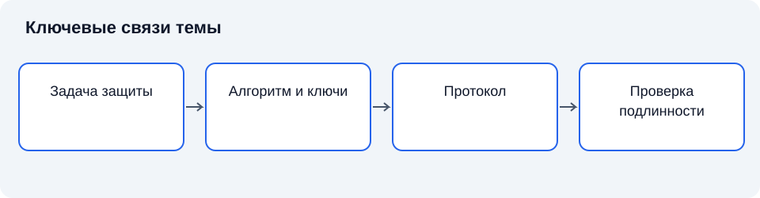

# Лекция 15. Криптографическая защита информации

**Дисциплина:** Основы информационной безопасности.

**Цель:** Различать задачи шифрования, контроля целостности, аутентификации и электронной подписи.

**Задачи:** различить криптографические задачи; сопоставить симметричные и асимметричные методы; объяснить подпись; описать управление ключами.

## Введение

Криптографические методы защищают свойства информации посредством математических преобразований. Их возможности определяются не только алгоритмом, но и ключами, протоколами и предположениями о системе.

План занятия: задачи и модель криптографии; симметричные и асимметричные методы; хеширование, аутентификация и подпись; ключевой жизненный цикл и ограничения.

## Схема темы

*Рисунок 15. Упрощённые связи понятий. Схема поясняет текст и не заменяет условия применения правил.*

## 1. Задачи и модель криптографии

**Криптография** изучает методы преобразования информации для обеспечения определённых свойств безопасности при наличии противодействующей стороны. **Криптографический алгоритм** задаёт преобразование, а **ключ** определяет конкретный вариант его выполнения. Защита не должна зависеть от предположения о неизвестности противнику устройства алгоритма.

**Шифрование** преобразует открытый текст в шифротекст для защиты конфиденциальности. **Расшифрование** восстанавливает сообщение при наличии необходимых ключевых данных. Само шифрование не обеспечивает автоматически подлинность отправителя и целостность сообщения. Эти свойства требуют соответствующей конструкции и проверки [2].

**Модель противника** определяет доступные ему сведения, действия и вычислительные возможности. Утверждение о стойкости всегда относится к модели. Неограниченная вычислительная мощность, доступ к ключу и получение только шифротекста — принципиально разные условия.

В работе «Communication Theory of Secrecy Systems» 1949 года Клод Шеннон сформулировал основы информационно-теоретического анализа секретности. Его подход [6] отделяет невозможность получить сведения из наблюдения от практической трудности вычисления. В современных системах широко применяется вычислительная стойкость, основанная на предположениях о сложности задач.

Краткий конспект: свойства задаются отдельно; стойкость зависит от модели; секретность алгоритма не заменяет защиты ключа.

## 2. Симметричные и асимметричные методы

**Симметричная криптография** использует связанные секретные ключевые данные, известные участникам, которым разрешено выполнять соответствующие операции. Она подходит для обработки больших объёмов информации, но требует безопасного распределения и хранения секрета. Компрометация общего ключа меняет доверие между участниками.

**Асимметричная криптография** использует пару математически связанных ключей: открытый и закрытый. Назначение пары определяется схемой: ключи для подписи и ключи для шифрования не следует считать взаимозаменяемыми. Открытость одного ключа не означает открытость всех данных, обрабатываемых системой.

**Гибридная схема** сочетает методы: асимметричный механизм помогает установить или защитить ключевые данные, а симметричный используется для сообщения. Общая безопасность зависит от согласованности компонентов. Нельзя просто соединить произвольные алгоритмы и считать результат доказанно защищённым [1].

Для повторного применения ключа существенны дополнительные параметры: начальные значения, уникальные значения протокола и счётчики. Требования зависят от конкретного режима. Не следует превращать общее объяснение в универсальный рецепт: нарушение условия уникальности в одной конструкции может иметь иные последствия, чем в другой.

Краткий конспект: симметричные методы требуют общего секрета; асимметричные используют пару ключей; комбинирование нуждается в проверенной схеме.

## 3. Хеширование, аутентификация и подпись

**Криптографическая хеш-функция** отображает сообщение в значение установленной длины и проектируется с требованиями стойкости к определённым способам поиска исходных сообщений и совпадений. Хеширование не является шифрованием: у него нет штатной операции восстановления сообщения с помощью ключа расшифрования.

Совпадение хеша подтверждает равенство проверяемого представления только при надёжном исходном значении и применимых предположениях. Если нарушитель может изменить и файл, и опубликованный рядом хеш, такая проверка не подтверждает происхождение. **Код аутентификации сообщения** использует секретные ключевые данные для проверки сообщения участниками, обладающими соответствующим секретом.

**Электронная подпись** в криптографическом рассмотрении связывает сообщение с закрытым ключом подписания и позволяет проверить подпись соответствующим открытым ключом. Подпись не скрывает содержание. Юридические свойства конкретного вида электронной подписи определяются применимым правом и условиями, а не только математической проверкой.

**Сертификат открытого ключа** связывает ключ с определёнными сведениями и подтверждением выдающей стороны. Проверка подписи требует доверия к этой связи, учёта назначения ключа и состояния сертификата. Математически корректная подпись не доказывает, что содержание документа истинно или что подписавший имел право принять данное решение.

Краткий конспект: хеширование не шифрует; подпись не скрывает сообщение; подлинность происхождения не равна истинности содержания.

## 4. Ключевой жизненный цикл и ограничения

**Управление ключами** включает создание, распределение, хранение, использование, замену, отзыв и уничтожение ключевых данных. Ошибка любого этапа может обесценить стойкий алгоритм. Ненадёжная генерация секрета, избыточное копирование и хранение рядом с открытым доступом к данным меняют модель защиты. Принцип минимальных привилегий ограничивает круг участников и компонентов, получающих доступ к ключевым операциям [3]. Последствия компрометации оцениваются вместе с условиями реализации угрозы, а не только с названием алгоритма [4].

**Компрометация ключа** означает утрату уверенности в его исключительном контроле уполномоченными участниками. Ответные действия зависят от назначения ключа и условий применения. Замена текущего ключа не всегда восстанавливает конфиденциальность ранее раскрытых данных и не отменяет необходимости разбирательства.

**Криптографический протокол** задаёт последовательность сообщений и действий участников. Он должен учитывать повтор сообщений, подмену участника, порядок операций и завершение сеанса. Корректный алгоритм в ошибочном протоколе не даёт ожидаемых свойств [2].

Криптография защищает определённые представления и пути передачи, но не исключает раскрытие на конечном устройстве. Доступ легитимного пользователя к открытому содержанию, вредоносное изменение приложения и неверное решение о публикации требуют других мер. Поэтому криптографические средства входят в общую систему защиты [5].

Краткий конспект: ключ сопровождается на всём цикле; компрометация имеет последствия во времени; безопасность протокола и конечных устройств существенна.

## Заключение

Шифрование, хеширование, аутентификация сообщения и электронная подпись решают разные задачи. Их применение требует проверенных схем, управления ключами и защиты конечных устройств. Стойкость относится к определённой модели противника. В лекции 16 рассмотрим, как система устанавливает допустимость доступа к открытому содержанию.

## Вопросы для самопроверки

1. Почему стойкость зависит от модели?
2. Как различаются симметричные и асимметричные методы?
3. Что означает гибридная схема?
4. Почему хеширование не является шифрованием?
5. Что даёт подпись и чего не даёт?
6. Зачем проверяют связь открытого ключа с участником?
7. Каковы этапы управления ключами?
8. Почему криптография не защищает автоматически конечное устройство?

## Глоссарий

- **Криптография** изучает методы преобразования информации для обеспечения определённых свойств безопасности при наличии противодействующей стороны.
- **Криптографический алгоритм** задаёт преобразование, а **ключ** определяет конкретный вариант его выполнения.
- **ключ** определяет конкретный вариант его выполнения.
- **Шифрование** преобразует открытый текст в шифротекст для защиты конфиденциальности.
- **Расшифрование** восстанавливает сообщение при наличии необходимых ключевых данных.
- **Модель противника** определяет доступные ему сведения, действия и вычислительные возможности.
- **Симметричная криптография** использует связанные секретные ключевые данные, известные участникам, которым разрешено выполнять соответствующие операции.
- **Асимметричная криптография** использует пару математически связанных ключей: открытый и закрытый.
- **Гибридная схема** сочетает методы: асимметричный механизм помогает установить или защитить ключевые данные, а симметричный используется для сообщения.
- **Криптографическая хеш-функция** отображает сообщение в значение установленной длины и проектируется с требованиями стойкости к определённым способам поиска исходных сообщений и совпадений.
- **Код аутентификации сообщения** использует секретные ключевые данные для проверки сообщения участниками, обладающими соответствующим секретом.
- **Электронная подпись** в криптографическом рассмотрении связывает сообщение с закрытым ключом подписания и позволяет проверить подпись соответствующим открытым ключом.
- **Сертификат открытого ключа** связывает ключ с определёнными сведениями и подтверждением выдающей стороны.
- **Управление ключами** включает создание, распределение, хранение, использование, замену, отзыв и уничтожение ключевых данных.
- **Компрометация ключа** означает утрату уверенности в его исключительном контроле уполномоченными участниками.
- **Криптографический протокол** задаёт последовательность сообщений и действий участников.

## Литература

1. Anderson, R. Security Engineering : A Guide to Building Dependable Distributed Systems / R. Anderson. — 3rd ed. — Indianapolis : Wiley, 2020. — Текст : непосредственный.
2. Bishop, M. Computer Security : Art and Science / M. Bishop. — 2nd ed. — Boston : Addison-Wesley, 2018. — Текст : непосредственный.
3. Saltzer, J. H. The Protection of Information in Computer Systems / J. H. Saltzer, M. D. Schroeder // Proceedings of the IEEE. — 1975. — Vol. 63, no. 9. — P. 1278–1308. — DOI 10.1109/PROC.1975.9939. — Текст : электронный.
4. National Institute of Standards and Technology. Guide for Conducting Risk Assessments. — Gaithersburg : NIST, 2012. — NIST SP 800-30 Rev. 1. — DOI 10.6028/NIST.SP.800-30r1. — Текст : электронный.
5. National Institute of Standards and Technology. Security and Privacy Controls for Information Systems and Organizations. — Gaithersburg : NIST, 2020. — NIST SP 800-53 Rev. 5. — DOI 10.6028/NIST.SP.800-53r5. — Текст : электронный.

6. Shannon, C. E. Communication Theory of Secrecy Systems / C. E. Shannon // Bell System Technical Journal. — 1949. — Vol. 28, no. 4. — P. 656–715. — DOI 10.1002/j.1538-7305.1949.tb00928.x. — Текст : электронный.
