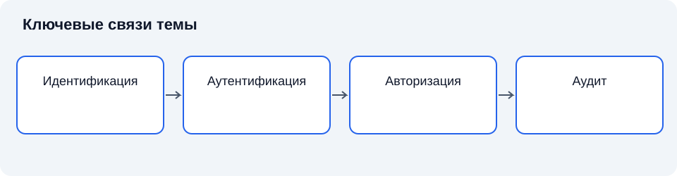

# Лекция 17. Управление доступом, модели доступа, идентификация и аутентификация

Дисциплина: «Основы информационной безопасности». Пункт РП: 4.6.

**Цель:** объяснить, как политика безопасности превращается в проверяемое решение о доступе. Задачи: различить идентификацию, аутентификацию и авторизацию; сопоставить модели управления доступом; определить границы доверия к сеансу пользователя.

## Введение

В предыдущей лекции несанкционированный доступ рассматривался как нарушение установленного порядка обращения с информацией. Теперь необходимо объяснить, каким образом этот порядок можно выразить достаточно точно, чтобы его исполняла вычислительная система. Разрешение сотруднику работать с документами ещё не определяет, какие операции он вправе выполнять, из какой среды и на каком основании. Управление доступом связывает полномочия человека, правила организации и механизмы системы [1], [2].

## Схема темы

*Рисунок 17. Упрощённые связи понятий. Схема поясняет текст и не заменяет условия применения правил.*

## 1. Основания решения о доступе

### 1.1. Субъект и объект

**Субъект доступа** — активная сущность, выполняющая действия над ресурсами: процесс, служба или пользователь, представленный в системе учётной записью. Человек и процесс не тождественны. Один человек может использовать несколько записей; один служебный процесс способен обслуживать многих людей. Поэтому связь между действием и ответственным лицом должна подтверждаться архитектурой регистрации событий, а не предполагаться по названию процесса.

**Объект доступа** — ресурс, обращение к которому регулируется политикой: файл, запись базы данных, устройство, интерфейс или операция службы. Один объект может содержать сведения разных категорий. Тогда уровень проверки должен соответствовать реальной границе полномочий. Разрешение открыть приложение само по себе не означает разрешения прочитать любую его запись.

**Право доступа** — допустимая операция субъекта над объектом при заданных условиях. Чтение, изменение, удаление и передача полномочий представляют разные права. Особенно значимо право изменять саму политику: оно позволяет косвенно получить доступ к остальным объектам. Административные полномочия поэтому выделяют и контролируют отдельно от обычной работы.

### 1.2. Политика, механизм и состояние

**Политика доступа** задаёт, какие действия разрешены. **Механизм доступа** реализует проверку. Их нельзя смешивать: качественный механизм может добросовестно исполнять ошибочную политику. Если всем сотрудникам выдано право изменения платёжных реквизитов, наличие надёжной аутентификации не устраняет организационную ошибку.

Для рассуждения удобно представить решение функцией разрешения, зависящей от субъекта, объекта, действия и контекста. Контекст включает время, состояние устройства, уровень подтверждения личности и параметры сеанса. Однако использование контекста порождает требование к его достоверности. Правило по географическому расположению не даёт надёжного ограничения, если источник признака легко подменяется [2], [3].

**Принцип наименьших привилегий** требует предоставлять только необходимые полномочия на необходимый срок. Он относится не только к людям, но и к службам. Программа, предназначенная для создания отчёта, не должна получать право изменения исходной базы лишь потому, что это упрощает настройку.

**Полное посредничество** означает проверку каждого обращения, требующего контроля [3]. Проверка только при открытии интерфейса недостаточна, если дальнейшие операции можно вызвать другим путём. Это объясняет важность контроля на стороне компонента, который действительно владеет объектом.

### 1.3. Пространства имён и однозначность идентификатора

Уникальность идентификатора определяется областью. Одинаковое имя может существовать в разных доменах, приложениях и организациях. При объединении систем возникает необходимость однозначно указать, к какой области относится запись. Иначе одно значение может быть ошибочно связано с другим субъектом.

**Пространство имён** устанавливает правила формирования и различения идентификаторов. Важно учитывать регистр, допустимые символы, нормализацию и возможность повторного использования. Если две формы визуально похожи, но технически различаются, пользователь может неверно интерпретировать участника взаимодействия. Если система считает формы эквивалентными не так, как поставщик идентичности, возникает риск неправильного сопоставления.

Постоянный внутренний идентификатор часто отделяется от изменяемого отображаемого имени. Сотрудник может сменить фамилию, подразделение или адрес, сохранив связь с прежними действиями. Если журнал использует только отображаемое имя, исторические записи становятся неоднозначными. Следовательно, идентификация важна не только при входе, но и при последующем установлении ответственности.

Повторное использование идентификатора требует осторожности. Новая учётная запись с именем бывшего сотрудника не должна автоматически наследовать прежние разрешения и исторические связи. Если назначения хранятся только по строке имени, восстановление такого имени может непреднамеренно вернуть доступ. Устойчивый идентификатор и управляемый жизненный цикл уменьшают этот риск.

**Служебная идентичность** представляет процесс или сервис. Её владелец и назначение должны быть известны организации, хотя действия не выполняются человеком вручную. Общая запись для множества служб затрудняет ограничение полномочий и расследование. Раздельные идентичности позволяют связать операцию с конкретной функцией и отозвать доступ без остановки несвязанных процессов.

**Групповая учётная запись** используется несколькими людьми. Она создаёт трудность атрибуции: знание общего секрета не определяет конкретного действовавшего человека. Дополнительные журналы могут частично восстановить связь, но не следует предполагать её автоматически. Предпочтение индивидуальным записям объясняется возможностью управления персональными полномочиями и ответственности, а не удобством нумерации пользователей.

### 1.4. Доступ как отношение, действие и результат

Слово «доступ» может обозначать потенциальную возможность, выданное разрешение или фактически выполненную операцию. Различие необходимо для точного анализа. Субъект может иметь разрешение, но не пользоваться им; может не иметь формального разрешения, но достичь объекта через ошибку; может попытаться выполнить операцию и получить отказ. Каждая ситуация требует собственного описания.

**Потенциальная достижимость** характеризует существование пути взаимодействия. **Нормативная допустимость** характеризует соответствие установленным правилам. **Фактическое выполнение** характеризует наблюдаемое действие. Защита стремится согласовать техническую возможность с нормативной допустимостью, но реальная система может иметь расхождения. Их выявление составляет значимую часть анализа.

Доказательство отсутствия доступа нельзя свести к отсутствию записи в одном списке. Необходимо учитывать косвенные роли, административные изменения, альтернативные интерфейсы и представления данных. В то же время бесконечное расширение гипотез без модели делает вывод непроверяемым. Поэтому область утверждения должна быть ясной: какой субъект, какой объект, какие пути и какие допущения рассмотрены.

**Операция** описывает смысл воздействия. Низкоуровневое чтение байтов, вызов функции экспорта и формирование агрегированного отчёта могут быть разными техническими путями получения сведений. Для политики важно определить, какие результаты допустимы. Название команды не всегда совпадает со смыслом для пользователя и владельца данных.

Результат может включать побочные изменения. Запрос на просмотр способен обновить отметку о прочтении, создать временный файл или сформировать кэш. Если эти изменения значимы для безопасности, их нельзя исключать из анализа только потому, что интерфейс называется «просмотр». Модель должна соответствовать фактическому поведению операции.

### 1.5. Идентичность объекта и устойчивость ссылки

Объект тоже нуждается в идентификации. Путь к файлу, имя таблицы или сетевой адрес являются ссылками, которые могут изменяться или указывать на другой ресурс. Если решение принимается по строковому имени, необходимо понимать связь имени с фактическим объектом в момент выполнения.

**Стабильная идентичность объекта** помогает сохранить связь проверки и действия. Она отличается от удобного отображаемого имени. Объект может быть переименован, перемещён или заменён, а строка пути сохраниться. Поэтому архитектура должна определить, что считается тем же объектом для политики и аудита.

Права на создание или замену объекта по доверенному пути способны иметь косвенное значение. Если приложение исполняет компонент из каталога, доступного для записи обычному пользователю, запрет на изменение основного исполняемого файла может оказаться недостаточным. Граница доверия включает все объекты, способные влиять на исполнение решения.

**Наследование атрибутов объекта** требует согласования с перемещением. При переносе файла в другую область система может сохранять прежние права или применять правила нового контейнера. Оба варианта возможны в разных реализациях. Политика должна учитывать фактическое поведение, иначе пользователь ожидает смены режима, которой не происходит.

### 1.6. Разделение запрета и отсутствия разрешения

В системе с разрешениями по умолчанию отсутствие записи иногда интерпретируется как отсутствие ограничения. В системе с запретом по умолчанию оно означает отсутствие основания для доступа. Это фундаментальное различие. При добавлении нового объекта или интерфейса безопасное исходное поведение зависит именно от выбранной логики.

**Явный запрет** может иметь отдельную семантику при конфликтах. Он не всегда эквивалентен отсутствию разрешения. Например, пользователь получает право через одну группу и запрет через другую. Результат определяется правилами объединения. Если администратор не знает этих правил, ручное добавление запретов способно привести к неожиданной блокировке или сохранению доступа.

Принцип безопасного значения по умолчанию не означает, что все данные всегда должны быть закрыты без учёта назначения. Политика может определять общедоступную категорию. Но основание открытости должно быть установлено, а не возникать случайно из отсутствия настройки. Это сохраняет различие осознанного решения и неопределённого состояния [3].

### 1.7. Краткий вывод

Решение о доступе связывает субъект, объект, операцию и контекст. Политика задаёт правило, механизм исполняет его; минимальные привилегии и полное посредничество ограничивают обходные пути.

## 2. Идентификация и доказательство подлинности

### 2.1. Три разных вопроса

**Идентификация** — предъявление идентификатора, позволяющего системе выбрать запись о субъекте. **Аутентификация** — проверка заявленной подлинности. **Авторизация** — определение разрешённых действий. Последовательность «назвался, подтвердил, получил полномочия» полезна для понимания, но в распределённой системе отдельные этапы могут выполняться разными компонентами.

Имя пользователя не обязано быть секретным. Его назначение — однозначно обозначать запись в установленной области. Пароль, напротив, является аутентификационным секретом. Разглашение имени и разглашение пароля поэтому имеют разные последствия. При этом имена тоже могут относиться к защищаемым сведениям в конкретном контексте.

### 2.2. Протокол проверки и границы доверия

Подлинность проверяется не одним фактом наличия секрета, а протоколом взаимодействия. **Протокол аутентификации** определяет сообщения, состояние участников и условия принятия результата. Простой повтор ранее переданного сообщения способен обойти наивную схему, если она не проверяет свежесть. Поэтому в протоколах используются одноразовые значения, временные ограничения и другие способы связать ответ с текущим обменом [1], [2].

**Атака повторного воспроизведения** заключается в использовании ранее полученного действительного сообщения вне его первоначального контекста. Защита требует различать доказательство знания секрета и копирование результата предыдущей проверки. Одноразовое значение должно быть непредсказуемым в соответствии с моделью протокола и проверяться в нужном контексте; одно слово «случайный» не описывает весь механизм.

В распределённой системе служба может доверять утверждению внешнего поставщика идентификации. Тогда возникает цепочка: первичная проверка, формирование утверждения, его доставка и проверка принимающей стороной. Каждое звено имеет свои предположения. Принимающая сторона должна убедиться, что утверждение предназначено ей, действительно в текущем контексте и выпущено доверенным участником. Подпись сообщения не доказывает его применимость ко всем службам.

**Федерация идентичности** позволяет использовать результаты одной области доверия в другой. Она уменьшает необходимость создавать независимые учётные записи, но концентрирует зависимость от поставщика. Компрометация или недоступность центральной службы имеет распределённые последствия. Проектирование предусматривает управление доверием, отзывом и режимом отказа.

Канал связи также имеет значение. Если пользователь подтверждает подлинность перед поддельной службой, секрет или результат обмена может попасть посреднику. Следовательно, во многих сценариях необходима взаимная проверка: пользователь должен иметь основание доверять службе, а служба — заявлению пользователя. Криптографическая защита канала помогает при корректной проверке его сторон, а не при безусловном принятии любого сертификата.

**Усиленная проверка для критического действия** означает повторное или дополнительное подтверждение перед значимой операцией. Оно оправдано тем, что условия сеанса могли измениться. Однако дополнительный запрос должен быть привязан к самой операции. Подтверждение входа и согласие на изменение реквизитов — разные факты, даже если пользователь видит похожие окна.

### 2.3. Секреты, проверочные данные и хранение

Пароль представляет секрет, который пользователь предъявляет или использует для формирования доказательства. Система не обязательно должна хранить пароль в исходном виде. **Проверочные данные** позволяют установить корректность предъявленного значения, не превращая каждое обращение к базе в прямое раскрытие всех паролей. Однако защита проверочных данных остаётся необходимой: их похищение может дать возможность автономного подбора.

**Хеширование пароля** отличается по назначению от шифрования. Хеш-функция преобразует вход в значение фиксированной длины, а шифрование предусматривает обратное восстановление при наличии ключа. Для хранения паролей применяются специально предназначенные схемы, учитывающие стоимость подбора. Общая криптографическая хеш-функция, быстро обрабатывающая сообщения, не становится автоматически подходящей схемой хранения паролей.

**Соль** — дополнительное значение, используемое при получении проверочных данных. Она препятствует прямому совпадению результатов для одинаковых паролей и повторному использованию заранее рассчитанных таблиц в простейшей форме. Соль обычно не является самостоятельным секретом; её назначение отличается от назначения дополнительного секретного параметра. Разглашение соли не должно автоматически разрушать всю защиту корректно спроектированной схемы.

Стоимость проверки создаёт компромисс. Увеличение вычислительных затрат затрудняет массовый подбор, но повышает нагрузку легитимной службы. Выбор зависит от оборудования, числа проверок и модели угроз. Нельзя считать самый медленный возможный режим универсально лучшим: недоступность службы аутентификации также нарушает безопасность.

**Онлайновый подбор** взаимодействует со службой и ограничивается её правилами. **Автономный подбор** выполняется по похищенным проверочным данным вне контроля службы. Ограничение числа попыток на странице входа помогает против первого сценария, но не останавливает второй. Поэтому защита базы и свойства схемы хранения дополняют контроль попыток.

Ограничение попыток также требует анализа доступности. Жёсткая блокировка учётной записи после небольшого числа ошибок может использоваться для отказа в обслуживании законного пользователя. Система способна применять задержки, дополнительную проверку и оценку контекста, но каждый метод имеет условия. Цель состоит в повышении стоимости неправомерной проверки без создания простого механизма блокирования чужого доступа.

### 2.4. Владение аутентификатором и привязка к субъекту

Аппаратный или программный аутентификатор подтверждает владение определённым средством. Связь этого средства с учётной записью устанавливается при регистрации. Если регистрация выполнена ненадёжно, последующая сильная криптографическая проверка может добросовестно подтверждать не того субъекта. Поэтому **первичная привязка аутентификатора** является частью общей цепочки доверия.

Передача устройства, его утрата и замена требуют отдельного порядка. Владелец потерянного средства должен иметь возможность инициировать отзыв, но злоумышленник не должен легко отозвать чужое средство или зарегистрировать своё. Решение о восстановлении сочетает проверку личности, оценку риска и уведомление заинтересованных сторон в пределах политики.

**Одноразовый код** ограничивает повторное использование конкретного значения, но не обязательно защищает от передачи посреднику в реальном времени. Пользователь может сам ввести действительный код в неподлинный интерфейс. Следовательно, одноразовость и устойчивость к фишингу — разные свойства. Для второй необходимо связывать доказательство с подлинной стороной и контекстом взаимодействия.

Привязка к устройству тоже не означает неограниченного доверия к нему. Устройство способно быть скомпрометировано, передано другому лицу или использоваться совместно. Дополнительные признаки состояния помогают оценке, но зависят от качества измерения. Отчёт устройства о собственной целостности имеет смысл в определённой модели доверия к источнику этого отчёта.

### 2.5. Маркеры, хранение состояния и завершение сеанса

**Маркер доступа** представляет данные, по которым принимающая сторона разрешает определённые обращения. Он может быть ссылкой на серверное состояние или самодостаточным утверждением с защищённой структурой. Эти варианты имеют разный баланс производительности, отзыва и объёма доверия.

При серверном состоянии отзыв может заключаться в изменении центральной записи, но все принимающие стороны должны действительно обращаться к актуальному состоянию. При самодостаточном маркере проверка может выполняться локально, однако немедленный отзыв требует дополнительного механизма либо ограничения срока. Отсутствие обращения к центру не означает отсутствия зависимости от правил жизненного цикла.

**Маркер обновления** позволяет получать новые краткоживущие полномочия. Он сам становится чувствительным объектом и должен иметь ограниченную область использования. Защита только конечного краткоживущего маркера не помогает, если злоумышленник сохранил долгоживущее основание его повторной выдачи.

Завершение сеанса может происходить на разных уровнях. Закрытие окна браузера не обязательно прекращает серверное состояние. Выход из одного приложения не всегда завершает сеанс у внешнего поставщика идентификации. Политика должна определять смысл выхода и ожидания пользователя. Иначе видимое действие создаёт ложное ощущение прекращения доступа.

**Привязка маркера к контексту** ограничивает его использование определённым участником, устройством или каналом в соответствии с протоколом. Однако чрезмерно жёсткая привязка к нестабильному признаку способна нарушать законную работу. Используемый контекст должен быть достоверным и достаточно устойчивым для задачи.

### 2.6. Категории факторов и сеанс

**Фактор аутентификации** — категория основания проверки: знание секрета, владение аутентификатором или неотъемлемый признак человека. **Многофакторная аутентификация** сочетает факторы разных категорий: два пароля не образуют два фактора. Устойчивость зависит также от независимости механизмов и процедуры восстановления. Биометрическое сопоставление вероятностно: порог влияет на ложный допуск и ложный отказ. После входа субъект обычно действует через маркер сеанса; его кража может позволить работать без повторного предъявления факторов [1; 2].

### 2.7. Краткий вывод

Идентификация предъявляет имя, аутентификация проверяет заявление о подлинности, авторизация определяет действия. Многофакторность требует разных категорий факторов; защита маркеров сеанса и восстановления столь же существенна, как вход.

## 3. Модели управления доступом

### 3.1. Базовые модели и защищаемое свойство

**Дискреционное управление (DAC)** допускает управление правами со стороны уполномоченного владельца в пределах политики системы. Его удобно представить матрицей: строки — субъекты, столбцы — объекты, ячейки — разрешённые операции. Список управления доступом хранит права относительно объекта; сама матрица является моделью и не обязана буквально храниться целиком.

**Мандатное управление (MAC)** подчиняет доступ обязательным правилам, которые обычный пользователь не может произвольно менять. В классической модели Белла — Лападулы ограничения «не читать вверх» и «не писать вниз» препятствуют переносу сведений к менее защищённому уровню. Уровни и категории образуют отношение доминирования: большего числового допуска недостаточно без нужных категорий. Доверенные субъекты и разрешённое раскрытие требуют отдельно определённых правил [2].

**Строгая модель Биба** защищает целостность правилами «не читать вниз» и «не писать вверх» относительно уровней целостности: менее доверенные данные не должны загрязнять более доверенные объекты. Это конкретный вариант политики, а не универсальная инструкция. Механическое объединение запретов конфиденциальности и целостности может сделать полезную работу невозможной.

**Ролевая модель (RBAC)** связывает разрешения с функциями, **атрибутная модель (ABAC)** — с характеристиками субъекта, объекта, операции и среды. Важно не только выдать право, но и ограничить несовместимые функции, проверить происхождение атрибутов и определить результат при конфликтующих правилах.

В модели Харрисона — Руззо — Ульмана рассматривают, может ли последовательность разрешённых изменений матрицы привести к появлению права у неуполномоченного субъекта. В общем выразительном классе задача безопасности неразрешима; это не означает невозможности проверить отдельную ограниченную систему. Для конечного пространства состояний достижимость можно исследовать перебором, но число состояний может быть практически неприемлемым [6].

### 3.2. Роли и атрибуты

**Ролевая модель** связывает разрешения с ролями, а пользователей — с назначенными ролями. Роль должна отражать функцию, а не просто должность. Сотрудник может исполнять несколько функций, но не все сочетания допустимы. **Разделение обязанностей** препятствует сосредоточению несовместимых операций у одного лица. Например, подготовка и окончательное утверждение критического решения могут требовать разных субъектов.

Роли уменьшают количество индивидуальных назначений, но не устраняют необходимость пересмотра. При изменении структуры организации устаревшие роли способны накапливать избыточные права. Проектирование ролей начинается с анализа процессов и ответственности, а не с копирования организационной схемы.

**Атрибутное управление доступом** принимает решение по характеристикам субъекта, объекта, операции и среды. Оно позволяет выражать более гибкие правила, но усложняет объяснение решения. Для проверки необходимо знать происхождение атрибутов, порядок разрешения конфликтов и поведение при отсутствии значения.

### 3.3. Ограничения ролей и объединение атрибутных решений

**Статическое разделение обязанностей** запрещает назначать субъекту несовместимые роли одновременно. **Динамическое разделение обязанностей** ограничивает их совместное использование в сеансе или процессе. Различие существенно: сотрудник может быть обучен двум функциям, но не должен выполнять их обе в рамках одной операции согласования. Реализация должна учитывать не только назначение роли, но и историю процесса.

Иерархия ролей позволяет одной роли наследовать разрешения другой. Она упрощает управление, но требует анализа транзитивных последствий. Добавление полномочия в базовую роль способно расширить права многих пользователей. Проверка изменений поэтому включает всех наследующих получателей, а не только непосредственно редактируемую группу.

В атрибутной модели несколько правил могут давать разные ответы. **Алгоритм объединения решений** устанавливает, как обработать разрешение, запрет, неприменимость и неопределённость. Приоритет запрета и приоритет разрешения имеют разные последствия. Если отсутствующий атрибут ошибочно интерпретируется как разрешающий, формально строгая политика превращается в слабую.

**Обязательство при решении** представляет дополнительное действие, связанное с разрешением: например, регистрация основания или применение ограничения к выдаваемым данным. Если механизм не способен выполнить необходимое обязательство, он не должен молча считать решение полностью исполненным. Политика и точка её применения должны согласованно понимать результат.

### 3.4. Права на объекты и информационные потоки

Контроль доступа отвечает на вопрос о разрешённой операции в определённом состоянии. Контроль потоков рассматривает, куда могут переходить сведения после разрешённого чтения. Различие особенно заметно при копировании: субъект читает защищённый объект законно, но сохраняет содержание в объект, доступный более широкому кругу. Каждая отдельная операция может соответствовать локальным разрешениям, а общий поток противоречить цели конфиденциальности.

**Прямой поток** возникает при передаче значения через предусмотренный механизм: файл, сообщение, параметр вызова. **Косвенный поток** может проявляться в зависимости результата от защищённого условия. Если программа выбирает одно из двух общедоступных сообщений в зависимости от секретного бита, информация передаётся даже без прямого копирования секрета. Это показывает, почему формальные модели потоков шире списков чтения и записи.

**Скрытый канал** использует ресурс или наблюдаемую характеристику вне предусмотренного назначения для передачи сведений. Возможность изменять загрузку или состояние общего ресурса способна создавать наблюдаемый сигнал. Само наличие общего ресурса не доказывает практически значимого канала: необходимы условия управления, наблюдения и различения сигнала. Оценка требует модели пропускной способности и допустимого ущерба.

Полное исключение любых косвенных взаимодействий в полезной системе чрезвычайно сложно. Поэтому инженерная задача часто состоит в ограничении значимых каналов и обосновании остаточных предпосылок. Утверждение «никакая информация не может выйти» требует гораздо более сильного основания, чем утверждение «пользователь не может открыть этот файл».

Мандатные политики помогают ограничивать перенос между уровнями. Однако работа организации требует разрешённых переходов: публикации, согласованного раскрытия, обезличивания или подготовки отчётности. **Деклассификация** в формальной модели означает контролируемое снятие части ограничений по установленному правилу. Она не должна трактоваться как произвольное право пользователя объявить любой документ общедоступным.

Доверенная функция понижения ограничения требует ясного критерия. Например, агрегирование данных может уменьшать чувствительность, но не всегда: малые группы и дополнительные источники способны позволить восстановление сведений. Следовательно, функция преобразования должна оцениваться относительно цели и контекста, а не только наличия слова «агрегированный» в названии результата.

### 3.5. Контекст, атрибуты и происхождение решения

Атрибутная политика способна выражать правило: субъект определённой функции может читать объект своей области при допустимом состоянии устройства. Здесь объединяются атрибут субъекта, объекта и среды. Для каждого нужен доверенный источник. Если подразделение пользователя берётся из редактируемого им профиля, правило опирается на недостоверное основание.

**Источник атрибутов** отвечает за выдачу или подтверждение значений. **Точка принятия решения** применяет политику, а **точка исполнения решения** обеспечивает разрешение или запрет операции. Функции могут быть объединены, но их разделение помогает анализу. Ошибка передачи решения либо игнорирование ограничения точкой исполнения способно нарушить защиту при корректной работе аналитического компонента.

Время жизни атрибута должно соответствовать скорости изменения свойства. Подразделение изменяется редко, состояние устройства — значительно чаще. Кэширование обоих признаков на одинаковый срок без анализа создаёт риск несвежих решений. Следовательно, архитектура должна учитывать семантику значения, а не только общий формат пары «имя — значение».

**Неопределённое решение** возникает, когда недоступен атрибут, правило некорректно или данные противоречат друг другу. Его нельзя незаметно преобразовывать в разрешение лишь ради продолжения работы. В то же время полный отказ может затронуть критический процесс. Режим поведения устанавливается политикой, анализом риска и предусмотренными резервными процедурами.

Для объяснения решения полезно сохранять использованную версию политики и существенные основания. Если через неделю правила изменились, попытка заново вычислить результат по текущей политике не обязательно воспроизводит историческое решение. **Историческая объяснимость** требует учитывать состояние на момент обращения.

### 3.6. Сопоставление моделей по задаче

Выбор модели начинается с защищаемого свойства. Если требуется управляемая передача пользователями разрешений на рабочие документы, дискреционный механизм может быть естественным инструментом. Если необходимо обязательное ограничение потоков между категориями, свобода владельца недостаточна. Если организация распределяет устойчивые функции, роли позволяют выразить повторяющиеся наборы полномочий. Если решение зависит от множества изменяемых признаков, полезна атрибутная политика.

Эти варианты не образуют простую шкалу от слабого к сильному. Более выразительная модель может быть сложнее для проверки, а более жёсткая — не соответствовать процессу. Защищённость зависит от корректности формализации и реализации. Нельзя объявить ABAC автоматически безопаснее RBAC только из-за большего числа параметров.

**Выразительность политики** характеризует, какие условия можно описать. **Проверяемость** характеризует способность обоснованно установить последствия правил. Рост выразительности иногда затрудняет анализ: правила с множеством зависимостей и исключений могут стать практически необозримыми. Инженерный выбор сочетает достаточную гибкость с возможностью сопровождения.

**Административная масштабируемость** относится к затратам изменения политики при росте числа пользователей, объектов и функций. Роли уменьшают повторение назначений, но могут порождать множество частных ролей. Атрибуты уменьшают некоторые индивидуальные настройки, но требуют поддержания качественных источников. Ни один подход не устраняет работу по управлению смыслом полномочий.

Область применения может включать сочетание механизмов. Операционная система контролирует доступ к файлам, приложение — к записям, сетевой уровень — к соединениям. Согласование требует определить, какой уровень отвечает за конкретное решение. Если каждый предполагает, что проверку выполнит другой, возникает пробел. Если уровни применяют противоречивые правила, законный процесс может блокироваться непредсказуемо.

### 3.7. Краткий вывод

DAC, MAC, RBAC и ABAC выражают разные способы назначения и проверки полномочий. BLP ограничивает потоки для конфиденциальности, строгая Biba — для целостности; формальная модель не доказывает правильности реализации.

## 4. Жизненный цикл полномочий и проверяемость

### 4.1. Отзыв, кэширование и изменение состояния

**Отзыв полномочий** должен достигнуть всех точек, где принимается решение. В распределённой системе копии сведений о правах могут обновляться с задержкой. Пользователь уже исключён из группы в центральном каталоге, но приложение продолжает использовать кэш. Значит, время отзыва является свойством всей архитектуры, а не одной административной команды.

Кэширование повышает производительность и устойчивость к кратковременной недоступности служб, но уменьшает свежесть сведений. Необходимо определить допустимый срок использования результата и события принудительного сброса. Для критических прав приемлемая задержка может отличаться от задержки для малозначимого ресурса. Универсальный срок без анализа последствий не обоснован.

**Проверка в момент использования** связана с проблемой изменения состояния между проверкой и действием. Она известна как time-of-check to time-of-use, TOCTOU. Механизм проверил разрешение на один объект, но к моменту операции ссылка стала указывать на другой либо изменились существенные свойства. Следовательно, решение и действие должны быть связаны так, чтобы проверенное основание сохранялось.

Одним из подходов является выполнение проверки и операции внутри согласованной транзакции или использование устойчивой ссылки на проверенный объект. Однако конкретное решение зависит от типа ресурса и модели конкурентного доступа. Само наличие блокировки не гарантирует правильности, если она защищает не те свойства, на которых основан контроль.

**Аварийный доступ** предусматривает заранее установленное исключение для определённой ситуации. Оно требует ограниченных полномочий, наблюдаемости и последующего пересмотра. Если исключение постоянно используется вместо обычного процесса, оно перестаёт быть аварийным и становится обходным административным каналом.

Полезно различать отказ проверки, отрицательное решение и невозможность получить решение. Отрицательное решение означает установленный запрет; техническая ошибка означает неопределённость. Политика определяет поведение при неопределённости, а журнал должен сохранять это различие. Иначе анализ будет смешивать попытки запрещённого доступа с неисправностью инфраструктуры.

### 4.2. Проверка политики на уровне процесса

Проверка управления доступом начинается с описания нормального процесса. Нужно установить участников, входные данные, последовательность действий и значимые результаты. Затем для каждого действия определяется необходимое полномочие. Если права проектируются без связи с процессом, легко выдать технически удобный, но избыточный набор.

**Положительный сценарий проверки** подтверждает, что уполномоченный субъект способен выполнить требуемую операцию. **Отрицательный сценарий** подтверждает, что субъект без достаточного основания получает отказ. Оба необходимы: политика, запрещающая всё, формально предотвращает многие нарушения конфиденциальности, но не выполняет назначение системы.

Следует проверять не только разные роли, но и разные состояния одной роли. Временное полномочие до начала срока, во время действия и после истечения — три разных случая. Изменение подразделения, блокировка записи и отзыв аутентификатора также меняют предпосылки. Контроль переходов выявляет ошибки, которые не видны при проверке стабильного состояния.

**Граничный случай** относится к условиям на границе правила. Если доступ разрешён до определённого момента, важно определить точную семантику времени и часового пояса. Если правило зависит от принадлежности к группе, проверяют отсутствие, одно и несколько членств. Это не механическое увеличение числа испытаний, а анализ неоднозначных мест политики.

Проверка через графический интерфейс недостаточна, когда существует программный интерфейс, фоновая задача или прямое обращение к хранилищу. Все пути до защищаемого объекта должны исполнять согласованную политику. Принцип полного посредничества требует искать обходные маршруты архитектурно, а не только проверять видимые кнопки [3].

### 4.3. Привилегированный доступ и временное повышение

**Привилегированный доступ** позволяет существенно влиять на систему, политику или множество субъектов. Его опасность определяется последствиями, а не названием записи. Право изменить доверенный образ программы может быть более значимым, чем прямое чтение отдельного файла.

Временное повышение полномочий ограничивает период административной власти. Оно может требовать основания, согласования и дополнительного подтверждения. Однако важно обеспечить реальное завершение: прекращение видимого сеанса не обязательно отзывает созданные ключи, фоновые задания и изменения конфигурации. Контроль должен учитывать сохраняемые результаты действий.

**Регистрация административной сессии** полезна для анализа, но не заменяет ограничение полномочий. Запись действия после причинения вреда не предотвращает последствие. Кроме того, регистрация может содержать секреты и чувствительные данные, поэтому доступ к ней и срок хранения также регулируются.

Выделение отдельной административной записи уменьшает риск случайного использования расширенных прав в обычной работе. Но эффективность зависит от процесса: если пользователь постоянно действует под этой записью, организационная цель не достигается. Политика должна сочетать удобный штатный путь с понятными основаниями повышения.

**Разделение среды администрирования** ограничивает воздействие повседневных приложений на привилегированное взаимодействие. Его значение объясняется различием риска: компрометация обычного рабочего окружения не должна автоматически давать контроль над всей инфраструктурой. Конкретная реализация зависит от масштаба и требований организации.

### 4.4. Связь организационного регламента и технического правила

Организационный регламент описывает допустимые действия на языке функций и ответственности. Техническое правило использует группы, роли, идентификаторы объектов и атрибуты. Между ними требуется явное сопоставление. Если регламент говорит о праве «работать с клиентами своего подразделения», настройка должна определять и принадлежность сотрудника, и принадлежность клиента, и допустимые операции.

**Трассировка полномочия** позволяет пройти от технического разрешения к организационному основанию и обратно. Она помогает проверке, потому что техническая группа без понятного назначения затрудняет оценку необходимости. Обратное направление также важно: установленная обязанность сотрудника не должна оставаться невыполнимой из-за отсутствующего разрешения.

Изменение регламента должно запускать анализ технической политики. Если функция разделена между двумя подразделениями, прежняя общая роль может стать избыточной. Изменение технической платформы, в свою очередь, требует убедиться, что организационный смысл сохранился. Перенос старых групп на новую систему без проверки может воспроизвести исторические ошибки.

### 4.5. Эталонный монитор и доверенный путь

**Эталонный монитор** — абстрактный механизм посредничества между субъектом и защищаемым объектом, предназначенный для проверки допустимости обращения. В классическом представлении от него ожидают полноты посредничества, защищённости от изменения неуполномоченным субъектом и достаточной простоты для анализа. Эти ожидания связаны: обходной путь нарушает полноту, возможность подмены разрушает доверие, а чрезмерная сложность затрудняет доказательство [2].

Эталонный монитор не обязательно реализуется единственной программой. В распределённой архитектуре функции могут быть разнесены, но тогда требуется обосновать, что совокупность точек контроля сохраняет необходимые свойства. Название одного центрального сервера не делает его единственным источником решения, если приложение принимает часть запросов самостоятельно.

**Защищённость механизма от вмешательства** зависит от более низких уровней. Проверка в приложении предполагает определённое доверие к операционной системе; операционная система — к загрузке и аппаратуре. Поэтому анализ должен определить, где заканчивается проверяемая часть и начинаются доверенные предпосылки. Невозможно бесконечно подтверждать каждый уровень другим без исходных оснований доверия.

**Доверенный путь** связывает субъекта с механизмом безопасности таким образом, чтобы взаимодействие не подменялось посторонним компонентом в рамках принятой модели. Пользователь должен иметь основание понимать, кому он предъявляет секрет и какое действие подтверждает. Обычное изображение знакомого окна не обеспечивает такого основания, если его способна воспроизвести любая программа.

Требование доверенного пути помогает объяснить риск поддельного интерфейса и значение архитектурного разделения. При этом конкретный механизм зависит от платформы и протокола. Нельзя обещать универсальную устойчивость по одному внешнему признаку окна. Оценка относится к способности системы защитить необходимый канал взаимодействия.

### 4.6. Итоговое согласование модели и эксплуатации

Для завершения проектирования необходимо сопоставить четыре описания: организационное правило, формальную модель, технический механизм и наблюдаемую эксплуатацию. Каждое способно расходиться с другим. Правило может быть неполным, модель — не охватывать исключение, механизм — допускать обход, а эксплуатация — использовать неучтённую запись.

**Согласованность описаний** поддерживается документированными связями и проверками. Для существенного разрешения известно, какое правило оно реализует; для существенного правила известно, где оно исполняется; для критической операции существует наблюдаемое свидетельство. Это позволяет локализовать причину отклонения и выбрать соответствующее исправление.

Наконец, управление доступом не является завершённым разовым проектом. Изменяются люди, функции, данные и платформы. Стабильной должна оставаться способность организации объяснять и контролировать эти изменения. Именно она превращает набор настроек в систему управления безопасностью.

### 4.7. Краткий вывод

Полномочия выдаются по основанию, пересматриваются и отзываются. Проверяются разрешённые, запрещённые и граничные случаи, обходные интерфейсы, кэш решений, аварийные исключения и достоверность журналов.

## Заключение

Управление доступом связывает политику организации с поведением системы. Надёжное подтверждение личности не исправляет избыточные права, а правильная ролевая схема не помогает при обходе точки проверки. Следовательно, защищённость определяется согласованной работой идентификации, аутентификации, авторизации, управления сеансами и аудита. Следующая лекция рассмотрит вредоносное программное обеспечение, которое способно действовать с правами легитимного процесса и тем самым показывает ограниченность одного лишь контроля входа.

## Вопросы для самопроверки

1. Чем субъект отличается от человека, использующего систему?
2. Почему имя пользователя не заменяет аутентификационный секрет?
3. Почему два пароля не обязательно означают два фактора?
4. Как восстановление доступа влияет на общую стойкость проверки?
5. Чем дискреционная модель отличается от мандатной?
6. Как разделение обязанностей реализуется через роли?
7. Почему после перевода сотрудника требуется пересмотр прав?
8. Какие условия делают журнал доступа пригодным для анализа?

## Глоссарий

- **Авторизация** — определение разрешённых действий.
- **Аутентификация** — проверка заявленной подлинности.
- **Идентификация** — предъявление идентификатора.
- **Субъект** — активная сущность, выполняющая операции.
- **Объект** — ресурс, доступ к которому регулируется.
- **Политика** — правила допустимого доступа.
- **Привилегия** — полномочие на выполнение операции.
- **Роль** — набор разрешений, соответствующий функции.
- **Атрибут** — характеристика, используемая в решении.
- **Сеанс** — состояние связи запросов с субъектом.
- **Аудит** — регистрация и анализ значимых действий.
- **Разделение обязанностей** — ограничение несовместимых полномочий.

## Литература

1. Anderson, R. Security Engineering: A Guide to Building Dependable Distributed Systems / R. Anderson. — 3rd ed. — Indianapolis : Wiley, 2020.
2. Bishop, M. Computer Security: Art and Science / M. Bishop. — 2nd ed. — Boston : Addison-Wesley, 2018.
3. Saltzer, J. H. The Protection of Information in Computer Systems / J. H. Saltzer, M. D. Schroeder // Proceedings of the IEEE. — 1975. — Vol. 63, no. 9. — P. 1278–1308. — DOI: 10.1109/PROC.1975.9939.
4. National Institute of Standards and Technology. Guide for Conducting Risk Assessments. — Gaithersburg : NIST, 2012. — SP 800-30 Rev. 1. — URL: https://csrc.nist.gov/pubs/sp/800/30/r1/final (дата обращения: 11.11.2026).
5. National Institute of Standards and Technology. Security and Privacy Controls for Information Systems and Organizations. — Gaithersburg : NIST, 2020. — SP 800-53 Rev. 5. — URL: https://csrc.nist.gov/pubs/sp/800/53/r5/upd1/final (дата обращения: 11.11.2026).

6. Harrison, M. A. Protection in Operating Systems / M. A. Harrison, W. L. Ruzzo, J. D. Ullman // Communications of the ACM. — 1976. — Vol. 19, no. 8. — P. 461–471. — DOI: 10.1145/360303.360333.
