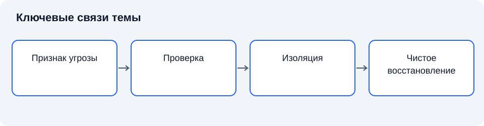

# Лекция 18. Защита от вредоносного программного обеспечения

Дисциплина: «Основы информационной безопасности». Пункт РП: 4.7.

**Цель:** Понять механизмы вредоносного воздействия и теоретические основания эшелонированной защиты.

**Задачи:** определить основные понятия; объяснить взаимосвязь механизмов; сопоставить подходы и ограничения; сформулировать критерии обоснованного выбора.

## Введение

После управления доступом необходимо рассмотреть код, который использует полученные полномочия вопреки назначению процесса. Мы выясним, почему заражение не всегда требует административного доступа и как обнаружение сочетается с ограничением исполнения и восстановлением. Эта тема подготовит переход к системам наблюдения за вторжениями.

## Схема темы

*Рисунок 18. Упрощённые связи понятий. Схема поясняет текст и не заменяет условия применения правил.*

## 1. Понятие и классификация вредоносного программного обеспечения

### 1.1. Теоретические основания

**Вредоносное программное обеспечение** — программное обеспечение, предназначенное для несанкционированного воздействия на информацию, вычислительные ресурсы или функционирование системы. Определение связано с назначением и контекстом применения, а не только с технической формой файла. Одна и та же административная функция может использоваться законно или в составе противоправного сценария. Поэтому обнаружение необычного поведения и доказательство вредоносного назначения представляют разные аналитические задачи [1], [2].

**Вирус** способен включать свой код в другие объекты, обеспечивая воспроизводство при их обработке. **Сетевой червь** распространяется между системами, используя сетевое взаимодействие. **Троянская программа** скрывает нежелательную функцию под видом полезной. Эти признаки относятся к разным основаниям классификации: способ воспроизводства, распространение и маскировка. Они могут сочетаться в одной программе, поэтому категории не образуют строго непересекающегося перечня.

**Программа-вымогатель** характеризуется целью воздействия: ограничить доступ к данным или системе и потребовать выполнения условий. Шифрование может быть её механизмом, но не всякое вымогательство основано на шифровании. **Шпионское программное обеспечение** связано с получением сведений без установленного разрешения. **Руткит** предназначен для скрытия присутствия или деятельности в системе. Для защитника важны не названия классов сами по себе, а переход от класса к наблюдаемым признакам и последствиям.

В истории вычислительной безопасности распространение сетевых червей показало, что локальная ошибка способна иметь распределённые последствия. Однако исторический пример не является готовой моделью любой современной атаки: меняются архитектуры, способы доставки и экономические мотивы.

### 1.2. Промежуточные выводы

Классы вредоносного ПО описывают разные признаки: воспроизводство, распространение, маскировку и цель. Получение объекта не равно исполнению, а вердикт требует контекста.

### 1.3. Разные основания классификации

Научная классификация требует одного ясного основания на каждом уровне. В описании вредоносного ПО часто одновременно используются способ доставки, механизм распространения, целевая функция, способ скрытия и среда исполнения. Это удобно для краткого описания, но не создаёт строгого дерева непересекающихся классов. Образец может одновременно распространяться как червь, выполнять шифрование и скрываться с помощью отдельного компонента.

**Способ доставки** определяет, каким образом объект достигает среды, где возможно исполнение. **Механизм исполнения** определяет, что запускает действие кода. **Целевая функция** описывает желаемый для нарушителя результат. Эти уровни связаны причинно, но не взаимозаменяемы. Получение файла не равняется его исполнению, исполнение не обязательно приводит к целевому ущербу, а целевая функция может выполняться без отдельного сохранённого файла.

**Вредоносный документ** использует возможности формата или обработчика для нежелательного действия. Опасность может определяться активным содержимым, внешними ссылками или ошибкой программы обработки. Поэтому классификация только по расширению ненадёжна. Расширение — соглашение об имени, а не доказательство внутреннего формата или безопасности обработчика.

**Бесфайловое исполнение** обычно означает, что существенная часть воздействия не представлена обычным исполняемым файлом на диске в ожидаемом виде. Это не буквальное отсутствие любых файлов и не самостоятельная гарантия незаметности. Следы могут находиться в памяти, журналах, конфигурации и действиях штатных компонентов. Термин полезен только при уточнении наблюдаемой среды.

**Загрузчик** выполняет получение или запуск следующего компонента. **Полезная нагрузка** в описании сценария обозначает функцию, ради которой организован предыдущий путь исполнения. Название не означает полезности для владельца системы. Разделение компонентов позволяет менять их независимо, а защитнику показывает необходимость анализировать связи, а не только один объект.

### 1.4. Самовоспроизведение и распространение

Воспроизводство кода требует условий: доступного объекта внедрения, возможности изменения и события, приводящего к дальнейшему выполнению. Для сетевого распространения нужны достижимые узлы и подходящий механизм перехода. Поэтому скорость и масштаб зависят от архитектуры сети, прав, доступности служб и поведения пользователей, а не только от свойств программы.

**Автономное распространение** уменьшает зависимость от каждого отдельного действия человека, но не означает отсутствия исходных предпосылок. Сегментация, устранение уязвимости и ограничение служебных взаимодействий могут разрывать путь. Даже при известном образце нельзя считать все узлы одинаково подверженными без проверки условий.

Эпидемиологическая аналогия помогает понять роль восприимчивых узлов и связей, но имеет ограничения. Компьютерные системы могут одновременно обновляться централизованно, отключаться по правилу и иметь неоднородные функции. Биологические показатели нельзя механически переносить на сеть без модели контактов и состояний.

**Заражённый объект** и **скомпрометированная система** обозначают разные масштабы. Наличие вредоносного файла в карантине не доказывает, что код исполнялся. Отсутствие найденного файла не доказывает, что система не подвергалась воздействию. Следовательно, интерпретация требует времени появления, событий исполнения и состояния средств наблюдения.

### 1.5. Функция, намерение и допустимость инструмента

Некоторые инструменты двойного назначения выполняют администрирование, диагностику или удалённое управление. Их наличие не является достаточным доказательством нарушения. Значение определяется основанием установки, используемыми полномочиями и фактическими действиями. С другой стороны, допустимое название продукта не делает любое его применение законным.

**Потенциально нежелательная программа** может нарушать ожидания владельца без соответствия всем признакам вредоносного кода в принятой классификации. Категория зависит от политики и критериев. Поэтому средство защиты должно позволять понять, что именно обозначает вердикт: подтверждённую вредоносную функцию, нежелательное поведение или недостаток доверия.

Профессиональный анализ избегает выводов по одному ярлыку. Вердикт рассматривается как утверждение с основанием и уровнем уверенности. При необходимости устанавливают происхождение объекта, его роль в процессе и наблюдаемые действия. Это сохраняет различие автоматического признака и окончательного решения.

## 2. Жизненный цикл воздействия и границы полномочий

### 2.1. Теоретические основания

Вредоносное воздействие рассматривают как последовательность состояний: получение начального исполнения, закрепление, достижение необходимых полномочий, выполнение целевой функции и сокрытие следов. Реальный сценарий не обязан проходить все этапы в таком порядке. Некоторые действия осуществляются штатными инструментами, а отдельные этапы могут отсутствовать. Модель нужна для анализа разрывов защиты, а не для подгонки наблюдений под неизменный шаблон [1].

**Поверхность атаки** — совокупность интерфейсов и условий, через которые возможно воздействие на систему. Она включает сетевые службы, обработчики документов, цепочки обновления и действия пользователей. Уменьшение поверхности атаки означает устранение ненужных возможностей взаимодействия. Это снижает число предпосылок успешного воздействия, но не доказывает отсутствие ошибок в оставшихся компонентах.

Исполнение программы происходит в некотором контексте полномочий. Если пользователь имеет избыточные права, вредоносный код получает более широкие возможности без отдельного повышения привилегий. Следовательно, контроль доступа и защита от вредоносного ПО взаимосвязаны. При этом минимальные полномочия не предотвращают все нарушения: программа может причинить существенный вред в пределах доступа к рабочим документам.

**Изоляция** ограничивает взаимодействие процесса с окружением. Её граница должна соответствовать защищаемым ресурсам. Запуск в изолированной среде полезен только при понимании разрешённых каналов обмена и доверия к механизмам самой изоляции. Общая папка или автоматически передаваемый секрет способны пересечь предполагаемую границу.

### 2.2. Промежуточные выводы

Сценарий связывает исходное исполнение, полномочия и объект воздействия. Минимальные права, сегментация и изоляция ограничивают разные переходы, даже если не исключают любую ошибку.

### 2.3. Начальные условия исполнения

Для исполнения кода требуется компонент, который интерпретирует или выполняет представление программы. Таким компонентом может быть загрузчик операционной системы, интерпретатор языка, обработчик документа или встроенная функция приложения. Поэтому защита должна учитывать все значимые среды исполнения. Ограничение обычных исполняемых файлов не обязательно охватывает сценарии скриптов и активного содержимого.

**Доверие к источнику** и **доверие к содержимому** различаются. Файл может прийти от знакомого адресата, чья запись скомпрометирована. Обновление может поступить по штатному каналу, но его происхождение или целостность требуют проверки. Доверие к каналу помогает установить определённые факты, а не автоматически все свойства передаваемого объекта.

Подпись программного компонента связывает его с ключом подписанта и позволяет выявить изменение защищённого представления. Она не доказывает отсутствие ошибок или соответствие ожиданиям конкретного владельца. Поэтому проверка подписи является одним из оснований политики, но не заменяет оценку назначения и допустимых функций.

**Уязвимость обработчика** способна превратить обычную обработку данных в непредусмотренное исполнение. Для защитника важны применимость ошибки, версия компонента и достижимость пути обработки. Публикация уязвимости не означает, что каждый файл соответствующего формата опасен; отсутствие известной ошибки не даёт абсолютного доказательства безопасности.

### 2.4. Закрепление и состояние системы

**Закрепление** позволяет сохранять возможность исполнения после первоначального события. Оно связано с механизмами запуска, конфигурацией, службами или другими состояниями среды. Анализ должен различать однократный запуск и наличие основания для повторного исполнения. Удаление первоначального файла не обязательно устраняет изменённую конфигурацию.

Штатные механизмы запуска существуют для полезных задач. Поэтому обнаружение изменения требует контекста: кто его выполнил, какая заявка существовала, соответствует ли компонент известной конфигурации. Простое запрещение всех изменений может остановить сопровождение. Нужен управляемый процесс, в котором изменения имеют владельца и проверяемое происхождение.

**Повышение привилегий** означает получение более широких полномочий по сравнению с исходным контекстом. Оно может использовать уязвимость, неверную настройку или организационную процедуру. Но не всякий ущерб требует повышения: документы, доступные обычному пользователю, уже могут быть ценными. Это объясняет необходимость защищать рабочие данные независимо от административных записей.

**Боковое перемещение** описывает переход к другим системам в рамках сценария. Возможность зависит от доверительных связей, доступных полномочий и сетевой достижимости. Общий административный секрет на многих узлах расширяет область последствий компрометации. Разделение идентичностей и ограничение взаимодействий уменьшают число переходов.

### 2.5. Нарушение конфиденциальности, целостности и доступности

Вредоносное ПО может затрагивать несколько свойств одновременно. Сбор данных нарушает конфиденциальность; изменение содержимого — целостность; блокирование функции — доступность. Последствия способны развиваться последовательно: раскрытые секреты позволяют изменить данные, а изменение конфигурации приводит к отказу службы.

**Разрушение данных** отличается от временного ограничения доступа. Для восстановления требуется знать, сохранена ли информация и существует ли надёжная копия. Нельзя делать вывод о возможности восстановления только по наличию сообщения на экране. Анализ фактического состояния выполняется с учётом риска дальнейшего изменения.

**Манипуляция данными** может быть менее заметна, чем массовое удаление. Небольшое изменение реквизита или параметра способно иметь существенные последствия. Поэтому контроль должен учитывать смысл значимых объектов и допустимые переходы, а не только общий объём файловых операций.

Ущерб определяется бизнес-процессом. Одинаковая задержка имеет разное значение для архивного отчёта и оперативной функции. Следовательно, приоритет защиты и восстановления выводится из критичности процесса. Техническая классификация образца сама по себе не задаёт порядок действий организации.

### 2.6. Предпосылки, цепочка и точки разрыва

Причинную цепочку полезно разложить на условия. Для определённого перехода могут требоваться достижимая служба, применимая ошибка, разрешённое исполнение и доступный объект воздействия. Мера может устранять одно из условий или уменьшать последствие. Такой анализ объясняет, почему разные эшелоны дополняют друг друга.

**Компенсирующая мера** уменьшает риск при невозможности немедленно устранить исходную предпосылку. Ограничение сетевого взаимодействия может сократить достижимость уязвимой службы, но не исправляет её код. Поэтому мера имеет область и срок применимости; необходимо проверить отсутствие альтернативных путей.

Эшелоны должны быть достаточно независимыми. Если обновления, политики и журналы полностью управляются одной скомпрометированной записью, несколько компонентов могут утратить доверие одновременно. Число продуктов не равно числу независимых оснований защиты. Принцип минимальных привилегий применяется и к управляющей инфраструктуре [3].

## 3. Методы обнаружения и их ограничения

### 3.1. Теоретические основания

**Сигнатурное обнаружение** использует признаки известных объектов или семейств. Его достоинство — возможность точного распознавания описанных образцов. Ограничение связано с изменением объекта и полнотой базы. Сигнатура не обязательно представляет полную последовательность байтов: это может быть сочетание структурных характеристик, но оно всё равно требует обоснования различающей способности.

**Эвристический анализ** применяет правила, позволяющие судить о подозрительности объекта без полного совпадения с известным образцом. **Поведенческий анализ** рассматривает действия в процессе исполнения. Эти подходы расширяют область обнаружения, одновременно создавая вероятность ложных срабатываний. Подозрительное действие не всегда вредоносно: резервное копирование и шифрование документов имеют законные применения.

**Ложноположительное срабатывание** означает сообщение об угрозе при её отсутствии. **Ложноотрицательное решение** означает пропуск существующей угрозы. Оценка качества должна учитывать оба вида ошибок, состав проверочной выборки и условия эксплуатации. Процент обнаружения без описания набора объектов не позволяет сравнивать средства защиты научно обоснованно.

**Песочница** — среда контролируемого выполнения и наблюдения. Наблюдаемое отсутствие вредоносного действия не доказывает безопасность: программа может зависеть от времени, окружения или внешнего события. Поэтому результат динамического анализа интерпретируется вместе со статическими признаками и контекстом получения объекта [2], [5].

### 3.2. Промежуточные выводы

Сигнатуры, эвристики и поведение дают разные основания обнаружения. Статический и динамический анализ ограничены моделью и средой; качество измеряется вместе с ошибками и условиями выборки.

### 3.3. Статический анализ и свойства представления

**Статический анализ** исследует объект без его обычного исполнения в целевой среде. Он может включать структуру формата, зависимости, строки, команды и свойства кода. Преимущество состоит в возможности исследовать пути, которые не проявились бы при одном запуске. Ограничение связано со сложностью понимания программы и наличием преобразований, скрывающих её структуру.

**Упаковка** изменяет представление программы, сохраняя возможность последующего исполнения после восстановления. Она используется и законными продуктами, поэтому сам признак упаковки не доказывает вредоносность. Однако он может ограничивать прямой анализ и требовать дополнительных методов. Решение должно учитывать совокупность признаков.

**Обфускация** затрудняет понимание структуры или смысла кода. Она не обязательно меняет вычисляемую функцию. Для анализатора это повышает неопределённость, но не превращает объект в математически непознаваемый. Важно избегать двух крайностей: считать любую обфускацию доказательством угрозы и считать её несущественной для качества анализа.

Невозможность полностью установить поведение произвольной программы общим автоматическим методом связана с фундаментальными ограничениями вычислимости. Из этого не следует бесполезность анализа конкретных классов. Инженерные средства работают с ограниченными моделями и наблюдаемыми признаками. Их выводы должны соответствовать этим ограничениям, а не обещать универсальное распознавание всех возможных программ.

### 3.4. Динамический анализ и наблюдаемое поведение

**Динамический анализ** исследует действия при выполнении в выбранной среде. Наблюдаются обращения к файлам, сети, конфигурации и процессам. Результат характеризует исполненный путь при данных условиях. Программа с ветвлением может вести себя иначе при другом времени, входе или доступности внешнего ресурса.

Среда анализа отличается от рабочей. Это различие может влиять на поведение даже без специального противодействия: нужное приложение отсутствует, документ имеет другой путь, служба недоступна. Следовательно, отсутствие действия в лаборатории интерпретируется как ограниченное наблюдение. Оно не доказывает невозможности действия во всех средах.

Наблюдение также способно влиять на систему. Дополнительные компоненты меняют задержки и окружение, а некоторые события теряются при перегрузке. **Полнота трассировки** требует контроля состояния датчиков и описания наблюдаемых классов. Нельзя считать невидимое событие отсутствующим только потому, что журнал его не содержит.

Динамический анализ полезен для подтверждения функции, но причинный вывод требует осторожности. Одновременное сетевое соединение и изменение файла могут быть связаны либо независимы. Необходимо установить последовательность и контекст. Корреляция помогает поиску, но не заменяет объяснения.

### 3.5. Поведенческие правила и контекст

Отдельная операция редко имеет однозначный смысл. Массовое открытие файлов выполняют индексатор, антивирус и вредоносный сборщик. Шифрование применяют законные средства защиты и программы-вымогатели. Правило повышает различающую способность, когда учитывает процесс, происхождение, цель, последовательность и допустимые объекты.

**Базовая линия поведения** описывает ожидаемые характеристики среды. Она меняется при обновлениях и новых процессах. Если модель не обновляется, возникает поток ложных тревог; если она автоматически принимает любое длительное отклонение за норму, возможно закрепление нежелательного поведения. Поэтому обучение и пересмотр требуют управляемых условий.

Исключения должны быть точными. Разрешение любого поведения по одному имени файла ненадёжно, если имя легко воспроизводится. Разрешение по пути зависит от прав записи, а по подписи — от доверия к подписанному содержимому. Чем шире исключение, тем значительнее его влияние на покрытие.

**Последовательностное правило** связывает несколько действий. Например, необычное исполнение, изменение устойчивой конфигурации и последующий доступ к чувствительному ресурсу могут образовать более сильный сигнал, чем каждое действие отдельно. При этом окно времени и идентичность процесса должны быть обоснованы, иначе связь становится случайной.

### 3.6. Репутация и внешние сведения

**Репутационная оценка** использует накопленные сведения о распространённости, происхождении и наблюдаемом поведении объекта. Редкость может быть признаком неопределённости, но не доказательством угрозы. Внутренняя специализированная программа бывает редкой и законной; широко распространённый компонент тоже способен содержать ошибку.

Внешние базы обновляются и имеют собственные критерии. Противоречие вердиктов не решается простым голосованием без понимания причин. Одни средства обнаруживают потенциально нежелательное поведение, другие — конкретное семейство, третьи — сходство структуры. Число названий не заменяет анализа исходных данных.

Передача объекта внешней службе может раскрывать его содержание. Если файл содержит конфиденциальные сведения, автоматическая загрузка требует установленного основания. Процесс анализа не должен создавать новое нарушение обращения с данными. Это связывает противодействие вредоносному ПО с политикой конфиденциальности и контролем каналов.

### 3.7. Научная оценка средства защиты

Сравнение требует описать выборку, критерий истины, окружение и единицу измерения. **Проверочная выборка** должна соответствовать задаче. Набор старых широко известных образцов характеризует иное свойство, чем новые целевые сценарии или легитимные программы с необычным поведением.

**Смещение выборки** возникает, когда проверяемые объекты не представляют целевую среду. Высокий результат на одной категории может скрывать слабое покрытие другой. Поэтому вывод ограничивается составом и условиями испытаний. Нельзя переносить лабораторный рейтинг на организацию без анализа её процессов и платформ.

Следует измерять не только обнаружение, но и влияние на работу: задержки, нагрузку, совместимость, отказы и удобство обработки. Средство с высоким числом ложных блокировок способно нарушить доступность и вызвать обходы. Безопасность требует согласованности защитной функции с эксплуатацией.

**Воспроизводимость испытания** предполагает фиксацию версий средства, правил и окружения. Результат меняется после обновления, поэтому дата является существенным условием. Это не означает, что любой старый результат бесполезен, но его применимость должна быть объяснена.

## 4. Эшелонированная защита и восстановление

### 4.1. Теоретические основания

**Эшелонированная защита** использует несколько взаимодополняющих барьеров. Управление обновлениями устраняет известные предпосылки; ограничение исполнения уменьшает возможности запуска; контроль полномочий сдерживает последствия; мониторинг выявляет отклонения; резервное копирование поддерживает восстановление. Несколько одинаковых сканеров не обязательно создают независимые эшелоны.

**Управление исправлениями** включает оценку применимости, проверку совместимости, развёртывание и подтверждение результата. Наличие опубликованного обновления не означает устранения уязвимости в конкретной системе. Установка без проверки может нарушить доступность, а бесконечное откладывание сохраняет риск. Решение принимается с учётом критичности функции и компенсирующих мер [4].

**Резервная копия** полезна тогда, когда защищена от того же сценария, что угрожает основным данным. Если программа способна изменить одновременно оригинал и все копии, восстановительная способность оказывается мнимой. Поэтому существенны разделение полномочий, история версий и проверка восстановления. Успешное создание копии не равнозначно успешному восстановлению.

Реагирование должно отделять ограничение распространения, сохранение данных для анализа, устранение причины и возврат к работе. Поспешное удаление следов может затруднить установление масштаба инцидента. В то же время сохранение доказательств не отменяет первоочередных требований безопасности людей и устойчивости критических процессов.

### 4.2. Промежуточные выводы

Обновления, ограничение исполнения, наблюдение и восстановление образуют взаимодополняющие меры. Копии защищаются от общего сценария, а восстановление доверия отделяется от простого возвращения работоспособности.

### 4.3. Превентивные меры и ограничение доверия

**Разрешительный список исполнения** определяет набор программ или характеристик программ, которым допускается выполнение. Его логика отличается от поиска известных вредоносных объектов: вместо перечисления нежелательного задаётся основание доверия к разрешённому. Это сокращает неопределённость, но требует процесса изменения списка. Если добавление нового приложения происходит без проверки, граница постепенно утрачивает смысл.

Разрешение по издателю, по хешу и по расположению файла имеют разные свойства. Хеш точно идентифицирует конкретное представление, но меняется при обновлении. Подпись издателя помогает связать объект с ключом подписанта, но не доказывает безошибочность кода. Разрешение по каталогу зависит от того, кто может записывать туда файлы. Следовательно, правило следует оценивать вместе с правами изменения доверенного основания.

**Контроль целостности** выявляет изменение защищаемого объекта относительно принятого эталона. Значение эталона зависит от доверия к моменту его создания и процессу обновления. Если эталон сформирован после компрометации, система способна добросовестно подтверждать нежелательное состояние. Поэтому контроль целостности неотделим от управляемой конфигурации.

**Изоляция приложения** уменьшает число доступных ресурсов. Она может ограничивать файловую систему, сеть, устройства и взаимодействие процессов. Однако полезность зависит от полноты посредничества. Если изолированное приложение получает полномочия через внешний сервис, реальная граница проходит через этот сервис и его проверки. Название режима не заменяет анализа каналов.

### 4.4. Компрометация и доверие к восстановленному состоянию

**Компрометация узла** означает нарушение оснований доверия к его состоянию или управлению. После неё простой результат «сканирование завершено, угроз не найдено» не всегда достаточен. Компонент, выполняющий проверку, может зависеть от уже изменённой среды. Следовательно, восстановление доверия иногда требует проверки из независимой среды или развёртывания известного состояния.

При восстановлении необходимо отделить возвращение работоспособности от устранения причины. Восстановленная служба может снова оказаться уязвимой, если сохранены исходные предпосылки. Смена пароля тоже не устраняет автоматически вредоносный процесс, продолжающий действовать в привилегированном контексте. Последовательность мер определяется фактической архитектурой и риском дальнейшего воздействия.

**Время восстановления** характеризует длительность возвращения допустимой функции, а **допустимая потеря данных** — глубину возможного отката. Эти показатели относятся к требованиям процесса. Частота копирования и способ хранения выбираются так, чтобы поддерживать их совместно. Очень частое копирование в полностью доступное вредоносной программе хранилище не решает задачу устойчивости.

### 4.5. Обновления как процесс изменения доверенного состояния

Обновление затрагивает одновременно уязвимости, совместимость и доверие к происхождению. Организация должна знать, какой компонент изменяется и какие системы от него зависят. Подтверждение загрузки пакета не равнозначно его применению, а успешная установка не всегда означает завершение требуемого перехода состояния. Может потребоваться перезапуск или изменение конфигурации, предусмотренное документацией.

**Инвентаризация программных компонентов** позволяет установить применимость исправления. Без неё невозможно уверенно определить, затронута ли организация опубликованной проблемой. Перечень установленных приложений должен учитывать встроенные библиотеки и вспомогательные компоненты в объёме, значимом для управления риском. Торговое название продукта не всегда раскрывает его зависимости.

Проверка совместимости снижает вероятность нарушения рабочего процесса. Однако бесконечная проверка без установленного решения сохраняет известную предпосылку воздействия. Необходим порядок определения срочности, ответственного и временных мер. Приоритет зависит от доступности уязвимого пути, важности функции и последствий возможного отказа [4].

**Откат обновления** должен быть предусмотрен с учётом данных и конфигурации. Возврат старой версии может восстановить работу, но одновременно вернуть уязвимость. Поэтому он является управляемым решением с компенсирующими мерами, а не простым завершением инцидента. Основания и последующие действия фиксируются.

### 4.6. Изоляция поражённого узла и ограничение распространения

Изоляция уменьшает взаимодействие узла с окружением. Её объём зависит от функции: полное отключение может остановить критический процесс или лишить аналитика необходимой телеметрии. Решение принимает уполномоченный участник по установленному порядку, учитывая риск дальнейшего воздействия и последствия отказа.

**Сетевая сегментация** ограничивает допустимые взаимодействия между областями. Она полезна против распространения, когда правила соответствуют реальным зависимостям и не допускают скрытых обходов. Наличие разных адресных подсетей само по себе не доказывает изоляцию. Существенны точки фильтрации, маршруты и управление исключениями.

**Сдерживание** направлено на ограничение масштаба, **устранение причины** — на удаление оснований дальнейшего действия, **восстановление** — на возвращение допустимого состояния. Эти задачи могут идти параллельно, но не должны смешиваться. Возвращение связи до устранения значимой причины способно повторить распространение.

### 4.7. Политика исполнения и жизненный цикл приложения

Организация должна различать право установить программу, право запустить её и право изменить её конфигурацию. Эти операции имеют разные последствия. Пользователь может законно использовать приложение, но не должен заменять его исполняемые компоненты. Разработчик может готовить новую версию в отдельной среде, не имея права незаметно изменять рабочую.

**Доверенный источник приложения** определяется установленным процессом получения и проверки. Копирование по знакомой ссылке недостаточно, если неизвестно, кто контролирует содержимое. Внутренний каталог также не становится доверенным автоматически: права публикации, проверка целостности и порядок обновления должны поддерживать его роль.

**Управление исключениями исполнения** позволяет поддерживать специализированные задачи. Каждое исключение имеет владельца, область и основание. Если исключение создаётся для всей папки, её права записи становятся критическими. Если для конкретного хеша — требуется обновление при изменении версии. Если для издателя — анализируется, какие ещё объекты он вправе подписывать. Выбор отражает модель доверия.

Удаление ненужного приложения уменьшает поверхность атаки и нагрузку сопровождения. Но решение требует знания зависимостей. Компонент может использоваться фоновым процессом, даже если пользователь не запускает его вручную. Инвентаризация и владельцы функций позволяют отличить действительно лишнее от редкого, но необходимого.

### 4.8. Согласование мер с критичностью процесса

Для каждой системы существенны разные последствия: потеря данных, остановка услуги, нарушение целостности управляющего параметра или раскрытие сведений. Универсальная политика блокирования без анализа может создавать несоразмерный ущерб. Поэтому защитные меры проектируются вместе с владельцем процесса.

**Критическая функция** определяется значимостью результата, а не стоимостью устройства. Недорогой узел способен поддерживать важный технологический процесс. Напротив, мощная рабочая станция может использоваться для восстановимой вспомогательной задачи. Приоритет реагирования выводится из последствий и зависимости других функций.

**Допустимый режим деградации** сохраняет ограниченную работу при снижении возможностей. Он должен быть заранее описан: какие действия разрешены, какие данные доступны и кто принимает решение. Неуправляемый обход защиты под давлением времени отличается от предусмотренного режима, даже если внешне выглядит похожим.

## Заключение

Механизмы вредоносного воздействия различаются путями исполнения, распространения и целевыми функциями. Эшелонированная защита ограничивает предпосылки, масштаб и последствия. Для её обоснования необходимо связывать определения с предпосылками, а свойства механизма — с условиями эксплуатации. Ни отдельное срабатывание, ни отсутствие сообщений не дают самостоятельного доказательства защищённости. Следующий этап изучения курса расширяет эту модель за счёт внутренних угроз, полномочий и организационных процедур.

## Вопросы для самопроверки

1. Почему классы вредоносного ПО могут пересекаться?
2. Чем вирус отличается от червя?
3. Почему штатная программа может участвовать во вредоносном сценарии?
4. Как права пользователя влияют на последствия исполнения?
5. Чем сигнатурное обнаружение отличается от поведенческого?
6. Почему отсутствие срабатывания песочницы не доказывает безопасность?
7. Какие свойства нужны резервной копии?
8. Почему сравнение средств требует описания условий испытания?

## Глоссарий

- **Вредоносное программное обеспечение** — программное обеспечение, предназначенное для несанкционированного воздействия на информацию, вычислительные ресурсы или функционирование системы.
- **Поверхность атаки** — совокупность интерфейсов и условий, через которые возможно воздействие на систему.
- **Песочница** — среда контролируемого выполнения и наблюдения.

## Литература

1. Anderson, R. Security Engineering: A Guide to Building Dependable Distributed Systems / R. Anderson. — 3rd ed. — Indianapolis : Wiley, 2020.
2. Bishop, M. Computer Security: Art and Science / M. Bishop. — 2nd ed. — Boston : Addison-Wesley, 2018.
3. Saltzer, J. H. The Protection of Information in Computer Systems / J. H. Saltzer, M. D. Schroeder // Proceedings of the IEEE. — 1975. — Vol. 63, no. 9. — P. 1278–1308. — DOI: 10.1109/PROC.1975.9939.
4. National Institute of Standards and Technology. Guide for Conducting Risk Assessments. — Gaithersburg : NIST, 2012. — SP 800-30 Rev. 1. — URL: https://csrc.nist.gov/pubs/sp/800/30/r1/final (дата обращения: 11.11.2026).
5. National Institute of Standards and Technology. Security and Privacy Controls for Information Systems and Organizations. — Gaithersburg : NIST, 2020. — SP 800-53 Rev. 5. — URL: https://csrc.nist.gov/pubs/sp/800/53/r5/upd1/final (дата обращения: 11.11.2026).
