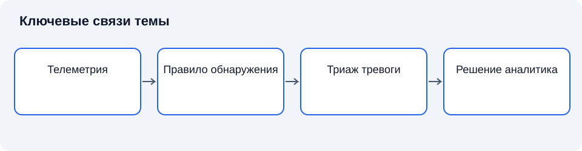

# Лекция 19. Системы обнаружения вторжений и требования к ним

Дисциплина: «Основы информационной безопасности». Пункт РП: 4.8.

**Цель:** Объяснить устройство СОВ, оценку качества обнаружения и место мониторинга в системе защиты.

**Задачи:** определить основные понятия; объяснить взаимосвязь механизмов; сопоставить подходы и ограничения; сформулировать критерии обоснованного выбора.

## Введение

Средства противодействия вредоносному ПО исследуют объекты и действия на конечных системах. СОВ расширяет наблюдение до событий и взаимодействий, позволяя искать распределённые признаки. Сегодня разберём устройство такого наблюдения и условия достоверного вывода; далее обратимся к контролю передачи защищаемых сведений.

## Схема темы

*Рисунок 19. Упрощённые связи понятий. Схема поясняет текст и не заменяет условия применения правил.*

## 1. Наблюдение, событие и инцидент

### 1.1. Теоретические основания

**Система обнаружения вторжений**, или СОВ, — совокупность средств сбора и анализа данных для выявления признаков несанкционированной деятельности или нарушений безопасности. Само обнаружение не обязательно включает блокирование. **Система предотвращения вторжений** способна выполнять активное противодействие в контролируемом потоке. В реальном продукте функции могут сочетаться, но различие необходимо сохранять при анализе рисков [1], [2].

**Событие безопасности** — наблюдаемое изменение состояния, значимое для защиты. **Инцидент** — событие или совокупность событий, нарушающих безопасность либо создающих соответствующую угрозу в принятом порядке оценки. **Оповещение** — результат работы правила анализа. Оповещение не тождественно доказанному инциденту: оно требует проверки контекста.

СОВ не наблюдает систему непосредственно во всей полноте. Она получает ограниченную проекцию происходящего: сетевые пакеты, журналы, действия процессов или сведения от приложений. Следовательно, способность обнаружения определяется как аналитическим методом, так и полнотой телеметрии. Нельзя выявить признак, который не попал в наблюдаемые данные.

Историческое развитие обнаружения вторжений связано с переходом от анализа отдельных записей к моделям поведения и корреляции распределённых событий. При этом увеличение количества собираемых данных само по себе не гарантирует более точного вывода.

### 1.2. Промежуточные выводы

СОВ формирует оповещение по наблюдаемым данным; оповещение не тождественно инциденту. Способность обнаружения ограничена телеметрией и местом наблюдения.

### 1.3. Наблюдение как ограниченная модель действительности

Система наблюдения получает данные о системе, но не совпадает с ней. Журнал отражает то, что источник умеет и настроен регистрировать. Сетевой датчик видит трафик в определённой точке. Прикладной агент наблюдает события в своём контексте полномочий. Поэтому каждый вывод должен иметь связь с конкретным источником и областью видимости.

**Наблюдаемость** характеризует возможность получить сведения, достаточные для установления значимых состояний. Она отличается от объёма данных. Большой поток однотипных записей может не содержать факта, необходимого для различения двух сценариев. Напротив, небольшое число правильно выбранных событий способно существенно уменьшить неопределённость.

Модель обнаружения предполагает, что определённые действия оставляют различимые признаки. Если признаки отсутствуют в выбранной телеметрии, аналитический метод не может восстановить их из ничего. Следовательно, выбор датчиков и выбор правил должны проектироваться совместно. Установка центральной платформы без подключения необходимых источников не решает задачу.

**Нормальное поведение** определяется относительно функции и периода. Ночная активность может быть необычна для рабочего места и обычна для серверной задачи. Универсальное правило без контекста создаёт систематические ошибки. Поэтому аналитика требует сведений о назначении ресурсов и изменениях процессов.

### 1.4. Инцидент как результат квалификации

Термин «инцидент» используется в технических и нормативных контекстах. Организация должна установить применимое определение и порядок квалификации. Нельзя переносить произвольный статус оповещения в юридически значимое сообщение без проверки основания. При этом ожидание полного доказательства не должно задерживать необходимое сдерживание очевидного риска.

**Триаж** означает первичную сортировку по значимости и необходимому действию. Он не равен полному расследованию. Его цель — направить ограниченные ресурсы на наиболее важные случаи, сохранив возможность пересмотра. Критерии включают достоверность признака, критичность объекта и возможные последствия.

**Обогащение события** добавляет контекст: роль узла, владельца, сведения о разрешённых изменениях и известные характеристики объекта. Эти сведения помогают интерпретации, но имеют собственную актуальность. Ошибочная классификация сервера как тестового может занизить приоритет реального инцидента. Поэтому источник контекста также входит в модель доверия.

Результат квалификации должен отличать установленное, вероятное и неизвестное. Такая градация помогает действиям в условиях неопределённости. Она не является признаком слабости анализа: ложная уверенность опаснее корректного указания, каких данных пока недостаточно.

### 1.5. Обнаружение и предотвращение

СОВ, работающая пассивно, не изменяет контролируемый поток непосредственно. Это уменьшает риск блокировки из-за ложного результата, но оставляет зависимость от скорости дальнейшего реагирования. Активное предотвращение способно ограничить воздействие быстрее, одновременно увеличивая цену ошибки.

**Режим блокирования** должен определять, какое действие выполняется и на каком основании. Прекращение одного соединения, изоляция узла и блокировка учётной записи имеют разный масштаб. Одинаковое правило обнаружения не обязательно подходит для всех видов автоматического воздействия.

При отказе активного компонента возможны разные режимы: продолжение потока без анализа, остановка или ограниченная работа. Каждый имеет риски. Продолжение сохраняет доступность, но снижает защиту; остановка сохраняет запрет, но способна нарушить критический процесс. Решение должно быть предварительно обосновано, а не возникать случайно из заводской настройки.

**Контроль автоматического действия** включает регистрацию причины, результата и возможности управляемой отмены. Если правило ошиблось, организация должна понимать, что именно изменилось. Наблюдаемость предотвращения столь же важна, как наблюдаемость исходного события.

## 2. Архитектура и уровни наблюдения

### 2.1. Теоретические основания

**Датчик** получает сведения из определённой точки наблюдения. **Анализатор** сопоставляет данные с правилами или моделями. **Подсистема управления** обеспечивает настройку, контроль состояния и представление результатов. **Хранилище событий** сохраняет данные для последующего анализа. Функциональные компоненты могут размещаться совместно или распределённо.

**Сетевая СОВ** наблюдает взаимодействие между узлами. Её обзор зависит от топологии и места подключения. Шифрование ограничивает доступ к содержимому, но не обязательно устраняет возможность анализа метаданных. **Узловая СОВ** получает данные внутри конкретной системы и видит контекст процессов и объектов. При компрометации узла достоверность этой телеметрии может снижаться.

Размещение датчиков должно следовать модели угроз. Контроль только внешней границы недостаточен при значимых внутренних сценариях. В то же время бесконтрольный сбор на каждом узле повышает нагрузку, сложность сопровождения и объём чувствительной информации. Выбор определяется защищаемыми процессами и необходимыми доказательствами [4], [5].

**Нормализация событий** приводит разнородные записи к согласованному представлению. При этом важно не потерять исходный смысл. Разные системы могут одинаково называть операции с различными последствиями. Аналитическая платформа должна сохранять связь преобразованной записи с исходным источником.

### 2.2. Промежуточные выводы

Сетевые и узловые датчики видят разные стороны процесса. Нормализация должна сохранять смысл и происхождение записи, а архитектура — контролировать потери и состояние источников.

## 3. Методы анализа и оценка качества

### 3.1. Теоретические основания

**Сигнатурный метод** ищет известные сочетания признаков. **Обнаружение аномалий** выявляет отклонения от принятой модели нормального поведения. Аномалия не равна атаке: изменение рабочего процесса также меняет статистику. Атака, похожая на обычную деятельность, может не вызвать заметного отклонения.

**Корреляция** связывает события по времени, субъекту, ресурсу или причинной гипотезе. Несколько слабых признаков иногда образуют сильное основание для проверки. Но близость событий во времени не доказывает причинную связь. Поэтому правило корреляции должно иметь понятную аналитическую интерпретацию.

**Точность оповещений** характеризует долю подтверждённых значимых результатов среди выданных оповещений. **Полнота обнаружения** характеризует долю выявленных случаев среди существующих случаев заданного класса. Эти показатели зависят от определения класса, качества разметки и условий наблюдения. Их нельзя подменять одним общим процентом эффективности.

При редкости реальных вторжений даже небольшой уровень ложных тревог может создавать большую нагрузку. Это проявление влияния базовой частоты событий: количество ложных сообщений зависит от числа нормальных действий. Следовательно, качество СОВ оценивают вместе с организационной способностью обработать поток результатов.

### 3.2. Промежуточные выводы

Сигнатуры ищут известное, аномалии — отклонение, корреляция — связь. Ни один метод не отменяет ошибок; базовая частота влияет на полезность потока оповещений.

## 4. Требования к эксплуатации и проверке

### 4.1. Теоретические основания

Требования к СОВ включают функциональность, достоверность, производительность, защищённость управления и сопровождаемость. Функциональная полнота означает наличие необходимых механизмов наблюдения и анализа для конкретной задачи. Производительность оценивают при характерной нагрузке, учитывая потери данных и задержку обнаружения.

**Защита управления** необходима потому, что изменение правила или отключение датчика способно лишить организацию наблюдаемости. Разделение административных ролей, регистрация изменений и контроль целостности конфигурации поддерживают доверие к результатам. Ограничение полномочий управляющих компонентов соответствует принципу наименьших привилегий [3]. Неисправный датчик должен отличаться от датчика, не обнаружившего подозрительных событий.

**Настройка правил** требует документированного основания. Отключение шумного правила без анализа причины может скрыть угрозу; сохранение всех правил без оценки нагрузки приводит к игнорированию оповещений. Необходим цикл: гипотеза, настройка, проверка, измерение, пересмотр [4], [5].

Требования регуляторов применяются в своей области действия. Нельзя переносить класс защиты, профиль или обязательность конкретной функции на все организации без определения типа системы и нормативного основания. Проверка действующей редакции документа предшествует выбору средства; реклама продукта не заменяет требования и область сертификата.

### 4.2. Промежуточные выводы

СОВ требует защищённого управления, измерения нагрузки и процесса реагирования. Изменения правил обосновываются, а нормативные требования применяются в установленной области.

### 4.3. Формальная интерпретация показателей

Пусть TP обозначает число правильно обнаруженных случаев, FP — число ложных оповещений, FN — число пропущенных случаев. Тогда точность определяется как TP/(TP+FP), а полнота — как TP/(TP+FN). Это **формула 1 — точность оповещений** и **формула 2 — полнота обнаружения**. Формулы применимы при ненулевых знаменателях и корректной разметке. Неопределённые события нельзя незаметно относить к подтверждённым нормальным.

Разные способы выделения единицы наблюдения дают разные результаты. Один инцидент может порождать сотни оповещений; одна кампания — несколько связанных инцидентов. Подсчёт каждого пакета как самостоятельной атаки и подсчёт каждого сценария как одного случая несопоставимы. Поэтому единица анализа должна задаваться до измерения.

**Задержка обнаружения** — время от установленного начала наблюдаемого события до формирования результата. Она отличается от задержки реагирования, включающей проверку и действия персонала. Быстрое оповещение, которое остаётся без рассмотрения, не обеспечивает быстрого ограничения последствий. Архитектурная эффективность должна включать весь путь от данных до принятого решения.

Показатели следует интерпретировать относительно модели угроз. Высокая полнота на известном наборе сигнатур не характеризует способность обнаруживать неизвестный поведенческий сценарий. С другой стороны, большое число аномалий не доказывает охват угроз. Проверочная выборка должна содержать реалистичные положительные и отрицательные случаи, а её происхождение — быть известно проверяющему.

### 4.4. Время, целостность и происхождение данных

Корреляция зависит от согласованности времени. **Временная метка** может отражать момент события, момент его записи или момент получения центральным компонентом. Эти моменты различаются при задержках и очередях. Аналитик должен понимать семантику поля, иначе перестановка записей способна создать ложную причинную последовательность.

**Происхождение события** включает источник и путь передачи. Подлинность сетевого соединения с агентом полезна, но не доказывает корректность самого источника. Если узел скомпрометирован, он может формировать ложные записи или скрывать значимые действия. Независимые точки наблюдения повышают обоснованность выводов, когда их данные действительно относятся к одному процессу.

**Целостность журнала** защищает записи от незаметного изменения. Она не равна полноте. Неизменяемое хранилище может добросовестно сохранять неполные данные, если датчик не передал часть событий. Следовательно, контроль защищённости хранения нужно дополнять наблюдением потерь, очередей и состояния источников.

Срок хранения определяется потребностями анализа и применимыми требованиями. Бесконечное хранение всех данных не является универсальной целью: оно повышает стоимость, сложность и риски. Слишком короткий срок затрудняет исследование событий, обнаруженных с задержкой. Решение обосновывается горизонтом значимых сценариев и категорией собираемых сведений.

### 4.5. Реагирование и обратная связь

Оповещение должно иметь понятный маршрут обработки. Сначала проверяют качество источника и соответствие признаков правилу, затем устанавливают контекст и вероятное последствие. После этого выбирается действие: дополнительное наблюдение, ограничение взаимодействия, расследование либо закрытие с указанием основания. Закрытие без причины лишает организацию возможности учиться на результатах.

**Аналитическая гипотеза** связывает наблюдения с предполагаемым сценарием. Она должна допускать опровержение. Если любой результат объявляется подтверждением, гипотеза перестаёт быть проверяемой. Полезно определить альтернативные объяснения и сведения, позволяющие их различить. Например, необычный объём передачи может относиться к резервному копированию, ошибке приложения или неправомерной выгрузке.

Обратная связь от расследований позволяет улучшать правила. Подтверждённый ложный результат может указывать на недостаток контекста, а пропущенный сценарий — на отсутствие телеметрии или неверную модель. Изменение правила документируется с указанием причины и ожидаемого эффекта. Без этого система становится набором исторически накопленных исключений.

## Заключение

СОВ формирует вывод по ограниченной телеметрии, поэтому качество зависит от архитектуры наблюдения, метода и процесса обработки. Для обоснованного использования необходимо связывать определения с предпосылками, а свойства механизма — с условиями эксплуатации. Ни отдельное срабатывание, ни отсутствие сообщений не дают самостоятельного доказательства защищённости. Следующий этап изучения курса расширяет эту модель за счёт внутренних угроз, полномочий и организационных процедур.

## Вопросы для самопроверки

1. Чем оповещение отличается от инцидента?
2. Почему место датчика влияет на полноту обнаружения?
3. Какие сведения доступны при шифровании трафика?
4. Чем узловая СОВ дополняет сетевую?
5. Почему аномалия не доказывает атаку?
6. Как базовая частота влияет на ложные тревоги?
7. Почему нужно наблюдать состояние датчиков?
8. Какие условия нужны для применения регуляторных требований?

## Глоссарий

- **Система обнаружения вторжений**, или СОВ, — совокупность средств сбора и анализа данных для выявления признаков несанкционированной деятельности или нарушений безопасности.
- **Событие безопасности** — наблюдаемое изменение состояния, значимое для защиты.
- **Инцидент** — событие или совокупность событий, нарушающих безопасность либо создающих соответствующую угрозу в принятом порядке оценки.
- **Оповещение** — результат работы правила анализа.

## Литература

1. Anderson, R. Security Engineering: A Guide to Building Dependable Distributed Systems / R. Anderson. — 3rd ed. — Indianapolis : Wiley, 2020.
2. Bishop, M. Computer Security: Art and Science / M. Bishop. — 2nd ed. — Boston : Addison-Wesley, 2018.
3. Saltzer, J. H. The Protection of Information in Computer Systems / J. H. Saltzer, M. D. Schroeder // Proceedings of the IEEE. — 1975. — Vol. 63, no. 9. — P. 1278–1308. — DOI: 10.1109/PROC.1975.9939.
4. National Institute of Standards and Technology. Guide for Conducting Risk Assessments. — Gaithersburg : NIST, 2012. — SP 800-30 Rev. 1. — URL: https://csrc.nist.gov/pubs/sp/800/30/r1/final (дата обращения: 11.11.2026).
5. National Institute of Standards and Technology. Security and Privacy Controls for Information Systems and Organizations. — Gaithersburg : NIST, 2020. — SP 800-53 Rev. 5. — URL: https://csrc.nist.gov/pubs/sp/800/53/r5/upd1/final (дата обращения: 11.11.2026).
