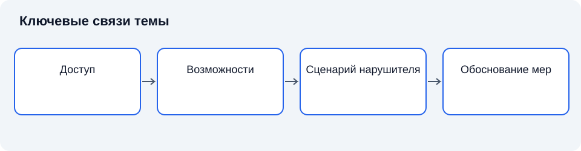

# Лекция 21. Нарушитель информационной безопасности и модели нарушителя

Дисциплина: «Основы информационной безопасности». Пункт РП: 6.1.

**Цель:** Построить научно обоснованное представление о возможностях нарушителя и его связи с угрозами.

**Задачи:** определить понятия; установить связи; сравнить подходы; объяснить ограничения.

## Введение

DLP показывает, что значимое нарушение может выполняться разрешённым субъектом через штатную функцию. Для выбора защиты требуется описать исходный доступ, знания и ресурсы такого субъекта. Сегодня построим понятие модели нарушителя и свяжем его со сценариями угроз. Затем курс перейдёт к процедурам подтверждения соответствия.

## Схема темы

*Рисунок 21. Упрощённые связи понятий. Схема поясняет текст и не заменяет условия применения правил.*

## 1. Нарушитель и источник угрозы

### 1.1. Основные положения

**Нарушитель информационной безопасности** — лицо или группа лиц, действия которых могут нарушать установленные требования безопасности. В зависимости от принятой модели рассматриваются намеренные и ошибочные действия. **Источник угрозы** шире: им может быть человек, техническая неисправность или природное явление. Нельзя приписывать стихийному явлению мотивацию и ресурсы человека [2], [4].

**Модель нарушителя** — согласованное описание предположений о доступе, знаниях, ресурсах, целях и возможных действиях нарушителя применительно к определённой системе. Это аналитический инструмент, а не психологический портрет конкретного сотрудника. Модель должна объяснять, какие сценарии возможны и почему.

Разделение на внешнего и внутреннего нарушителя зависит от границы доверия. Внутренний субъект имеет установленный доступ к некоторой части системы; внешний не располагает таким исходным доступом. Однако это не единая шкала опасности. Внешняя группа может обладать значительными ресурсами, а внутренний пользователь — минимальными правами, и наоборот.

История моделей безопасности показывает переход от абстрактного нарушителя к явному заданию его возможностей. Без такого задания утверждение о стойкости лишено смысла: система может быть устойчивой к одному классу действий и уязвимой к другому.

### 1.2. Краткий конспект

Нарушитель — человеческий источник угрозы; модель описывает возможности в границах системы. Внешний и внутренний доступ не образуют единой шкалы опасности.

## 2. Характеристики и предположения

### 2.1. Основные положения

**Потенциал нарушителя** характеризует совокупность возможностей достижения цели. Он не сводится к образованию или наличию специального программного средства. Значение имеют время, финансирование, доступ к оборудованию, знания о системе и возможность кооперации. Конкретная шкала потенциала определяется используемой методикой, а не произвольным словом «профессиональный».

**Исходный доступ** описывает положение до начала рассматриваемого сценария. **Приобретаемый доступ** возникает в результате действий. Если модель сразу предполагает полный контроль над системой, она не объясняет, каким образом он достигнут. Для анализа нужны явные начальные условия и последовательность переходов.

**Мотивация** помогает установить вероятные цели, но не доказывает возможность их достижения. Заинтересованность в изменении данных и техническая способность изменить их — независимые характеристики. Равным образом отсутствие известного мотива не доказывает невозможность действия.

Допущения необходимо документировать. Например, предположение об отсутствии физического доступа существенно меняет набор сценариев. Если оно основано только на наличии двери, а контроль посещений отсутствует, модель теряет связь с действительностью. Каждый значимый допуск требует основания и условия пересмотра.

### 2.2. Краткий конспект

Потенциал включает ресурсы, знания и доступ. Мотивация не доказывает способность, исходный доступ отличается от получаемого, а допущения требуют основания.

## 3. Связь с моделью угроз и риском

### 3.1. Основные положения

**Сценарий угрозы** связывает источник, предпосылку, действие, объект воздействия и негативное последствие. Модель нарушителя помогает оценить реализуемость человеческого действия; модель системы показывает путь до ресурса; модель последствий определяет значимость результата [4].

Одна уязвимость может быть доступна нескольким категориям нарушителей. Один нарушитель может реализовать различные угрозы. Следовательно, соответствие между категориями нарушителей и угрозами является отношением многие-ко-многим, а не однозначной таблицей по названиям.

**Актуальность угрозы** устанавливается относительно конкретных условий. Наличие записи в каталоге не означает актуальность для любой организации. Необходимо определить применимость объекта, наличие предпосылок, доступность действий и возможность существенного ущерба.

**Риск** связывает неопределённость реализации с последствиями. Качественная оценка допускает шкалы и экспертное суждение, но требует прозрачных критериев. Числовые баллы без объяснения шкалы не превращают предположение в измеренный факт. Особенно важно избегать ложной точности там, где статистические данные отсутствуют.

### 3.2. Краткий конспект

Модель нарушителя поддерживает оценку реализуемости сценария. Каталог угроз не устанавливает актуальность автоматически; риск зависит от условий и последствий.

## 4. Проверка, обновление и использование модели

### 4.1. Основные положения

Проверка модели начинается с согласования границ: какие системы, помещения, каналы и процессы входят в рассмотрение. Затем характеристики нарушителя сопоставляют с реальными доступами и возможностями. Полноту оценивают не числом перечисленных категорий, а охватом значимых сценариев.

**Валидация допущений** — проверка того, что основания модели соответствуют наблюдаемой среде. Изменение подрядчика, появление удалённого подключения или объединение сетей может сделать прежнюю модель неполной. Поэтому обновление требуется при значимых изменениях, а не только в заранее назначенную дату.

Модель используется для выбора мер: ограничение полномочий, разделение обязанностей, контроль каналов, защита журналов, управление изменениями. Принцип наименьших привилегий обосновывает уменьшение доступных субъекту действий [3]. Связь должна быть объяснимой: мера противодействует конкретному действию или ограничивает последствие. Перечень средств без такой связи не показывает достаточности защиты [1], [5].

Этическая и профессиональная граница состоит в анализе функций и возможностей, а не в необоснованном подозрении к группам людей. Признаки поведения требуют проверки; принадлежность к подразделению или гражданство сами по себе не являются доказательством нарушения. Организационные решения принимаются на законных основаниях с соблюдением установленных процедур.

### 4.2. Краткий конспект

Модель проверяется по реальной среде и пересматривается при изменениях. Сговор, цепочка поставок и неопределённость учитываются без необоснованного подозрения к людям.

### 4.3. Модель как набор проверяемых утверждений

Полезно представить каждую характеристику нарушителя в форме утверждения с основанием. Например, «может подключаться к административному интерфейсу» отличается от «знает о существовании интерфейса». Первое требует сетевого или физического пути, второе — только знания. Смешение характеристик приводит к ошибочному завышению или занижению реализуемости сценария.

**Возможность взаимодействия** не равна разрешению. Наличие сетевого маршрута показывает достижимость интерфейса, а действующая учётная запись — определённые полномочия. Дополнительные условия могут ограничивать операции: состояние устройства, необходимость подтверждения, сегментация и контроль контекста. Модель должна учитывать совокупность, а не один признак.

**Знание системы** имеет уровни детализации. Общедоступная документация, сведения о конфигурации и исходный код дают разные преимущества. Однако отсутствие исходного кода не означает отсутствия возможности найти ошибку. Напротив, наличие кода не означает автоматической способности использовать любое обнаруженное отклонение. Значение знаний определяется сценарием.

Ресурсы также необходимо связывать с задачей. Вычислительная мощность может быть существенна для перебора, но не компенсирует отсутствие физического доступа в сценарии вмешательства в оборудование. Финансирование позволяет приобретать возможности, однако конкретный путь приобретения остаётся предположением, которое требует обоснования.

### 4.4. Кооперация, доверенные участники и цепочка поставок

**Сговор** означает согласованные действия нескольких участников. Разделение обязанностей эффективно относительно одиночного субъекта при определённых предположениях о независимости. Если два участника могут действовать совместно, контроль одного другим имеет иные свойства. Это не повод считать любую организационную меру бесполезной; это основание явно указать пределы модели.

**Доверенный участник** — субъект, корректность действий которого принимается как предпосылка определённого свойства защиты. Чем больше таких предпосылок, тем шире область потенциального нарушения доверия. Важно отличать необходимое доверие от привычки не проверять действия определённой должности.

**Цепочка поставок** включает разработку, сборку, распространение и сопровождение компонентов. Нарушитель может воздействовать до поступления продукта в организацию. Тогда проверка только пользовательских действий не охватывает исходный сценарий. Необходим анализ происхождения компонента, контроля обновлений и доверия к поставщикам.

Кооперация не обязательно имеет вид устойчивой группы. Доступ одного лица может быть передан другому, а сведения об архитектуре — использованы независимо. Поэтому модель может включать передачу знаний или полномочий как отдельный переход. Это позволяет точнее объяснить, почему разглашение конфигурации имеет значение даже без немедленного технического воздействия.

### 4.5. Неопределённость и устойчивость решения

**Неопределённость модели** возникает из неполноты сведений о системе и нарушителе. Её нельзя устранить приданием экспертной оценке большого числа десятичных знаков. Полезнее указать диапазон предположений и проверить, меняется ли решение при их изменении.

**Анализ чувствительности** рассматривает, какие предпосылки сильнее влияют на вывод. Если выбор меры зависит только от спорного предположения о недоступности интерфейса, следует сначала проверить это предположение. Если мера полезна при широком наборе разумных сценариев, решение может быть более устойчивым к неопределённости.

Приоритет мер определяется сочетанием возможностей и последствий. Маловероятный, но катастрофический сценарий требует иной аргументации, чем частая мелкая ошибка. Нельзя автоматически игнорировать первую категорию или объявлять любой воображаемый сценарий основанием для неограниченных затрат. Модель должна поддерживать соразмерное решение.

Документирование альтернатив важно для последующего пересмотра. Если отклонённый сценарий вновь становится возможным после изменения системы, прежние основания позволяют быстро определить, что именно устарело. Таким образом, модель является средством управляемого знания, а не одноразовым текстом для формального согласования.

## Заключение

Модель нарушителя описывает проверяемые предположения о возможностях, доступе и целях в определённых границах. Сегодня мы установили, что надёжность вывода определяется не количеством собранных сведений, а качеством их связи с политикой и реальной системой. Анализ должен сохранять границы применимости, отделять событие от его интерпретации и приводить к проверяемым мерам. Следующая тема позволит связать эти положения с организационной ответственностью и подтверждением соответствия.

## Вопросы для самопроверки

1. Чем источник угрозы шире нарушителя?
2. Относительно чего определяется внешний нарушитель?
3. Что входит в потенциал?
4. Почему мотив не доказывает возможность?
5. Чем исходный доступ отличается от приобретаемого?
6. Как связаны нарушитель и сценарий?
7. Почему БДУ не заменяет модель угроз?
8. Какие изменения требуют пересмотра модели?

## Глоссарий

- **Нарушитель информационной безопасности** — лицо или группа лиц, действия которых могут нарушать установленные требования безопасности.
- **Модель нарушителя** — согласованное описание предположений о доступе, знаниях, ресурсах, целях и возможных действиях нарушителя применительно к определённой системе.
- **Валидация допущений** — проверка того, что основания модели соответствуют наблюдаемой среде.

## Литература

1. Anderson, R. Security Engineering: A Guide to Building Dependable Distributed Systems / R. Anderson. — 3rd ed. — Indianapolis : Wiley, 2020.
2. Bishop, M. Computer Security: Art and Science / M. Bishop. — 2nd ed. — Boston : Addison-Wesley, 2018.
3. Saltzer, J. H. The Protection of Information in Computer Systems / J. H. Saltzer, M. D. Schroeder // Proceedings of the IEEE. — 1975. — Vol. 63, no. 9. — P. 1278–1308. — DOI: 10.1109/PROC.1975.9939.
4. National Institute of Standards and Technology. Guide for Conducting Risk Assessments. — Gaithersburg : NIST, 2012. — SP 800-30 Rev. 1. — URL: https://csrc.nist.gov/pubs/sp/800/30/r1/final (дата обращения: 11.11.2026).
5. National Institute of Standards and Technology. Security and Privacy Controls for Information Systems and Organizations. — Gaithersburg : NIST, 2020. — SP 800-53 Rev. 5. — URL: https://csrc.nist.gov/pubs/sp/800/53/r5/upd1/final (дата обращения: 11.11.2026).
