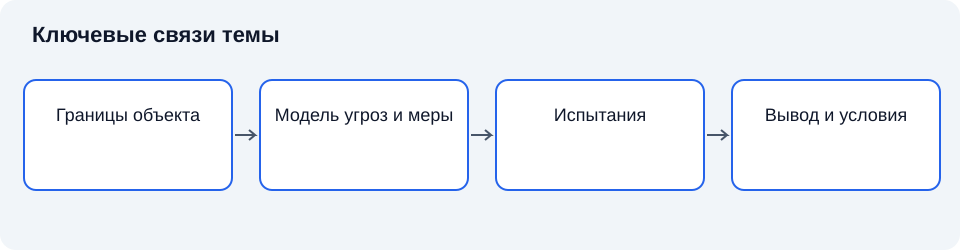

# Лекция 24. Аттестация объектов информатизации по требованиям защиты информации

Дисциплина: «Основы информационной безопасности». Пункт РП: 7.3.

**Цель:** Понять оценку конкретного объекта в эксплуатационных условиях и её связь с жизненным циклом защиты.

**Задачи:** определить объекты и участников; объяснить доказательные основания; сопоставить документы; установить границы применимости результатов.

## Введение

После рассмотрения сертификации средства перейдём к конкретному объекту информатизации. Даже проверенный продукт действует в окружении других компонентов и организационных процедур. Заключительная лекция курса объясняет оценку этой совокупности и сохранение условий соответствия в эксплуатации.

## Схема темы

*Рисунок 24. Упрощённые связи понятий. Схема поясняет текст и не заменяет условия применения правил.*

## 1. Объект и предмет аттестации

### 1.1. Основные положения

**Объект информатизации** рассматривается как конкретная совокупность средств, ресурсов и условий, в которых обрабатывается или обращается защищаемая информация. Его границы определяются задачей и применимыми требованиями. Набор сертифицированных компонентов сам по себе ещё не означает соответствия всей системы [1], [2].

**Аттестация по требованиям защиты информации** относится к оценке конкретного объекта в установленной области. Сертификация средства оценивает продукт; аттестация учитывает его применение совместно с другими компонентами и организационными условиями. Различие объясняет, почему два одинаковых комплекта оборудования могут иметь разную защищённость.

**Граница объекта** определяет, что включается в рассмотрение: технические средства, соединения, помещения и существенные внешние взаимодействия. Если фактический канал обмена не отражён в описании, испытания могут не охватить значимый путь воздействия.

Правовое основание и обязательность аттестации устанавливаются применительно к виду объекта и информации. Порядок ФСТЭК, утверждённый приказом № 77, имеет определённую область действия; его нельзя объявлять универсальным порядком для любых сведений, включая государственную тайну [6].

### 1.2. Краткий конспект

Объект включает конкретные компоненты и условия взаимодействия. Аттестация не заменяется сертификатами отдельных средств, а обязательность определяется применимой областью норм.

## 2. Подготовка и описание условий

### 2.1. Основные положения

**Исходные данные об объекте** позволяют установить назначение, состав, режим работы и категории информации. Эти сведения задают основу оценки. Их полнота зависит от согласованности технического описания с реальным процессом, а не от объёма текста.

**Модель угроз** связывает свойства объекта с возможными негативными последствиями. При подготовке к оценке она помогает объяснить, почему выбраны определённые меры. Копирование модели другого объекта без проверки применимости нарушает эту связь.

**Организационные меры** определяют ответственность, порядок доступа, учёт носителей и управление изменениями. Их нельзя заменить установленным программным средством. Если процесс выдачи полномочий допускает бесконтрольное расширение доступа, исправный механизм исполняет ошибочное организационное решение.

Описание конфигурации должно быть достаточно точным для идентификации проверяемого состояния. Необходимо различать проектное намерение и фактическую реализацию. Документ о планируемой сегментации не доказывает наличия границы в действующей сети [3].

### 2.2. Краткий конспект

Исходные данные, модель угроз и организационные меры должны соответствовать действующему объекту. Проектное намерение не доказывает реализации.

## 3. Испытания и вывод о соответствии

### 3.1. Основные положения

**Аттестационные испытания** проверяют выполнение требований в условиях рассматриваемого объекта. Методика должна связывать требования с наблюдаемыми результатами. Проверка отдельных настроек полезна, но не заменяет оценки взаимодействия компонентов и организационных процедур.

**Функциональная проверка** устанавливает выполнение требуемой функции. Проверка эффективности рассматривает способность функции противодействовать определённому воздействию в заданных условиях. Наличие переключателя «защита включена» не доказывает эффективности механизма.

**Свидетельства соответствия** включают документы и результаты проверок, позволяющие обосновать вывод. При анализе существенны условия получения, достоверность и связь с объектом. Отсутствие зарегистрированных нарушений не является достаточным свидетельством: нарушения могли не наблюдаться либо не фиксироваться.

Результат имеет область применимости. Если оценка проводилась для установленной конфигурации и режима, изменение этих предпосылок требует анализа. Документ оценки не превращает конкретное состояние объекта в неизменную гарантию на все будущие варианты [1], [6].

### 3.2. Краткий конспект

Испытания проверяют требования в определённых условиях. Свидетельства и вывод должны относиться к той же конфигурации и режиму.

## 4. Поддержание соответствия при эксплуатации

### 4.1. Основные положения

**Поддержание соответствия** означает сохранение условий и мер, на которых основан положительный результат. Эта задача включает контроль изменений, сопровождение средств, управление доступом и документирование значимых событий. Она распределяется между владельцем, эксплуатационными подразделениями и ответственными за защиту.

**Изменение объекта** может затрагивать оборудование, программную конфигурацию, внешние подключения или технологический процесс. Значимость определяется влиянием на требования и модель угроз. Перенос службы на другую площадку способен изменить физические условия и доверие к каналам, даже если код службы остался прежним.

**Периодический контроль** поддерживает знание об актуальном состоянии. Его нельзя считать заменой повседневного сопровождения. Между проверками также должны действовать процедуры регистрации изменений и реакции на отклонения. Конкретные сроки и формы устанавливаются применимым порядком, поэтому здесь они не подменяются универсальным числом.

Завершая курс, сопоставим три процедуры: средство подтверждается в системе сертификации, деятельность регулируется лицензированием, конкретный объект оценивается в аттестации. Их связь создаёт более обоснованное доверие, но окончательная безопасность зависит от исполнения требований на протяжении жизненного цикла [3], [4], [5], [6].

### 4.2. Краткий конспект

Владелец поддерживает условия соответствия. Изменения анализируются по влиянию, регистрируются и проверяются; периодический контроль дополняет повседневное сопровождение.

### 4.3. Композиция компонентов и свойства системы

Системное свойство не всегда равно сумме свойств компонентов. Два механизма могут быть корректны по отдельности, но взаимодействовать через небезопасный интерфейс. Например, служба принимает решение на основе идентичности, которую другой компонент передаёт без достаточной проверки. Следовательно, оценка объекта должна учитывать связи и распределение доверия.

**Доверенная граница** разделяет области, между которыми меняются предположения о достоверности данных или полномочиях. Передача через границу требует явной проверки. Если внутренний сервис безусловно доверяет любому сообщению из сети, сетевой периметр фактически становится частью его основания безопасности.

Организационные процедуры также входят в композицию. Технический контроль может предполагать, что учётные записи своевременно отключаются, носители учитываются, а обновления проходят проверку. Если эти предпосылки не исполняются, система работает вне условий, на которых основана оценка. Поэтому нельзя ограничить аттестацию перечнем установленных продуктов.

### 4.4. Изменения и сохранение доказательных оснований

Изменение необходимо классифицировать по влиянию, а не только по масштабу затрат. Небольшая настройка способна открыть внешний интерфейс, а крупная замена оборудования — сохранить прежнюю модель взаимодействия. Анализ начинается с вопроса, какие предпосылки и требования затронуты.

**Регистрация изменений** сохраняет содержание, основание, согласование и результат проверки. Она позволяет восстановить актуальное состояние и объяснить отличие от ранее оценённого. Без истории изменений технический паспорт рискует стать описанием прошлого, не связанным с действующей системой.

Контроль после изменения должен охватывать затронутые зависимости. Проверка только нового компонента не обнаружит нарушение взаимодействия с существующими средствами. При этом полное повторение всех проверок для любого изменения также может быть неоправданным. Объём определяется установленным порядком и обоснованным анализом влияния.

### 4.5. Ответственность и жизненный цикл

Владелец объекта обеспечивает условия эксплуатации, а исполнители выполняют свои функции в пределах полномочий. Передача отдельных работ внешней организации не устраняет необходимость управлять требованиями и принимать результаты. Договор должен отражать предмет, границы и необходимые свидетельства.

**Остаточный риск** сохраняется после применения мер и проведения оценки. Он не обязательно свидетельствует о нарушении требований: любая система работает при ограниченных ресурсах и неопределённости. Однако решение о принятии риска должно приниматься уполномоченным субъектом и не подменять обязательное требование произвольным согласием.

Завершение эксплуатации также требует управления: носители, копии, учётные записи и внешние подключения не исчезают автоматически при выключении оборудования. Переход к новому объекту создаёт период совместного существования систем и дополнительных каналов. Жизненный цикл защиты охватывает этот переход наравне с вводом и обычной работой.

## Заключение

Аттестация оценивает определённый объект в конкретной конфигурации и условиях. Сохранение соответствия требует сопровождения, контроля изменений и исполнения организационных мер. Для обоснованной эксплуатации необходимо сохранять различие между фактом выполнения процедуры и обоснованностью применения её результата в конкретной системе. Документированное соответствие относится к определённым требованиям и условиям. Профессиональная работа требует проверять эти условия и поддерживать их при изменениях.

## Вопросы для самопроверки

1. Что входит в границу объекта?
2. Почему сертифицированные компоненты не гарантируют соответствие системы?
3. Как устанавливается обязательность аттестации?
4. Чем проектное описание отличается от фактического состояния?
5. Как модель угроз связана с мерами?
6. Что ограничивает применимость результата?
7. Какие изменения могут потребовать пересмотра?
8. Как различаются три процедуры оценки?

## Глоссарий

- **Объект информатизации** — конкретная совокупность средств, ресурсов и условий обращения информации.
- **Граница объекта** — состав включённых средств и взаимодействий.
- **Аттестация** — оценка соответствия конкретного объекта в установленной области.
- **Исходные данные** — сведения о назначении, составе и режиме объекта.
- **Модель угроз** — описание возможных воздействий и последствий.
- **Организационная мера** — установленный порядок действий и ответственности.
- **Аттестационные испытания** — проверка требований в условиях объекта.
- **Функциональная проверка** — установление выполнения требуемой функции.
- **Свидетельство** — данные, обосновывающие вывод.
- **Соответствие** — выполнение установленных требований.
- **Изменение объекта** — изменение существенного состава или условий.
- **Периодический контроль** — повторное получение сведений об актуальном состоянии.

## Литература

1. Anderson, R. Security Engineering: A Guide to Building Dependable Distributed Systems / R. Anderson. — 3rd ed. — Indianapolis : Wiley, 2020.
2. Bishop, M. Computer Security: Art and Science / M. Bishop. — 2nd ed. — Boston : Addison-Wesley, 2018.
3. National Institute of Standards and Technology. Security and Privacy Controls for Information Systems and Organizations. — Gaithersburg : NIST, 2020. — SP 800-53 Rev. 5. — URL: https://csrc.nist.gov/pubs/sp/800/53/r5/upd1/final (дата обращения: 11.11.2026).
4. Российская Федерация. Законы. О лицензировании отдельных видов деятельности : Федеральный закон от 04.05.2011 № 99-ФЗ. — Текст : электронный. — URL: https://www.nalog.gov.ru/rn77/about_fts/docs/5161105/ (дата обращения: 11.11.2026).
5. Федеральная служба по техническому и экспортному контролю. Об утверждении Положения о системе сертификации средств защиты информации : приказ от 03.04.2018 № 55. — Москва, 2018.
6. Федеральная служба по техническому и экспортному контролю. Об утверждении Порядка организации и проведения работ по аттестации объектов информатизации на соответствие требованиям о защите информации ограниченного доступа, не составляющей государственную тайну : приказ от 29.04.2021 № 77. — Москва, 2021.
