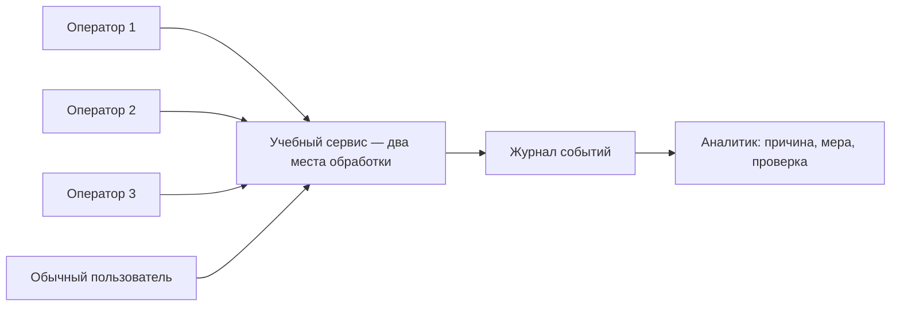

# Доступность сервиса: распределённая нагрузка, обнаружение и защита

**Когда выполнять:** после лекции 19 «Системы обнаружения вторжений и требования к ним», до перехода к DLP. К этому моменту вы умеете описывать угрозы, выбирать меры защиты и разбирать события. Здесь эти знания соединяются в расследование нарушения доступности.

**Формат:** дополнительный лабораторный модуль на 90 минут. Команда: администратор стенда, три оператора нагрузки и аналитик-наблюдатель. Результат — журналы, сравнительная таблица и обоснованное решение о защите.

## Ситуация и задача специалиста

Учебный веб-сервис периодически отказывает пользователям. Нужно установить, связано ли это с одновременными обращениями нескольких клиентов, найти признаки в журнале, применить ограничение запросов и проверить результат для обычного пользователя.

DoS — нарушение доступности; при DDoS воздействие распределено между источниками. Несколько компьютеров ещё не доказывают DDoS: распределённая легитимная нагрузка тоже возможна. В этой работе мы **моделируем перегрузку приложения**, а не заполняем канал связи и не пытаемся вывести Windows из строя. Намерение источников из одного журнала установить нельзя.

Лучше выделить один учебный ПК или виртуальную машину с этим сервисом. Повседневный компьютер одногруппника без подготовки стенда не подходит. Существующий сервер с защитой от DDoS оставляем для отдельного согласованного исследования: его внешняя защита и другие пользователи делают результаты этой работы неоднозначными.

## Стенд и ограничения

Преподаватель назначает адреса. Ниже примеры: замените их реальными адресами своего стенда во **всех** командах.

| Роль | Пример адреса | Действие |
|---|---|---|
| Сервер | 192.168.50.10 | Только учебный сервис TCP 8765 |
| Оператор load1 | 192.168.50.21 | Ограниченная нагрузка |
| Оператор load2 | 192.168.50.22 | Ограниченная нагрузка |
| Оператор load3 | 192.168.50.23 | Ограниченная нагрузка |
| Наблюдатель observer | 192.168.50.30 | Проверка обычного пользователя |



Проводите работу в выделенном преподавателем сегменте локальной сети. Адреса узнавайте у преподавателя, без сканирования сети. Установленный Python 3.10 или новее достаточен; дополнительных библиотек нет.

Сервис обрабатывает одновременно два обращения, каждое имитирует работу задержкой 350 мс. Это искусственная ёмкость приложения, а не измерение мощности компьютера. При занятых местах возвращается HTTP 503. В защищённом режиме на один IP допускается не более одного обращения к `/work` за скользящую секунду, остальные получают HTTP 429. Общий предел 20 обращений в секунду действует в обоих режимах.

Клиент работает последовательно, без повторных попыток: не более двух запросов в секунду, запуск 10–45 секунд. Разрешены только буквальные частные IPv4/loopback и фиксированный порт; перед работой клиент проверяет маркер учебного сервиса. Это защита от ошибки адреса, **не аутентификация**. На каждом компьютере запускайте ровно один клиент. Не меняйте ограничения и не открывайте дополнительные копии ради получения отказов.

Преподаватель останавливает опыт при влиянии на посторонние сервисы, заметном зависании интерфейса или выходе за согласованные показатели ресурсов. Для стенда можно заранее принять CPU выше 70% в течение 5 секунд либо память выше 80% как сигнал остановки. Эти значения — условия занятия, а не универсальные нормы.

## Шаг 1. Подготовьте рабочую папку и паспорт опыта — 10 минут

1. Скачайте папку [lab_availability](lab_availability) целиком. На каждом компьютере рядом должны находиться `server.py`, `client.py`, `lab_common.py`, `summary.py`. Откройте PowerShell в этой папке.
2. Проверьте Python и свой адрес:

```powershell
python --version
ipconfig
```

3. Запишите роли, адреса, дату, версию Python, разрешённый порт и ответственного за остановку в [шаблон отчёта](templates/Доступность_отчёт.md).
4. Сверьте часы компьютеров; журналы используют UTC. Зафиксируйте оставшееся расхождение. Имена выходных файлов должны быть уникальными: программы отказываются перезаписывать существующие результаты.

Если Python не найден, обратитесь к преподавателю до начала опыта. Не устанавливайте случайные «DDoS-программы».

## Шаг 2. Запустите сервис — 10 минут

**На сервере**, в PowerShell:

```powershell
python server.py --bind 192.168.50.10 --allow 192.168.50.21 --allow 192.168.50.22 --allow 192.168.50.23 --allow 192.168.50.30 --log results/server-open.csv
```

Окно оставьте открытым. Сервис завершится через 30 минут либо по `Ctrl+C`. Привязка идёт к указанному интерфейсу; список разрешает только четыре клиентских адреса.

**На наблюдателе**:

```powershell
Test-NetConnection -ComputerName 192.168.50.10 -Port 8765
Invoke-RestMethod http://192.168.50.10:8765/health
```

Ожидается доступный порт и ответ с `lab: oib-availability-v1`, `protected: false`. Если порт закрыт, преподаватель проверяет адрес, профиль сети и точечное правило брандмауэра. Не отключайте брандмауэр целиком. При HTTP 403 проверьте разрешённый IP. При ошибке маркера прекратите работу: выбран другой сервис.

## Шаг 3. Измерьте обычный режим — 5 минут

Операторы нагрузки пока ничего не запускают. **На наблюдателе**:

```powershell
python client.py --server 192.168.50.10 --client observer --phase baseline --seconds 30 --rps 0.5 --out results/baseline-observer.csv
```

Это одно обращение раз в две секунды. Сохраните число успешных ответов и задержки. HTTP 200 означает завершённую работу; 503 — занятые места обработки; 429 — сработавшее ограничение; статус 0 в клиентском CSV — сетевая ошибка, а не HTTP-код.

## Шаг 4. Проведите распределённый опыт — 10 минут

Преподаватель даёт общий отсчёт. Наблюдатель и три оператора запускают команды одновременно, каждый на своём компьютере. Запишите фактическое время начала и окончания: ручной старт не обеспечивает точную синхронность.

**Наблюдатель:**

```powershell
python client.py --server 192.168.50.10 --client observer --phase load --seconds 30 --rps 0.5 --out results/load-observer.csv
```

**Оператор load1:**

```powershell
python client.py --server 192.168.50.10 --client load1 --phase load --seconds 30 --rps 2 --out results/load-load1.csv
```

На двух других ПК замените `load1` на `load2` и `load3` **в метке и имени файла**. Остальные параметры одинаковы. Суммарный заданный предел — 6,5 запроса в секунду, фактическая скорость может быть ниже из-за времени ответа и ошибок.

Наблюдайте за доступностью обычного пользователя и журналом сервиса. По истечении 30 секунд клиенты завершаются сами; последний начатый запрос может закончиться немного позже. Досрочная остановка — `Ctrl+C` на всех клиентах, затем на сервере. Неполный запуск отметьте как прерванный и исключите из сравнения пропускной способности за полное окно.

Если все ответы успешные, это допустимый результат: выбранная нагрузка не доказала отказ в данных условиях. Не увеличивайте пределы. Объясните влияние распределения запросов по времени и двух мест обработки.

## Шаг 5. Найдите признаки инцидента — 10 минут

Администратор сохраняет `results/server-open.csv`. Аналитик открывает его в таблице либо выполняет:

```powershell
Import-Csv results/server-open.csv | Where-Object { $_.status -eq '503' } | Select-Object utc,source,status,active
```

1. Найдите интервалы 503 и адреса источников `/work`. Подтвердите участие минимум двух источников по серверному журналу, а не только по словам операторов.
2. Сопоставьте отказы с `load-observer.csv` и временем работы операторов. Сервер записывает время завершения обработки; клиент — начала запроса. Учитывайте задержку и расхождение часов.
3. Предложите правило уведомления, например три ответа 503 за пять секунд. Проверьте, сработало ли оно на ваших данных. Укажите, почему такой порог может дать ложное срабатывание.
4. Разделите наблюдение, гипотезу и доказанный вывод. Рост обращений вместе с 503 — признак перегрузки; он сам по себе не доказывает злоумышленника.

Этот разбор журнала — упражнение аналитика. Скрипт не является полноценной IDS и не выполняет сетевое обнаружение вторжений.

## Шаг 6. Включите защиту и повторите измерение — 10 минут

Убедитесь, что клиенты завершились. На сервере нажмите `Ctrl+C`, затем запустите:

```powershell
python server.py --bind 192.168.50.10 --allow 192.168.50.21 --allow 192.168.50.22 --allow 192.168.50.23 --allow 192.168.50.30 --protected --log results/server-protected.csv
```

Проверьте `/health`: теперь `protected: true`. Повторите общий запуск из шага 4 с прежними скоростями и длительностью. У всех клиентов замените `--phase load` на `--phase protected`, а начало имени выходного файла `load-` на `protected-`. Например, наблюдатель:

```powershell
python client.py --server 192.168.50.10 --client observer --phase protected --seconds 30 --rps 0.5 --out results/protected-observer.csv
```

Оператор load1:

```powershell
python client.py --server 192.168.50.10 --client load1 --phase protected --seconds 30 --rps 2 --out results/protected-load1.csv
```

Ответы 429 показывают применение ограничения. Это не равнозначно сохранению доступности: проверьте успешность запросов **наблюдателя**. Ответы 503 всё ещё возможны при совпадении разрешённых запросов. Не подменяйте их кодом 429 в отчёте.

## Шаг 7. Проверьте восстановление — 5 минут

Операторы нагрузки больше не запускают клиентов. Защищённый сервер оставьте работающим. Только наблюдатель:

```powershell
python client.py --server 192.168.50.10 --client observer --phase recovery --seconds 30 --rps 0.5 --out results/recovery-observer.csv
```

Зафиксируйте режим защиты и сравните восстановление с baseline. Не объявляйте инцидент завершённым только по исчезновению нагрузки: подтвердите успешную работу обычного пользователя.

## Шаг 8. Подготовьте доказательства и решение — 15 минут

Соберите клиентские CSV всех компьютеров в одну папку `results` у аналитика, сохранив уникальные имена. Добавьте два журнала сервера. Создайте сводку:

```powershell
python summary.py "results/*.csv" --out results/summary.csv
```

Скрипт распознаёт клиентские файлы по заголовку; серверные журналы в расчёт не входят. Для повторного расчёта задайте другое имя выходного файла.

Сравните четыре строки **наблюдателя**:

| Режим | Попытки | HTTP 200 | HTTP 429 | HTTP 503 | Другие/ошибки | Успех, % | Успешных/с | p95 успешных, мс |
|---|---:|---:|---:|---:|---:|---:|---:|---:|
| baseline | | | | | | | | |
| load | | | | | | | | |
| protected | | | | | | | | |
| recovery | | | | | | | | |

Доля успеха = 200 / все попытки × 100%. Полезная пропускная способность = число 200 / заданные 30 секунд. p95 рассчитывается по успешным запросам методом ближайшего ранга; без успешных ответов стоит `NA`. Малое число измерений делает p95 нестабильным. Быстрые отказы не должны искусственно «улучшать» задержку, поэтому их задержки исключены из p95 успехов, но сами отказы обязательно отражаются в доле успеха.

Не усредняйте процентили разных ПК. Общая сводка каждого запуска охватывает полное 30-секундное окно: из-за ручного старта оно может частично включать время без общей нагрузки. В отчёте отдельно отметьте общий интервал пересечения запусков по UTC и наблюдавшиеся в нём отказы; не выдавайте общую сводку за расчёт исключительно этого интервала. Сравнивайте режимы с одинаковыми настройками и учитывайте погрешности.

В выводе ответьте:

- Ухудшилась ли работа обычного пользователя? Какие строки подтверждают это?
- Что изменило ограничение по IP: успешность, задержку и отказы? Хватило ли меры?
- Почему несколько пользователей за одним NAT могут попасть под общий лимит?
- Какие ещё меры стоит проверить отдельно: очереди, квоты, масштабирование, фильтрацию перед сервисом?
- Чего опыт не доказывает о реальной защите от DDoS? Здесь не проверялись заполнение канала, возможности внешнего провайдера и производительность промышленного сервера.

**Новая вводная:** все три оператора оказались за одним адресом NAT. Не меняя стенд, опишите ожидаемую ошибку ограничения по IP и предложите, какие дополнительные данные нужны для выбора меры. Различайте гипотезу и результат реального замера.

**Сдать:** паспорт стенда; четыре клиентских файла наблюдателя; шесть клиентских файлов операторов (три до и три после защиты); два журнала сервера; сводку; отчёт с временной линией, правилом уведомления и выводами. Если запуск прерван, приложите его отдельно с пояснением. Не публикуйте реальные адреса учебного заведения без необходимости: для открытого отчёта замените их согласованными обозначениями.

## Шаг 9. Завершите работу — 5 минут

Остановите сервис `Ctrl+C`, проверьте завершение клиентов. Преподаватель удаляет только созданное для опыта правило брандмауэра. Проверьте, что порт 8765 больше не доступен, сохраните доказательства и отметьте восстановление стенда в отчёте.

## Оценивание

| Критерий | Баллы |
|---|---:|
| Паспорт, согласованные адреса, воспроизводимые настройки и корректное завершение | 25 |
| Полные измерения четырёх режимов, исходные журналы, правильные метрики | 25 |
| Анализ источников, временной линии, признаков и ограничений доказательств | 25 |
| Проверка защиты и восстановления, обоснованный вывод и разбор новой вводной | 25 |

По каждому критерию: 0 — результата нет, 12,5 — выполнено частично, 25 — выполнено и подтверждено. Отсутствие отказов не снижает оценку при корректных измерениях и честном выводе.

## Справка

[HTTP 429 и ограничение частоты — RFC 6585](https://www.rfc-editor.org/rfc/rfc6585.html#section-4). [Учебный HTTP-сервер Python](https://docs.python.org/3/library/http.server.html): модуль предоставляет базовые проверки и не предназначен для промышленной эксплуатации. После опыта сервис следует остановить.
